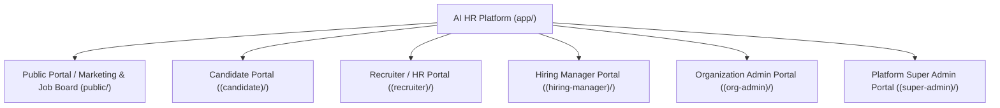

# Product Scope and Portals

This document details the functional scope, page structures, operational workflows, and information hierarchy across all five dedicated platform portals.

---

## 1. Portal Architecture & Navigation Hierarchy

The application frontend leverages Next.js 14 App Router, separating experiences into distinct route groups with dedicated layouts, middleware authentication checks, and role-based navigation menus:

---

## 2. Portal Specifications

### A. Candidate Portal (`/(candidate)`)
Designed for job seekers to maintain their professional identities, apply to open requisitions, manage interview invitations, and exercise privacy rights.

#### Route Structure:
- `/candidate/dashboard`: Active applications summary, upcoming interview cards, profile completeness meter.
- `/candidate/profile`: Personal contact info, education, work history, certifications, and portfolio links.
- `/candidate/resumes`: Resume version management (upload PDF, set default, view extracted parsing results, trigger deletion).
- `/candidate/jobs`: Public/tenant job board search, faceted filtering (location, department, remote status), AI-assisted job recommendations.
- `/candidate/jobs/[jobId]`: Detailed job specification, required qualifications, and one-click application submission.
- `/candidate/applications`: Detailed tracking of submitted applications with stage history (e.g. *Under Review*, *Interview Scheduled*).
- `/candidate/interviews`: Interview invitation viewer, interactive slot booking picker, iCal download, and rescheduling request trigger.
- `/candidate/privacy`: Explicit consent toggles, automated data export download (JSON/ZIP), and account deletion request workflow.

#### Candidate Experience Safeguards:
- Candidates have full visibility into what the AI extracted from their resume and can manually override parsed skills or experience before submitting.
- Candidate PII is protected; candidates can withdraw applications and request complete erasure under GDPR/DPDP.

---

### B. Recruiter / HR Portal (`/(recruiter)`)
Designed for high-throughput talent acquisition teams managing multiple requisitions, candidate talent pools, automated screening runs, and hiring pipelines.

#### Route Structure:
- `/recruiter/dashboard`: Open requisitions overview, candidate conversion funnel metrics, pending review queues, today's interviews.
- `/recruiter/jobs`: Requisition list, requisition drafting, approval routing, job publishing/closing toggles.
- `/recruiter/jobs/[jobId]/pipeline`: Kanban board visualizing candidates across pipeline stages (`Applied`, `Screening`, `Shortlisted`, `Interview`, `Offer`, `Hired`, `Rejected`).
- `/recruiter/candidates`: Global candidate talent pool database with full-text search, skill filtering, and tag management.
- `/recruiter/candidates/[candidateId]`: Comprehensive candidate dossier: resume viewer, parsed skills, timeline activity log, interview feedback scorecards, internal team notes.
- `/recruiter/jobs/[jobId]/screening`: AI-assisted screening workspace: trigger batch matching runs, review component-level explainable scores, filter by missing vs. matched required skills.
- `/recruiter/interviews`: Central scheduling console, panel availability coordinator, interview link generator.
- `/recruiter/assessments`: Assessment configuration, rule-based and LLM-assisted question generator studio, template library.
- `/recruiter/reports`: Analytics dashboard, time-to-fill charts, recruiter activity logs, asynchronous Excel/PDF export generator.

---

### C. Hiring Manager Portal (`/(hiring-manager)`)
Designed for department leads, engineering managers, and team interviewers who need focused access to their assigned requisitions without overwhelming ATS administrative clutter.

#### Route Structure:
- `/hiring-manager/dashboard`: Action-oriented dashboard: candidates awaiting manager review, upcoming assigned interviews, pending scorecards.
- `/hiring-manager/jobs`: List of requisitions where the manager is explicitly assigned as the hiring manager or panel reviewer.
- `/hiring-manager/jobs/[jobId]/shortlist`: Curated candidate shortlist with side-by-side candidate comparison matrix.
- `/hiring-manager/candidates/[candidateId]`: Scoped candidate view: sanitized resume preview, explainable match breakdown, recruiter notes (sensitive contact PII can be masked based on org policy).
- `/hiring-manager/interviews/[interviewId]/scorecard`: Structured interview feedback form: quantitative rating rubrics (1–5 scale), skill verification checkmarks, and recommendation decision (*Strong Yes*, *Yes*, *Neutral*, *No*, *Strong No*).

#### Scoping Guarantees:
- Hiring managers **cannot** browse the entire organization talent pool; their data access is strictly bounded to candidates tied to their assigned jobs.

---

### D. Organization Admin Portal (`/(org-admin)`)
Designed for HR operations, IT administrators, and enterprise organizational owners managing corporate settings, compliance, users, and workflows.

#### Route Structure:
- `/org-admin/dashboard`: Organization profile, user count, subscription plan status, active job volume, storage utilization.
- `/org-admin/settings`: Corporate identity, company logo, domain verification, single sign-on (SSO) configuration, security policies.
- `/org-admin/departments`: Organizational hierarchy, department listings, cost centers, and team mapping.
- `/org-admin/members`: User invitations, role assignments (Recruiter, Hiring Manager, Org Admin), user deactivation.
- `/org-admin/roles`: Granular permission matrix customization, role creation, capability assignment.
- `/org-admin/pipelines`: Custom recruitment pipeline stage builder (configure stage names, order, automated transition hooks, notification triggers).
- `/org-admin/audit-logs`: Immutable organization-level audit trail: logins, data exports, candidate status changes, role updates.
- `/org-admin/billing`: Subscription tier details, seat allocation, usage quotas, invoice history.

---

### E. Platform Super Admin Portal (`/(super-admin)`)
Designed for the SaaS operating company's infrastructure and support administrators. Governed by strict least-privilege principles and immutable auditing.

#### Route Structure:
- `/super-admin/dashboard`: Platform-wide telemetry: total tenants, active organizations, monthly active users, Celery job queue throughput, error rates.
- `/super-admin/tenants`: Multi-tenant organization directory: tenant provisioning, tier upgrades, suspension/reactivation toggles.
- `/super-admin/subscriptions`: Global SaaS pricing plans, feature flag entitlements, seat limits, storage quotas.
- `/super-admin/ai-providers`: LLM and embedding provider configuration: API keys, model routing (OpenAI vs. Anthropic vs. Bedrock), fallback thresholds, global token usage and cost monitoring.
- `/super-admin/workers`: Background worker health monitor: Celery queue backlog, dead-letter queue (DLQ) inspection, retry controls.
- `/super-admin/security`: Global security dashboard: failed authentication anomalies, rate-limit triggers, cross-tenant RLS violation alerts.
- `/super-admin/audit-logs`: Platform-level immutable audit records tracking all administrative actions.

#### Strict Super Admin Access Boundaries:
- Super Admins **do not have default access** to candidate resumes, interview scorecards, or private organization notes.
- If a tenant requests customer support requiring record inspection, a privileged, time-limited, audited "Support Impersonation" grant must be authorized by the tenant and logged in the immutable audit trail.
