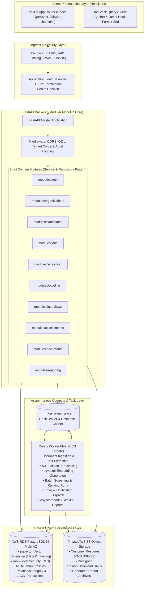
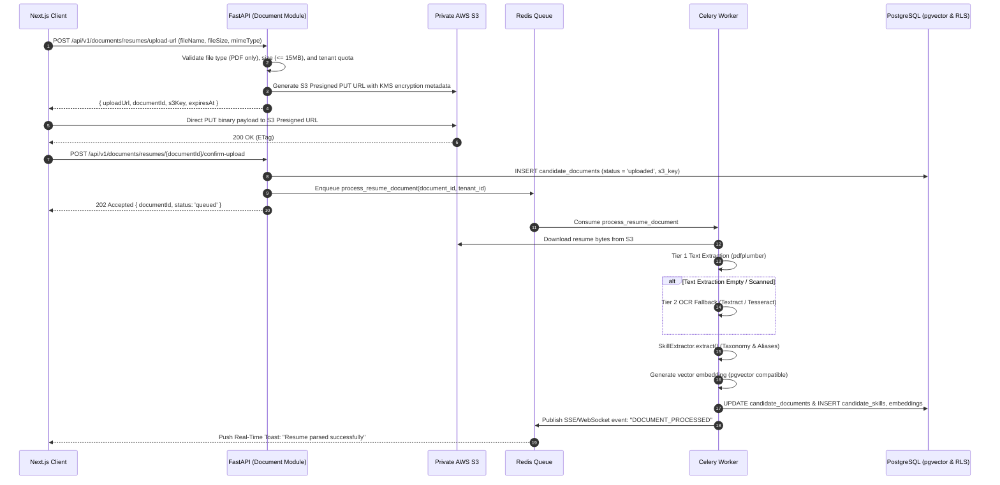

# System Architecture Blueprint

## 1. Architectural Paradigm: Asynchronous Modular Monolith

The **AI HR Platform** is architected as an **Asynchronous Modular Monolith**. 

This paradigm combines the simplicity, atomic deployment, and single-codebase developer velocity of a monolith with the strict domain boundaries, asynchronous performance offloading, and eventual microservice readiness required for enterprise commercial scale.



---

## 2. Domain Module Decomposition & Isolation Rules

The FastAPI backend is strictly structured around domain packages located under `backend/app/modules/`. Each module is self-contained with its own models, schemas, repositories, and domain services:

```
backend/app/modules/
├── auth/                 # Identity, credentials, sessions, MFA, JWT issuance
├── organizations/        # Tenants, departments, teams, subscription tracking
├── candidates/           # Candidate dossiers, experience, education, skills
├── jobs/                 # Requisitions, job posts, hiring criteria, weights
├── screening/            # Explainable matching engine, pgvector embeddings
├── pipeline/             # FSM hiring stages, transitions, state history
├── interviews/           # Slot booking, panel coordination, scorecards
├── assessments/          # Rule-based & LLM question generator, response evaluation
├── documents/            # S3 presigned URL issuance, document validation
├── reporting/            # Metrics aggregation, Excel/PDF background exports
└── audit/                # Immutable platform and organization audit logs
```

### Module Boundary Governance Rules:
1. **Strict Write Ownership**: Each domain module strictly owns its respective database tables. A domain module is **never permitted** to perform direct `INSERT`, `UPDATE`, or `DELETE` statements on tables owned by another domain. State mutations must occur via public method calls on the owning domain's `Service` class.
2. **Controlled Read Projections**: Cross-domain read access is permitted through controlled Service queries or optimized read-only repository projections to avoid excessive in-process joins or performance bottlenecks on complex dashboard views.
3. **Dependency Injection**: Services and repositories are resolved using FastAPI's dependency injection (`Depends()`), ensuring clear unit-testability and mocking.
4. **Asynchronous Delegation**: Any operation exceeding $50\text{ ms}$ of CPU or network time (e.g. PDF parsing, OCR, vector embedding generation, LLM completion calls, bulk report generation) must be dispatched as a background Celery task.

---

## 3. Data & Asynchronous Execution Flow

### High-Throughput Resume Ingestion Workflow:


---

## 4. Architectural Readiness for Future Service Extraction

The platform avoids the operational overhead of microservices today (service meshes, distributed tracing, network latency, distributed transactions). However, should specific modules experience extreme horizontal scaling demands in the future (e.g. `screening` vector search or `documents` OCR parsing), the architecture supports clean extraction:

1. **Clean Service Interfaces**: Because external modules only interact with a domain via its public Service API, replacing in-process method calls with an HTTP/gRPC client requires minimal refactoring.
2. **Explicit Database Ownership**: Because tables are grouped strictly by domain ownership, migrating a module's tables to a dedicated database schema or cluster is straightforward.
3. **Event Broker Evolution**: In-process domain event dispatchers can be swapped for an external message bus (e.g. Apache Kafka or AWS SQS/SNS) with zero impact on core business logic.
