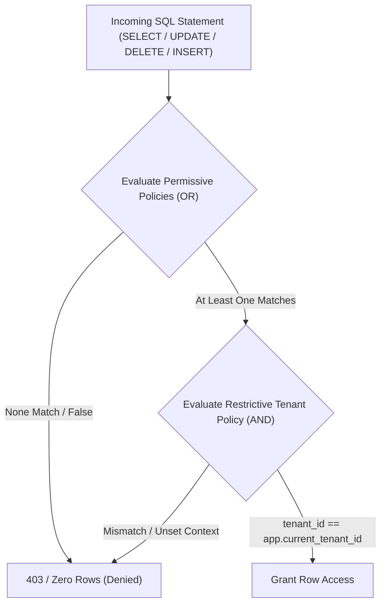

# Multi-Tenant Architecture & PostgreSQL Row-Level Security (RLS)

This document specifies the enterprise multi-tenant architecture, tenant context lifecycle, database role boundaries, connection pooling safety, and PostgreSQL Row-Level Security (RLS) policies.

---

## 1. PostgreSQL Database Role Security & Privilege Separation

A fundamental requirement of PostgreSQL RLS security is that **the runtime application role must never own tenant tables and must never possess administrative bypass attributes**.

### Database Role Partitioning:

| Role Name | Table Owner? | Superuser? | BYPASSRLS? | Runtime Permissions |
|:---|:---:|:---:|:---:|:---|
| **`app_user`** (Runtime Application Role) | **NO** | **NO** | **NO** | `SELECT`, `INSERT`, `UPDATE`, `DELETE` on tables; `USAGE` on sequences. **Subject to RLS at all times.** |
| **`migration_user`** (CI/CD Alembic Role) | **YES** | **NO** | **NO** | DDL permissions (`CREATE TABLE`, `ALTER TABLE`, `DROP TABLE`). Used strictly during migrations in CI/CD pipelines. |
| **`rds_superuser`** (Cloud Admin) | No | Yes | Yes | Extension creation (`pgvector`), backups, parameter tuning. **Never accessible to application containers.** |

### Why `app_user` Must Not Own Tables:
In PostgreSQL, by default, table owners bypass RLS policies on their own tables unless explicitly overridden. If the application runtime role owned the tables, any misconfiguration or omitted setting could allow the connection to bypass RLS. By ensuring `app_user` is merely a granted user (not the table owner), RLS is non-bypassable.

### Behavior & Limitations of `FORCE ROW LEVEL SECURITY`:
All tenant-scoped tables execute:
```sql
ALTER TABLE <table_name> ENABLE ROW LEVEL SECURITY;
ALTER TABLE <table_name> FORCE ROW LEVEL SECURITY;
```
- `FORCE ROW LEVEL SECURITY` mandates that RLS policies are applied **even if a table owner queries the table**.
- **Critical Limitation**: `FORCE ROW LEVEL SECURITY` has **zero effect on roles possessing the `SUPERUSER` or `BYPASSRLS` attributes**. In PostgreSQL, `SUPERUSER` and `BYPASSRLS` roles completely bypass RLS regardless of the `FORCE` directive. Therefore, the application runtime role (`app_user`) must be strictly created without `SUPERUSER` or `BYPASSRLS`.

---

## 2. PostgreSQL RLS Policy Semantics: Permissive vs. Restrictive

In PostgreSQL, Row-Level Security policies operate under a precise two-tier evaluation model:
1. **Permissive Policies (`AS PERMISSIVE`)**:
   - The default policy type in PostgreSQL.
   - When multiple permissive policies apply to a given command, they are combined using boolean **`OR`**.
   - **Crucial Engine Rule**: For a row to be accessible, **at least one applicable permissive policy must grant access (evaluate to true)**. If only restrictive policies exist without any permissive policy, all access is denied by default!
2. **Restrictive Policies (`AS RESTRICTIVE`)**:
   - Evaluated after permissive policies.
   - When one or more restrictive policies apply, they are combined with the permissive result using boolean **`AND`**.
   - **Crucial Engine Rule**: Restrictive policies act as **mandatory filters** (veto gates). They **cannot independently grant access**, but they unconditionally restrict rows granted by permissive policies.
3. **The Multi-Tenant Security Guarantee**:
   - By creating a baseline permissive policy granting standard application-role access (`AS PERMISSIVE FOR ALL TO app_user USING (true)`), and pairing it with a **mandatory restrictive tenant-isolation policy** (`AS RESTRICTIVE FOR ALL USING (tenant_id = NULLIF(current_setting('app.current_tenant_id', true), '')::uuid)`), we guarantee:
     $$\text{Access Granted} = \text{Permissive Granted} \;\mathbf{AND}\; (\text{tenant\_id} = \text{current\_tenant\_id})$$
   - Any additional permissive policies created later (e.g. for departmental access or recruiter role assignment) will be `OR`ed within the permissive set, but **can never bypass or override the restrictive tenant filter**!



---

## 3. Complete, Executable PostgreSQL RLS Implementation Pattern

Below is the verified, correct DDL specification for tenant-scoped tables (demonstrated on `applications`):

```sql
-- 1. Enable and Force RLS
ALTER TABLE applications ENABLE ROW LEVEL SECURITY;
ALTER TABLE applications FORCE ROW LEVEL SECURITY;

-- 2. Base Permissive Policy (Grants runtime access to standard application role)
CREATE POLICY applications_app_user_permissive_policy ON applications
    AS PERMISSIVE
    FOR ALL
    TO app_user
    USING (true)
    WITH CHECK (true);

-- 3. Restrictive Mandatory Tenant Isolation Policies (Acts as un-bypassable AND gate)

-- A. SELECT Restrictive Policy
CREATE POLICY applications_tenant_isolation_select_policy ON applications
    AS RESTRICTIVE
    FOR SELECT
    USING (
        tenant_id = NULLIF(current_setting('app.current_tenant_id', true), '')::uuid
    );

-- B. INSERT Restrictive Policy
CREATE POLICY applications_tenant_isolation_insert_policy ON applications
    AS RESTRICTIVE
    FOR INSERT
    WITH CHECK (
        tenant_id = NULLIF(current_setting('app.current_tenant_id', true), '')::uuid
    );

-- C. UPDATE Restrictive Policy
CREATE POLICY applications_tenant_isolation_update_policy ON applications
    AS RESTRICTIVE
    FOR UPDATE
    USING (
        tenant_id = NULLIF(current_setting('app.current_tenant_id', true), '')::uuid
    )
    WITH CHECK (
        tenant_id = NULLIF(current_setting('app.current_tenant_id', true), '')::uuid
    );

-- D. DELETE Restrictive Policy
CREATE POLICY applications_tenant_isolation_delete_policy ON applications
    AS RESTRICTIVE
    FOR DELETE
    USING (
        tenant_id = NULLIF(current_setting('app.current_tenant_id', true), '')::uuid
    );
```

### Missing Context Behavior:
If `app.current_tenant_id` is empty, unset, or malformed, `current_setting('app.current_tenant_id', true)` returns `NULL` (due to the `missing_ok = true` parameter). `NULLIF` returns `NULL`. The comparison `tenant_id = NULL` yields `UNKNOWN` (falsy in SQL). Hence, **all SELECT queries return 0 rows, and all INSERT/UPDATE/DELETE statements fail**.

---

## 4. Connection Pool Safety, Transaction Scoping & Reset Semantics

In asynchronous Python connection pools (`asyncpg` with SQLAlchemy 2.x), safe context management is critical:

### Step-by-Step Connection Lifecycle:
1. **Authentication & Tenant Validation**:
   - The API **never trusts** an unvalidated tenant identifier supplied by client headers or browser query parameters.
   - The user's active membership in `organization_memberships` for that specific tenant is cryptographically verified against the authenticated session token.
2. **Transaction Initiation (`BEGIN`)**:
   - An explicit transaction block is opened (`async with session.begin():`).
3. **Transaction-Local Setting (`is_local = true`)**:
   - The tenant setting is injected using `set_config` with `is_local = true`:
     ```python
     await session.execute(
         text("SELECT set_config('app.current_tenant_id', :tenant_id, true)"),
         {"tenant_id": str(context.tenant_id)}
     )
     ```
   - In PostgreSQL, setting `is_local = true` binds the setting strictly to the lifetime of the transaction.
4. **Automatic Reversion on Commit or Rollback**:
   - Upon `COMMIT` or `ROLLBACK`, PostgreSQL automatically drops the transaction-local setting.
5. **Connection Pool Defense-in-Depth Reset**:
   - Even though `is_local = true` reverts upon transaction termination, if an application defect executes a session-level `SET app.current_tenant_id` (`is_local = false`), the setting could persist into the pooled connection.
   - To completely eliminate pooled connection poisoning, the SQLAlchemy connection pool implements a checkout/checkin reset listener:
     ```python
     # SQLAlchemy Pool Event Hook
     @event.listens_for(async_engine.sync_engine, "reset")
     def on_connection_reset(dbapi_connection, connection_record):
         with dbapi_connection.cursor() as cursor:
             cursor.execute("SELECT set_config('app.current_tenant_id', '', false);")
     ```
   - If Connection X is checked out by Tenant A and subsequently reused by Tenant B, Tenant B's transaction setting overwrites the parameter immediately, and checkin resets it to empty.

---

## 5. Background Workers & Admin Support Scoping

1. **Celery Worker Tasks**:
   - Worker tasks receive `tenant_id: str` as an explicit payload argument.
   - Workers open an explicit transaction and execute `SELECT set_config('app.current_tenant_id', :tenant_id, true)`.
   - **Workers use the same restricted `app_user` role** and are fully subject to RLS. No bypass privileges are granted to workers.
2. **Platform Super Admin Support Access**:
   - Super Admins **never** connect with a `BYPASSRLS` role.
   - For audited customer support sessions, the application explicitly sets the target customer's tenant ID (`SET LOCAL app.current_tenant_id = :target_org_id`), ensuring Super Admins operate under the exact same RLS filters and composite foreign keys as regular users, while recording the session in `platform_audit_logs`.
