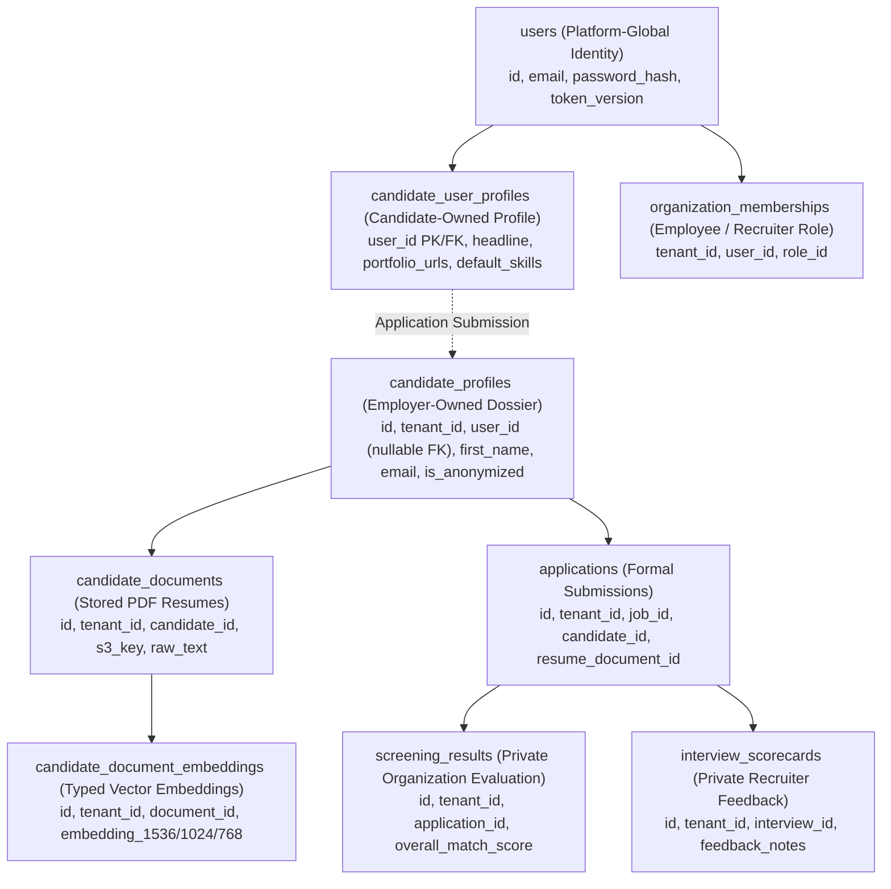

# Relational Database Design & Referential Integrity

This document details the relational database schema, table specifications, constraints, composite tenant-safe foreign keys, deletion semantics, and embedding architectures.

---

## 1. Architectural Standards for Database Design

### A. Primary Key & Identifier Strategy: UUIDv7
All primary keys use **UUIDv7** (time-ordered UUIDs) generated at the **application layer** using Python's standard `uuid-utils` library (RFC 9562 compliant) during model instantiation in SQLAlchemy:
```python
from uuid_utils import uuid7
id: Mapped[UUID] = mapped_column(UUID(as_uuid=True), primary_key=True, default=uuid7)
```
In database DDL migrations, the column type is defined as `UUID NOT NULL`.

### B. Valid PostgreSQL Timestamp Functions
All timestamps use `TIMESTAMPTZ` and default strictly to standard, valid PostgreSQL functions:
- `DEFAULT CURRENT_TIMESTAMP` or `DEFAULT clock_timestamp()`

### C. 100% Composite Tenant-Safe Foreign Key Enforcement
To guarantee tenant isolation at the relational engine level, **every relationship between tenant-scoped tables must enforce a composite foreign key containing `(tenant_id, <parent_id>)`**.

#### Reconciled Foreign Key Delete Semantics:
1. **`organization_memberships -> departments`**:
   - `department_id UUID NULL`
   - Foreign key uses column-specific nullification:
     ```sql
     FOREIGN KEY (tenant_id, department_id) REFERENCES departments(tenant_id, id) ON DELETE SET NULL (department_id)
     ```
2. **`candidate_profiles -> users`**:
   - `user_id UUID NULL REFERENCES users(id) ON DELETE SET NULL`
   - When a candidate deletes their user account, the employer's candidate dossier remains intact with `user_id = NULL`.
3. **`applications -> candidate_documents`**:
   - `resume_document_id UUID NULL`
   - Deletion behavior: `ON DELETE SET NULL (resume_document_id)`. If an uploaded resume is purged under a candidate erasure request, the historical application record is preserved with `resume_document_id = NULL`.
4. **`applications -> candidate_profiles`**:
   - Deletion behavior: **`ON DELETE RESTRICT`**. Historical application records must not be orphaned; candidate profile dossiers are anonymized in place under GDPR/statutory retention workflows.
5. **`applications -> pipeline_stages`**:
   - Deletion behavior: **`ON DELETE RESTRICT`**. A pipeline stage cannot be deleted while candidate applications reside in that stage. Candidates must be reassigned first.
6. **`applications -> jobs`**:
   - Deletion behavior: **`ON DELETE RESTRICT`**. A job with applicant records cannot be deleted; it must be marked `status = 'archived'`.
7. **`screening_score_components -> screening_results`**:
   - Deletion behavior: `FOREIGN KEY (tenant_id, screening_result_id) REFERENCES screening_results(tenant_id, id) ON DELETE CASCADE`.
8. **`interview_feedback -> interview_scorecards`**:
   - Deletion behavior: `FOREIGN KEY (tenant_id, scorecard_id) REFERENCES interview_scorecards(tenant_id, id) ON DELETE CASCADE`.
9. **`assessment_responses -> assessment_questions`**:
   - Deletion behavior: `FOREIGN KEY (tenant_id, question_id) REFERENCES assessment_questions(tenant_id, id) ON DELETE CASCADE`.

#### Complete Audit of Database Foreign Keys Referencing `users(id)`:
The relational schema contains exactly **9 tables** with direct database foreign key constraints referencing the platform-global `users(id)` primary key:

1. **`candidate_user_profiles.user_id`**: `REFERENCES users(id) ON DELETE CASCADE` (Platform-global candidate portfolio; allowed to cascade upon verified candidate deletion).
2. **`organization_memberships.user_id`**: `REFERENCES users(id) ON DELETE CASCADE` (Tenant-scoped; **STRICTLY BLOCKED by database trigger guard `fn_protect_user_cascade_deletion`** with cross-tenant `BYPASSRLS` if active or inactive memberships exist).
3. **`candidate_profiles.user_id`**: `REFERENCES users(id) ON DELETE SET NULL` (Tenant-scoped employer dossier; allowed with deliberate `SET NULL`; dossier is preserved and anonymized in place).
4. **`jobs.hiring_manager_id`**: `REFERENCES users(id) ON DELETE SET NULL` (Tenant-scoped; **STRICTLY BLOCKED by database trigger guard** if assigned as hiring manager on active/open jobs; allowed with `SET NULL` if jobs archived).
5. **`screening_runs.created_by`**: `REFERENCES users(id) ON DELETE SET NULL` (Tenant-scoped batch screening run audit; allowed with deliberate `SET NULL` to retain audit trail).
6. **`interview_participants.user_id`**: `REFERENCES users(id) ON DELETE CASCADE` (Tenant-scoped; **STRICTLY BLOCKED by database trigger guard** if assigned to upcoming scheduled interviews; historical completed participation allowed to cascade).
7. **`interview_scorecards.interviewer_id`**: `REFERENCES users(id) ON DELETE RESTRICT` (Tenant-scoped; **DATABASE RELATIONAL ENGINE RESTRICTS DELETION** if scorecards exist; requires Account Scrambling & Deactivation).
8. **`comments.author_id`**: `REFERENCES users(id) ON DELETE SET NULL` (Tenant-scoped recruiter comments; allowed with deliberate `SET NULL`; preserved with author attributed to "Former Employee").
9. **`platform_audit_logs.actor_id`**: `REFERENCES users(id) ON DELETE SET NULL` (Platform-global immutable audit log; allowed with deliberate `SET NULL` to preserve compliance trail).

*(Two additional non-table application-level dependencies are enforced by the business logic: Organization Sole Administrator Ownership and Statutory Litigation Holds).*

---

## 2. Embedding Model-to-Dimension Integrity & Valid PostgreSQL DDL

To ensure strict model-to-dimension integrity, eliminate vector dimension mismatches, and guarantee valid PostgreSQL 16 syntax:

### A. Database-Enforced Model Registry Table
The `embedding_models` table enforces uniqueness across `(model_identifier, expected_dimensions)`:

```sql
CREATE TABLE embedding_models (
    model_identifier VARCHAR(100) PRIMARY KEY,
    provider VARCHAR(50) NOT NULL,
    expected_dimensions INT NOT NULL CHECK (expected_dimensions IN (1536, 1024, 768)),
    is_active BOOLEAN NOT NULL DEFAULT TRUE,
    created_at TIMESTAMPTZ NOT NULL DEFAULT CURRENT_TIMESTAMP,

    -- Required composite unique key to allow composite foreign key references
    CONSTRAINT uq_embedding_models_dims UNIQUE (model_identifier, expected_dimensions)
);

-- Seed approved model identifiers
INSERT INTO embedding_models (model_identifier, provider, expected_dimensions, is_active) VALUES
('text-embedding-3-small', 'openai', 1536, true),
('amazon.titan-embed-text-v1', 'aws_bedrock', 1536, true),
('cohere.embed-english-v3', 'aws_bedrock', 1024, true),
('bge-base-en-v1.5', 'huggingface', 768, true);
```

#### Enforcement Boundary for Inactive Models:
- The database enforces that every embedding record references an existing, valid `(model_identifier, expected_dimensions)` pair via composite foreign keys.
- **Active Model Verification**: PostgreSQL foreign keys cannot conditionally assert `WHERE is_active = TRUE` on the referenced table. Therefore:
  - **Application Service Layer Boundary (FastAPI / Celery)**: New embedding generation jobs check `is_active = TRUE` before requesting embeddings from providers. If a model is deprecated (`is_active = FALSE`), new embedding creation is blocked.
  - **Database Trigger (Optional Defense-in-Depth)**: A `BEFORE INSERT OR UPDATE` trigger on `candidate_document_embeddings` and `job_embeddings` can query `embedding_models.is_active` and raise an exception if a new vector attempts to use a deactivated model. Historical embeddings created under older model versions remain readable for auditability.

---

### B. Valid PostgreSQL 16 DDL for `candidate_document_embeddings`

```sql
CREATE TABLE candidate_document_embeddings (
    id UUID PRIMARY KEY,
    tenant_id UUID NOT NULL,
    document_id UUID NOT NULL,
    model_identifier VARCHAR(100) NOT NULL,
    model_version VARCHAR(50) NOT NULL,
    vector_dimensions INT NOT NULL,
    embedding_1536 vector(1536),
    embedding_1024 vector(1024),
    embedding_768 vector(768),
    created_at TIMESTAMPTZ NOT NULL DEFAULT CURRENT_TIMESTAMP,

    -- Composite Tenant-Safe Foreign Key to candidate_documents
    CONSTRAINT fk_cand_emb_doc
        FOREIGN KEY (tenant_id, document_id)
        REFERENCES candidate_documents(tenant_id, id)
        ON DELETE CASCADE,

    -- Database-Enforced Model-to-Dimension Integrity Composite Foreign Key
    CONSTRAINT fk_cand_emb_model_dims
        FOREIGN KEY (model_identifier, vector_dimensions)
        REFERENCES embedding_models(model_identifier, expected_dimensions),

    -- Unique constraint per document, model, and version
    CONSTRAINT uq_cand_emb_version
        UNIQUE (tenant_id, document_id, model_identifier, model_version),

    -- Exactly-one-vector-column CHECK constraint matching vector_dimensions
    CONSTRAINT chk_cand_emb_dimensions CHECK (
        (vector_dimensions = 1536 AND embedding_1536 IS NOT NULL AND embedding_1024 IS NULL AND embedding_768 IS NULL) OR
        (vector_dimensions = 1024 AND embedding_1024 IS NOT NULL AND embedding_1536 IS NULL AND embedding_768 IS NULL) OR
        (vector_dimensions = 768  AND embedding_768 IS NOT NULL  AND embedding_1536 IS NULL AND embedding_1024 IS NULL)
    )
);

-- Partial HNSW Indexes (Valid PostgreSQL 16 Syntax: WITH parameters precede WHERE clause)
CREATE INDEX idx_cand_emb_1536 ON candidate_document_embeddings 
    USING hnsw (embedding_1536 vector_cosine_ops)
    WITH (m = 16, ef_construction = 64)
    WHERE embedding_1536 IS NOT NULL;

CREATE INDEX idx_cand_emb_1024 ON candidate_document_embeddings 
    USING hnsw (embedding_1024 vector_cosine_ops)
    WITH (m = 16, ef_construction = 64)
    WHERE embedding_1024 IS NOT NULL;

CREATE INDEX idx_cand_emb_768 ON candidate_document_embeddings 
    USING hnsw (embedding_768 vector_cosine_ops)
    WITH (m = 16, ef_construction = 64)
    WHERE embedding_768 IS NOT NULL;
```

---

### C. Valid PostgreSQL 16 DDL for `job_embeddings`

```sql
CREATE TABLE job_embeddings (
    id UUID PRIMARY KEY,
    tenant_id UUID NOT NULL,
    job_id UUID NOT NULL,
    model_identifier VARCHAR(100) NOT NULL,
    model_version VARCHAR(50) NOT NULL,
    vector_dimensions INT NOT NULL,
    embedding_1536 vector(1536),
    embedding_1024 vector(1024),
    embedding_768 vector(768),
    created_at TIMESTAMPTZ NOT NULL DEFAULT CURRENT_TIMESTAMP,

    -- Composite Tenant-Safe Foreign Key to jobs
    CONSTRAINT fk_job_emb_job
        FOREIGN KEY (tenant_id, job_id)
        REFERENCES jobs(tenant_id, id)
        ON DELETE CASCADE,

    -- Database-Enforced Model-to-Dimension Integrity Composite Foreign Key
    CONSTRAINT fk_job_emb_model_dims
        FOREIGN KEY (model_identifier, vector_dimensions)
        REFERENCES embedding_models(model_identifier, expected_dimensions),

    -- Unique constraint per job, model, and version
    CONSTRAINT uq_job_emb_version
        UNIQUE (tenant_id, job_id, model_identifier, model_version),

    -- Exactly-one-vector-column CHECK constraint matching vector_dimensions
    CONSTRAINT chk_job_emb_dimensions CHECK (
        (vector_dimensions = 1536 AND embedding_1536 IS NOT NULL AND embedding_1024 IS NULL AND embedding_768 IS NULL) OR
        (vector_dimensions = 1024 AND embedding_1024 IS NOT NULL AND embedding_1536 IS NULL AND embedding_768 IS NULL) OR
        (vector_dimensions = 768  AND embedding_768 IS NOT NULL  AND embedding_1536 IS NULL AND embedding_1024 IS NULL)
    )
);

-- Partial HNSW Indexes (Valid PostgreSQL 16 Syntax: WITH parameters precede WHERE clause)
CREATE INDEX idx_job_emb_1536 ON job_embeddings 
    USING hnsw (embedding_1536 vector_cosine_ops)
    WITH (m = 16, ef_construction = 64)
    WHERE embedding_1536 IS NOT NULL;

CREATE INDEX idx_job_emb_1024 ON job_embeddings 
    USING hnsw (embedding_1024 vector_cosine_ops)
    WITH (m = 16, ef_construction = 64)
    WHERE embedding_1024 IS NOT NULL;

CREATE INDEX idx_job_emb_768 ON job_embeddings 
    USING hnsw (embedding_768 vector_cosine_ops)
    WITH (m = 16, ef_construction = 64)
    WHERE embedding_768 IS NOT NULL;
```

---

## 3. Candidate Global Identity & Organization Dossier Reconciliation



#### `candidate_user_profiles` (Platform-Global / Candidate-Owned)
- **Primary Key**: `user_id UUID PRIMARY KEY REFERENCES users(id) ON DELETE CASCADE`
- **Columns**: `headline VARCHAR(255)`, `bio TEXT`, `portfolio_urls JSONB NOT NULL DEFAULT '[]'`, `self_declared_skills JSONB NOT NULL DEFAULT '[]'`, `created_at TIMESTAMPTZ NOT NULL DEFAULT CURRENT_TIMESTAMP`.

#### `candidate_profiles` (Tenant-Scoped Employer Dossier)
- **Primary Key**: `id UUID PRIMARY KEY`
- **Columns**:
  - `tenant_id UUID NOT NULL REFERENCES organizations(id) ON DELETE CASCADE`
  - `user_id UUID REFERENCES users(id) ON DELETE SET NULL`
  - `first_name VARCHAR(100) NOT NULL`
  - `last_name VARCHAR(100) NOT NULL`
  - `email VARCHAR(255) NOT NULL`
  - `phone VARCHAR(50)`
  - `location VARCHAR(255)`
  - `total_experience_years NUMERIC(4, 1)`
  - `highest_education_level VARCHAR(100)`
  - `source_type VARCHAR(50) DEFAULT 'direct_apply'`
  - `is_anonymized BOOLEAN NOT NULL DEFAULT FALSE`
  - `created_at TIMESTAMPTZ NOT NULL DEFAULT CURRENT_TIMESTAMP`
  - `updated_at TIMESTAMPTZ NOT NULL DEFAULT CURRENT_TIMESTAMP`
- **Constraints**: `UNIQUE (tenant_id, id)`, `INDEX idx_cand_tenant_email (tenant_id, email)`.

---

## 4. Platform-Global Identity & Revocation Outbox Schema (PostgreSQL 16)

### A. Authoritative `users` Table DDL
The `users` table acts as the platform-global identity anchor, storing authentication credentials, authorization versions, account state flags, and security audit attributes:

```sql
CREATE TABLE users (
    id UUID PRIMARY KEY, -- Application-generated UUIDv7
    email VARCHAR(255) NOT NULL,
    password_hash VARCHAR(255) NOT NULL,
    first_name VARCHAR(100) NOT NULL,
    last_name VARCHAR(100) NOT NULL,
    phone_number VARCHAR(30) NULL,
    avatar_url VARCHAR(512) NULL,
    mfa_secret VARCHAR(255) NULL,
    oauth_provider VARCHAR(50) NULL,
    oauth_subject_id VARCHAR(255) NULL,
    token_version INT NOT NULL DEFAULT 1,
    is_active BOOLEAN NOT NULL DEFAULT TRUE,
    is_super_admin BOOLEAN NOT NULL DEFAULT FALSE,
    litigation_hold BOOLEAN NOT NULL DEFAULT FALSE,
    force_authoritative_check BOOLEAN NOT NULL DEFAULT FALSE,
    last_login_ip INET NULL,
    created_at TIMESTAMPTZ NOT NULL DEFAULT CURRENT_TIMESTAMP,
    updated_at TIMESTAMPTZ NOT NULL DEFAULT CURRENT_TIMESTAMP,

    -- Constraints
    CONSTRAINT uq_users_email UNIQUE (email),
    CONSTRAINT chk_users_names CHECK (length(trim(first_name)) > 0 AND length(trim(last_name)) > 0)
);

CREATE INDEX idx_users_active_lookup ON users (id, is_active, token_version, force_authoritative_check);
```

### B. Transactional Invalidation Outbox DDL (`auth_revocation_outbox`)
The `auth_revocation_outbox` table guarantees reliable, asynchronous propagation of session and permission invalidations from PostgreSQL transactions to Redis. To prevent clearing race conditions and ensure complete dependency tracking across user-specific, membership-specific, and organization-wide events, the outbox schema explicitly models entity relationships:

```sql
CREATE TABLE auth_revocation_outbox (
    id UUID PRIMARY KEY, -- UUIDv7
    event_type VARCHAR(50) NOT NULL, -- 'GLOBAL_LOGOUT', 'USER_SUSPENDED', 'PASSWORD_CHANGED', 'ROLE_CHANGED', 'ORG_SUSPENDED', 'MEMBERSHIP_REMOVED'
    entity_type VARCHAR(50) NOT NULL, -- 'USER', 'ORGANIZATION', 'MEMBERSHIP'
    entity_id UUID NOT NULL, -- Primary target UUID (user_id, membership_id, or organization_id)
    user_id UUID NULL, -- Explicit user affected (populated for USER and MEMBERSHIP events; NULL for multi-user ORG events)
    organization_id UUID NULL, -- Explicit tenant affected (populated for MEMBERSHIP and ORGANIZATION events)
    new_version INT NULL, -- Target version number (token_version or role_version)
    payload JSONB NOT NULL DEFAULT '{}'::jsonb,
    created_at TIMESTAMPTZ NOT NULL DEFAULT CURRENT_TIMESTAMP,
    processed_at TIMESTAMPTZ NULL,

    -- Referential integrity constraints (RESTRICT prevents cascading destruction of pending audit/invalidation events)
    CONSTRAINT fk_auth_outbox_user FOREIGN KEY (user_id) REFERENCES users(id) ON DELETE RESTRICT,
    CONSTRAINT fk_auth_outbox_org FOREIGN KEY (organization_id) REFERENCES organizations(id) ON DELETE RESTRICT
);

-- Fast index for the high-frequency Celery outbox polling dispatcher
CREATE INDEX idx_auth_outbox_unprocessed ON auth_revocation_outbox (created_at) WHERE processed_at IS NULL;

-- Fast partial indexes for user and organization pending event lookups to support race-free clearing
CREATE INDEX idx_auth_outbox_pending_user ON auth_revocation_outbox (user_id, created_at) WHERE processed_at IS NULL;
CREATE INDEX idx_auth_outbox_pending_org ON auth_revocation_outbox (organization_id, created_at) WHERE processed_at IS NULL;

-- Fast partial index for daily retention purge job (processed_at older than 90 days)
CREATE INDEX idx_auth_outbox_retention_purge ON auth_revocation_outbox (processed_at) WHERE processed_at IS NOT NULL;

-- Table-level Deletion Guard: Unprocessed outbox events must NEVER be deleted under any circumstances
CREATE OR REPLACE FUNCTION public.fn_prevent_delete_pending_outbox()
RETURNS TRIGGER
LANGUAGE plpgsql
SECURITY DEFINER
SET search_path = pg_catalog, pg_temp
AS $$
BEGIN
    IF OLD.processed_at IS NULL THEN
        RAISE EXCEPTION 'CANNOT_DELETE_PENDING_OUTBOX_EVENT: Outbox event % (entity_type=%, entity_id=%) has not been processed or acknowledged by Redis.', 
            OLD.id, OLD.entity_type, OLD.entity_id
            USING ERRCODE = 'restrict_violation';
    END IF;
    RETURN OLD;
END;
$$;

CREATE TRIGGER trg_prevent_delete_pending_outbox
BEFORE DELETE ON public.auth_revocation_outbox
FOR EACH ROW
EXECUTE FUNCTION public.fn_prevent_delete_pending_outbox();
```

#### 1. Multi-Level Outbox-to-User Tracking Architecture:
Revocation events originate across three distinct operational scopes:
1. **USER Events** (`GLOBAL_LOGOUT`, `USER_SUSPENDED`, `PASSWORD_CHANGED`):
   - Scope: Individual user across all organizations.
   - Outbox Population: `user_id = :user_id`, `organization_id = NULL`.
   - Mutation: Atomically sets `users.force_authoritative_check = TRUE` on the user before commit.
2. **MEMBERSHIP Events** (`ROLE_CHANGED`, `MEMBERSHIP_REMOVED`):
   - Scope: Specific user within a specific tenant organization.
   - Outbox Population: `user_id = :user_id`, `organization_id = :tenant_id`.
   - Mutation: Atomically sets `users.force_authoritative_check = TRUE` on the user before commit.
3. **ORGANIZATION Events** (`ORG_SUSPENDED`, `ORG_COMPLIANCE_FREEZE`):
   - Scope: Tenant-wide mutation affecting **all active members** of the organization.
   - Outbox Population: `user_id = NULL`, `organization_id = :tenant_id`.
   - Mutation: Sets `organizations.status = 'suspended'` and atomically sets `force_authoritative_check = TRUE` across all active members of that organization:
     ```sql
     UPDATE public.users u
     SET force_authoritative_check = TRUE,
         updated_at = CURRENT_TIMESTAMP
     FROM public.organization_memberships om
     WHERE om.user_id = u.id 
       AND om.tenant_id = :tenant_id
       AND om.is_active = TRUE;
     ```

#### 2. Executable PostgreSQL 16 PL/pgSQL Function for Event Processing:
To ensure procedural operations (`PERFORM`, `IF/ELSE`) execute in a valid PostgreSQL 16 runtime environment, the event processing and flag clearing logic is encapsulated in a `SECURITY DEFINER` function:

```sql
CREATE OR REPLACE FUNCTION public.fn_process_auth_revocation_event(
    p_outbox_id UUID
)
RETURNS BOOLEAN
LANGUAGE plpgsql
SECURITY DEFINER
SET search_path = pg_catalog, pg_temp
AS $$
DECLARE
    v_entity_type VARCHAR(50);
    v_user_id UUID;
    v_org_id UUID;
    v_user_exists BOOLEAN := FALSE;
    v_has_pending BOOLEAN;
    v_target_user_id UUID;
    -- Captures the exact set of user rows locked in Step 2B.
    -- Step 4B is restricted to this same set so the locked set equals the updated set.
    v_locked_users UUID[] := '{}';
BEGIN
    -- Step 1: Snapshot inspection of target outbox metadata (non-locking read)
    -- Reads target entity coordinates without taking exclusive tuple locks.
    -- This allows all transactions to acquire parent locks FIRST, strictly
    -- adhering to the Global Lock Hierarchy and preventing lock-inversion deadlocks.
    SELECT entity_type, user_id, organization_id
    INTO v_entity_type, v_user_id, v_org_id
    FROM public.auth_revocation_outbox
    WHERE id = p_outbox_id 
      AND processed_at IS NULL;

    IF NOT FOUND THEN
        -- Event already processed by another concurrent worker or does not exist
        RETURN FALSE;
    END IF;

    -- Step 2: Lock parent entities FIRST in strict Global Lock Hierarchy order
    -- Level 0 (organizations) -> Level 1 (users in ascending UUID order)

    -- Case 2A: Individual USER or MEMBERSHIP event
    IF v_user_id IS NOT NULL THEN
        -- Level 1: Lock the target user FIRST before touching the outbox row
        PERFORM 1 
        FROM public.users u 
        WHERE u.id = v_user_id 
        FOR NO KEY UPDATE;

        v_user_exists := FOUND;

        -- If user was already deleted prior to this processing transaction,
        -- mark the outbox event processed and exit safely.
        IF NOT v_user_exists THEN
            UPDATE public.auth_revocation_outbox
            SET processed_at = CURRENT_TIMESTAMP
            WHERE id = p_outbox_id 
              AND processed_at IS NULL;
            RETURN TRUE;
        END IF;

    -- Case 2B: ORGANIZATION-wide event
    ELSIF v_entity_type = 'ORGANIZATION' AND v_org_id IS NOT NULL THEN
        -- Level 0: Acquire exclusive lock on the organization row (FOR UPDATE).
        -- ORGANIZATIONAL CONCURRENCY & PHANTOM INSERTION PROTOCOL:
        -- 1. Phantom Insert Prevention: When any concurrent transaction executes INSERT INTO
        --    organization_memberships, PostgreSQL's foreign-key check on tenant_id
        --    references organizations(id) and internally acquires FOR KEY SHARE on this
        --    organization row. In PostgreSQL 16, FOR UPDATE is the ONLY lock mode that
        --    conflicts with FOR KEY SHARE. Therefore, holding FOR UPDATE on organizations(id)
        --    strictly BLOCKS concurrent membership insertions at the database engine level.
        -- 2. Membership Mutation Prevention: Application workflows mutating memberships
        --    (reactivation, deactivation, deletion, role change) acquire Level 0 locks
        --    (FOR NO KEY UPDATE / FOR UPDATE) on organizations(id), conflicting with this
        --    FOR UPDATE lock and serializing all membership modifications.
        -- 3. Concurrent Organization Deletion: Any concurrent DELETE FROM organizations
        --    requires FOR UPDATE at Level 0 and safely serializes without deadlocks.
        PERFORM 1
        FROM public.organizations o
        WHERE o.id = v_org_id
        FOR UPDATE;

        -- Level 1: Lock affected active member users INDIVIDUALLY in deterministic
        -- ascending UUID order using a cursor loop. PostgreSQL does not permit
        -- FOR UPDATE/SHARE with aggregate functions.
        -- Individual row locking preserves strict ascending lock acquisition order
        -- and dynamically collects each successfully locked user_id into v_locked_users.
        v_locked_users := '{}';
        FOR v_target_user_id IN
            SELECT u.id
            FROM public.users u
            WHERE u.id IN (
                SELECT om.user_id 
                FROM public.organization_memberships om 
                WHERE om.tenant_id = v_org_id AND om.is_active = TRUE
            )
            ORDER BY u.id ASC
            FOR NO KEY UPDATE
        LOOP
            v_locked_users := array_append(v_locked_users, v_target_user_id);
        END LOOP;
        -- v_locked_users now contains EXACTLY the user rows locked at Level 1.
        -- No new user, membership, or organization row locks may be acquired
        -- after the Level 5 outbox lock (Step 3).
    END IF;

    -- Step 3: Now that all parent entities are safely locked in top-down order,
    -- acquire exclusive lock on the Level 5 outbox row and mark it processed.
    UPDATE public.auth_revocation_outbox
    SET processed_at = CURRENT_TIMESTAMP
    WHERE id = p_outbox_id 
      AND processed_at IS NULL;

    IF NOT FOUND THEN
        -- Sibling worker processed this event concurrently while parent locks were acquired
        RETURN FALSE;
    END IF;

    -- Step 4: Evaluate remaining pending dependencies and safely clear barrier flags

    -- Case 4A: Individual User / Membership
    IF v_user_id IS NOT NULL AND v_user_exists THEN
        -- Check if any OTHER pending events remain affecting this user
        SELECT EXISTS (
            SELECT 1 
            FROM public.auth_revocation_outbox o
            WHERE o.processed_at IS NULL
              AND (
                  o.user_id = v_user_id
                  OR 
                  (o.entity_type = 'ORGANIZATION' AND o.organization_id IN (
                      SELECT om.tenant_id 
                      FROM public.organization_memberships om 
                      WHERE om.user_id = v_user_id AND om.is_active = TRUE
                  ))
              )
        ) INTO v_has_pending;

        -- Reset flag only if zero pending events remain
        IF NOT v_has_pending THEN
            UPDATE public.users 
            SET force_authoritative_check = FALSE,
                updated_at = CURRENT_TIMESTAMP 
            WHERE id = v_user_id;
        END IF;

    -- Case 4B: Organization-wide
    ELSIF v_entity_type = 'ORGANIZATION' AND v_org_id IS NOT NULL THEN
        -- Bulk reset force_authoritative_check for EXACTLY the users locked in Step 2B.
        -- Update is restricted to v_locked_users (not re-derived from organization_memberships)
        -- to guarantee: locked set == updated set. No new row locks are acquired here because
        -- u.id = ANY(v_locked_users) matches only rows already held FOR NO KEY UPDATE.
        IF v_locked_users IS NOT NULL AND array_length(v_locked_users, 1) > 0 THEN
            UPDATE public.users u
            SET force_authoritative_check = FALSE,
                updated_at = CURRENT_TIMESTAMP
            WHERE u.id = ANY(v_locked_users)
              AND NOT EXISTS (
                  SELECT 1 
                  FROM public.auth_revocation_outbox o
                  WHERE o.processed_at IS NULL
                    AND (
                        o.user_id = u.id
                        OR 
                        (o.entity_type = 'ORGANIZATION' AND o.organization_id IN (
                            SELECT om2.tenant_id 
                            FROM public.organization_memberships om2 
                            WHERE om2.user_id = u.id AND om2.is_active = TRUE
                        ))
                    )
              );
        END IF;
    END IF;

    RETURN TRUE;
END;
$$;

-- Ownership transferred to dedicated outbox processing role with explicit UPDATE grants
ALTER FUNCTION public.fn_process_auth_revocation_event(UUID) OWNER TO aihr_revocation_processor_role;
REVOKE ALL ON FUNCTION public.fn_process_auth_revocation_event(UUID) FROM PUBLIC;
GRANT EXECUTE ON FUNCTION public.fn_process_auth_revocation_event(UUID) TO aihr_app_user;
```

#### 3. Valid Standalone Executable PostgreSQL 16 SQL (Pure SQL Pattern):
For application workers or synchronous post-commit execution without stored procedures, the following standard SQL transactions are 100% executable and strictly adhere to the top-down Global Lock Hierarchy:

##### Pattern A: Processing Individual USER or MEMBERSHIP Event
```sql
BEGIN;

-- Step 1: Pre-lock the target user FIRST in Level 1 of the Global Lock Hierarchy
SELECT 1 
FROM public.users u 
WHERE u.id = :user_id 
FOR NO KEY UPDATE;

-- Step 2: Now acquire exclusive lock on the Level 5 outbox row and mark it processed
UPDATE public.auth_revocation_outbox 
SET processed_at = CURRENT_TIMESTAMP 
WHERE id = :outbox_event_id 
  AND processed_at IS NULL;

-- Step 3: Conditionally reset force_authoritative_check in pure SQL (NO procedural IF / PERFORM)
UPDATE public.users u
SET force_authoritative_check = FALSE,
    updated_at = CURRENT_TIMESTAMP
WHERE u.id = :user_id
  AND NOT EXISTS (
      SELECT 1 
      FROM public.auth_revocation_outbox o
      WHERE o.processed_at IS NULL
        AND (
            o.user_id = :user_id
            OR 
            (o.entity_type = 'ORGANIZATION' AND o.organization_id IN (
                SELECT om.tenant_id 
                FROM public.organization_memberships om 
                WHERE om.user_id = :user_id AND om.is_active = TRUE
            ))
        )
  );

COMMIT;
```

##### Pattern B: Processing ORGANIZATION Event with Deterministic Ascending Locking

> **Organization-Level Locking & Phantom Prevention Invariant**:
> 1. Step 1 acquires `FOR UPDATE` on `organizations(id)` (Level 0). This conflicts with
>    `FOR KEY SHARE` acquired by PostgreSQL's foreign-key engine check during concurrent
>    `INSERT INTO organization_memberships`, physically blocking concurrent phantom inserts.
>    It also conflicts with `FOR NO KEY UPDATE` acquired by membership mutation workflows
>    (reactivations, deactivations, deletions), freezing the organization's membership set.
> 2. Step 2 locks affected active member users individually in deterministic ascending UUID
>    order without aggregates (`SELECT u.id ... ORDER BY u.id ASC FOR NO KEY UPDATE`).
>    The client application fetches the returned rows into `:locked_user_ids`.
> 3. After Step 3 acquires the Level 5 outbox lock, no subsequent statement may acquire
>    any new row lock on `organizations`, `organization_memberships`, or `users`.
> 4. Step 4 restricts its `UPDATE` strictly to `:locked_user_ids`, guaranteeing that the
>    locked set equals the updated set without re-deriving from `organization_memberships`.

```sql
BEGIN;

-- Step 1: Acquire exclusive lock on the target organization (Level 0).
-- Blocks concurrent membership insertions (via FK FOR KEY SHARE conflict),
-- membership mutations (via FOR NO KEY UPDATE conflict), and org deletions.
SELECT 1 
FROM public.organizations o 
WHERE o.id = :org_id 
FOR UPDATE;

-- Step 2: Lock affected users individually in deterministic ascending UUID order (Level 1).
-- Executed without aggregates. The client application fetches the returned list
-- into an array parameter: :locked_user_ids.
SELECT u.id
FROM public.users u
WHERE u.id IN (
    SELECT om.user_id 
    FROM public.organization_memberships om 
    WHERE om.tenant_id = :org_id AND om.is_active = TRUE
)
ORDER BY u.id ASC
FOR NO KEY UPDATE;

-- Step 3: Now acquire exclusive lock on Level 5 outbox row and mark it processed.
-- Invariant: After this statement, no new row lock on organizations or users may be acquired.
UPDATE public.auth_revocation_outbox 
SET processed_at = CURRENT_TIMESTAMP 
WHERE id = :outbox_event_id 
  AND processed_at IS NULL;

-- Step 4: Conditionally reset force_authoritative_check for EXACTLY :locked_user_ids.
-- Update is bound strictly to :locked_user_ids with zero re-derivation from
-- organization_memberships, ensuring locked set == updated set.
UPDATE public.users u
SET force_authoritative_check = FALSE,
    updated_at = CURRENT_TIMESTAMP
WHERE u.id = ANY(:locked_user_ids)
  AND NOT EXISTS (
      SELECT 1 
      FROM public.auth_revocation_outbox o
      WHERE o.processed_at IS NULL
        AND (
            o.user_id = u.id
            OR 
            (o.entity_type = 'ORGANIZATION' AND o.organization_id IN (
                SELECT om2.tenant_id 
                FROM public.organization_memberships om2 
                WHERE om2.user_id = u.id AND om2.is_active = TRUE
            ))
        )
  );

COMMIT;
```

### C. RLS-Aware Database Trigger Guard for User Cascading Deletions
To prevent accidental administrative, worker-level, or application-level `DELETE FROM users` operations from silently executing cascading deletions across ANY tenant, dedicated RLS-aware database trigger guards are enforced.

#### 1. Privilege & Identity Model: Strict Separation of Roles:
To maintain least privilege and prevent privilege escalation across RLS boundaries:

1. **`aihr_deletion_guard_role` (Strictly Read-Only)**:
   - Owns deletion and active-check validation triggers: `fn_protect_user_cascade_deletion()`, `fn_protect_organization_deletion()`, `fn_jobs_check_hiring_manager_active()`, `fn_interview_participants_check_active()`, `fn_interview_schedules_check_participants_active()`.
   - Has `BYPASSRLS` so triggers can inspect rows across all tenants.
   - **Strictly minimal read-only permissions**: Granted `SELECT` only on inspected tables (`users`, `organization_memberships`, `jobs`, `interview_participants`, `interview_schedules`, `interview_scorecards`, `auth_revocation_outbox`).
   - Has **ZERO `UPDATE`, `INSERT`, or `DELETE` grants**. It cannot mutate or delete any application data under any circumstance.

2. **`aihr_revocation_processor_role` (Dedicated Outbox Definer Role)**:
   - Owns `fn_process_auth_revocation_event()`.
   - Has `BYPASSRLS` to inspect `organization_memberships` across tenants during asynchronous Celery processing.
   - **Column-level least-privilege grants**:
     - `SELECT, UPDATE (processed_at)` on `public.auth_revocation_outbox`.
     - `SELECT (id, force_authoritative_check, is_active), UPDATE (force_authoritative_check, updated_at)` on `public.users`.
     - `SELECT (id, tenant_id, user_id, is_active)` on `public.organization_memberships`.
     - `SELECT (id), UPDATE (name)` on `public.organizations` (narrowest valid column-level permissions: `SELECT (id)` for the lookup predicate and `UPDATE (name)` on the existing, non-key, non-sensitive `name` column required by PostgreSQL 16 for the Level 0 `FOR UPDATE` locking clause).
   - Has **ZERO permissions on recruitment tables** (`jobs`, `candidates`, `applications`, `interviews`, `audit_logs`).

```sql
-- Step 1: Secure public schema against modification and privilege escalation
REVOKE CREATE ON SCHEMA public FROM PUBLIC;

-- Step 2: Create dedicated non-login role with BYPASSRLS for deletion guards (Strictly Read-Only)
CREATE ROLE aihr_deletion_guard_role WITH 
    NOLOGIN 
    NOINHERIT 
    NOSUPERUSER 
    NOCREATEDB 
    NOCREATEROLE 
    BYPASSRLS;

-- Step 3: Grant strictly minimal read-only permissions to deletion guard role
GRANT SELECT ON public.users TO aihr_deletion_guard_role;
GRANT SELECT ON public.organization_memberships TO aihr_deletion_guard_role;
GRANT SELECT ON public.jobs TO aihr_deletion_guard_role;
GRANT SELECT ON public.interview_participants TO aihr_deletion_guard_role;
GRANT SELECT ON public.interview_schedules TO aihr_deletion_guard_role;
GRANT SELECT ON public.interview_scorecards TO aihr_deletion_guard_role;
GRANT SELECT ON public.auth_revocation_outbox TO aihr_deletion_guard_role;

-- Step 4: Create dedicated non-login role for asynchronous revocation outbox processing
CREATE ROLE aihr_revocation_processor_role WITH 
    NOLOGIN 
    NOINHERIT 
    NOSUPERUSER 
    NOCREATEDB 
    NOCREATEROLE 
    BYPASSRLS;

-- Step 5: Grant least-privilege column-level permissions to outbox processor role
GRANT SELECT, UPDATE (processed_at) ON public.auth_revocation_outbox TO aihr_revocation_processor_role;
GRANT SELECT (id, force_authoritative_check, is_active), 
      UPDATE (force_authoritative_check, updated_at) 
ON public.users TO aihr_revocation_processor_role;
GRANT SELECT (id, tenant_id, user_id, is_active) 
ON public.organization_memberships TO aihr_revocation_processor_role;
GRANT SELECT (id), UPDATE (name) 
ON public.organizations TO aihr_revocation_processor_role;

-- Step 6: Define hardened SECURITY DEFINER trigger function for user deletion (owned by deletion guard)
CREATE OR REPLACE FUNCTION public.fn_protect_user_cascade_deletion()
RETURNS TRIGGER 
LANGUAGE plpgsql 
SECURITY DEFINER 
SET search_path = pg_catalog, pg_temp
AS $$
BEGIN
    -- 1. Block deletion if statutory litigation hold is flagged
    IF OLD.litigation_hold THEN
        RAISE EXCEPTION 'Cannot hard-delete user %: active statutory litigation hold.', OLD.id
            USING ERRCODE = 'restrict_violation';
    END IF;

    -- 2. Block deletion if corporate organization memberships exist across ANY tenant (active or inactive)
    -- Operates under aihr_deletion_guard_role (BYPASSRLS) to inspect all tenants
    IF EXISTS (
        SELECT 1 
        FROM public.organization_memberships 
        WHERE user_id = OLD.id
    ) THEN
        RAISE EXCEPTION 'Cannot hard-delete user %: corporate organization memberships exist across one or more tenants. User must be offboarded via corporate administrator workflow.', OLD.id
            USING ERRCODE = 'restrict_violation';
    END IF;
    
    -- 3. Block deletion if assigned as hiring manager on active/open jobs across ANY tenant
    IF EXISTS (
        SELECT 1 
        FROM public.jobs 
        WHERE hiring_manager_id = OLD.id 
          AND status IN ('published', 'draft', 'internal')
    ) THEN
        RAISE EXCEPTION 'Cannot hard-delete user %: active job requisitions assigned as hiring manager. Jobs must be reassigned first.', OLD.id
            USING ERRCODE = 'restrict_violation';
    END IF;

    -- 4. Block deletion if participant in upcoming scheduled interview(s) across ANY tenant
    IF EXISTS (
        SELECT 1 
        FROM public.interview_participants ip
        JOIN public.interview_schedules s ON s.id = ip.interview_id
        WHERE ip.user_id = OLD.id 
          AND s.scheduled_at >= CURRENT_TIMESTAMP
          AND s.status IN ('scheduled', 'confirmed')
    ) THEN
        RAISE EXCEPTION 'Cannot hard-delete user %: assigned as participant in upcoming scheduled interview(s). User must be unassigned or interview rescheduled.', OLD.id
            USING ERRCODE = 'restrict_violation';
    END IF;

    -- 5. Block deletion if pending authorization revocation outbox events exist
    -- Guarantees unprocessed outbox events are preserved until Redis acknowledgement completes
    IF EXISTS (
        SELECT 1 
        FROM public.auth_revocation_outbox 
        WHERE (user_id = OLD.id OR entity_id = OLD.id) 
          AND processed_at IS NULL
    ) THEN
        RAISE EXCEPTION 'Cannot hard-delete user %: pending authorization revocation events in outbox. Invalidation must complete before deletion.', OLD.id
            USING ERRCODE = 'restrict_violation';
    END IF;
    
    RETURN OLD;
END;
$$;

-- Transfer user deletion guard ownership to read-only deletion guard role
ALTER FUNCTION public.fn_protect_user_cascade_deletion() OWNER TO aihr_deletion_guard_role;
REVOKE ALL ON FUNCTION public.fn_protect_user_cascade_deletion() FROM PUBLIC;
GRANT EXECUTE ON FUNCTION public.fn_protect_user_cascade_deletion() TO aihr_app_user;

CREATE TRIGGER trg_protect_user_cascade_deletion
BEFORE DELETE ON public.users
FOR EACH ROW
EXECUTE FUNCTION public.fn_protect_user_cascade_deletion();

-- Step 7: Define hardened SECURITY DEFINER trigger function for organization deletion
CREATE OR REPLACE FUNCTION public.fn_protect_organization_deletion()
RETURNS TRIGGER 
LANGUAGE plpgsql 
SECURITY DEFINER 
SET search_path = pg_catalog, pg_temp
AS $$
BEGIN
    -- Block deletion if pending authorization revocation outbox events exist for this organization
    IF EXISTS (
        SELECT 1 
        FROM public.auth_revocation_outbox 
        WHERE (organization_id = OLD.id OR entity_id = OLD.id) 
          AND processed_at IS NULL
    ) THEN
        RAISE EXCEPTION 'Cannot hard-delete organization %: pending authorization revocation events in outbox. Redis invalidation must complete before deletion.', OLD.id
            USING ERRCODE = 'restrict_violation';
    END IF;
    
    RETURN OLD;
END;
$$;

ALTER FUNCTION public.fn_protect_organization_deletion() OWNER TO aihr_deletion_guard_role;
REVOKE ALL ON FUNCTION public.fn_protect_organization_deletion() FROM PUBLIC;
GRANT EXECUTE ON FUNCTION public.fn_protect_organization_deletion() TO aihr_app_user;

CREATE TRIGGER trg_protect_organization_deletion
BEFORE DELETE ON public.organizations
FOR EACH ROW
EXECUTE FUNCTION public.fn_protect_organization_deletion();
```

---

### D. Child Table Guards Against Concurrent Activation and Scheduling

To guarantee that concurrent transactions cannot activate an archived job, assign a hiring manager, or schedule an interview with a user currently undergoing deletion or deactivation (`is_active = FALSE`):

#### 1. Concurrent Job Activation Guard:
```sql
CREATE OR REPLACE FUNCTION public.fn_jobs_check_hiring_manager_active()
RETURNS TRIGGER 
LANGUAGE plpgsql 
SECURITY DEFINER 
SET search_path = pg_catalog, pg_temp
AS $$
BEGIN
    IF NEW.status IN ('published', 'draft', 'internal') AND NEW.hiring_manager_id IS NOT NULL THEN
        -- Acquire FOR SHARE on users to serialize against concurrent deactivation (is_active = FALSE) and deletion
        -- In PostgreSQL 16, non-key UPDATEs acquire FOR NO KEY UPDATE, which strictly CONFLICTS with FOR SHARE
        PERFORM 1 
        FROM public.users u 
        WHERE u.id = NEW.hiring_manager_id 
          AND u.is_active = TRUE
        FOR SHARE OF u;
        
        IF NOT FOUND THEN
            RAISE EXCEPTION 'Cannot assign or activate job % with inactive or deleting hiring manager %.', NEW.id, NEW.hiring_manager_id
                USING ERRCODE = 'restrict_violation';
        END IF;
    END IF;
    RETURN NEW;
END;
$$;

ALTER FUNCTION public.fn_jobs_check_hiring_manager_active() OWNER TO aihr_deletion_guard_role;
REVOKE ALL ON FUNCTION public.fn_jobs_check_hiring_manager_active() FROM PUBLIC;
GRANT EXECUTE ON FUNCTION public.fn_jobs_check_hiring_manager_active() TO aihr_app_user;

CREATE TRIGGER trg_jobs_check_hiring_manager_active
BEFORE INSERT OR UPDATE OF status, hiring_manager_id ON public.jobs
FOR EACH ROW
EXECUTE FUNCTION public.fn_jobs_check_hiring_manager_active();
```

#### 2. Concurrent Interview Participant Assignment Guard:
```sql
CREATE OR REPLACE FUNCTION public.fn_interview_participants_check_active()
RETURNS TRIGGER 
LANGUAGE plpgsql 
SECURITY DEFINER 
SET search_path = pg_catalog, pg_temp
AS $$
DECLARE
    v_scheduled_at TIMESTAMPTZ;
    v_status VARCHAR(50);
BEGIN
    SELECT scheduled_at, status INTO v_scheduled_at, v_status
    FROM public.interview_schedules
    WHERE id = NEW.interview_id;
    
    IF v_scheduled_at >= CURRENT_TIMESTAMP AND v_status IN ('scheduled', 'confirmed') THEN
        -- Acquire FOR SHARE on users to serialize against concurrent deactivation (is_active = FALSE) and deletion
        PERFORM 1 
        FROM public.users u 
        WHERE u.id = NEW.user_id 
          AND u.is_active = TRUE
        FOR SHARE OF u;
        
        IF NOT FOUND THEN
            RAISE EXCEPTION 'Cannot assign inactive or deleting user % to upcoming interview %.', NEW.user_id, NEW.interview_id
                USING ERRCODE = 'restrict_violation';
        END IF;
    END IF;
    RETURN NEW;
END;
$$;

ALTER FUNCTION public.fn_interview_participants_check_active() OWNER TO aihr_deletion_guard_role;
REVOKE ALL ON FUNCTION public.fn_interview_participants_check_active() FROM PUBLIC;
GRANT EXECUTE ON FUNCTION public.fn_interview_participants_check_active() TO aihr_app_user;

CREATE TRIGGER trg_interview_participants_check_active
BEFORE INSERT OR UPDATE OF user_id ON public.interview_participants
FOR EACH ROW
EXECUTE FUNCTION public.fn_interview_participants_check_active();
```

#### 3. Concurrent Interview Schedule / Reschedule Guard:
When an existing interview schedule is modified (e.g., changing `status` from `'draft'`/`'cancelled'` to `'scheduled'`, or updating `scheduled_at` to a future date), the `interview_participants` table is not directly touched. Without a dedicated trigger on `interview_schedules`, `trg_interview_participants_check_active` would not execute, allowing an upcoming interview to be rescheduled or activated with a user currently undergoing deletion or deactivation.

A dedicated database trigger on `public.interview_schedules` closes this vulnerability:

```sql
CREATE OR REPLACE FUNCTION public.fn_interview_schedules_check_participants_active()
RETURNS TRIGGER 
LANGUAGE plpgsql 
SECURITY DEFINER 
SET search_path = pg_catalog, pg_temp
AS $$
DECLARE
    v_participant RECORD;
BEGIN
    -- Only evaluate when schedule is or transitions to an upcoming active state
    IF NEW.scheduled_at >= CURRENT_TIMESTAMP AND NEW.status IN ('scheduled', 'confirmed') THEN
        -- Acquire FOR SHARE on all assigned participant users in ascending order
        FOR v_participant IN 
            SELECT ip.user_id 
            FROM public.interview_participants ip
            WHERE ip.interview_id = NEW.id
            ORDER BY ip.user_id ASC
        LOOP
            PERFORM 1 
            FROM public.users u 
            WHERE u.id = v_participant.user_id 
              AND u.is_active = TRUE
            FOR SHARE OF u;
            
            IF NOT FOUND THEN
                RAISE EXCEPTION 'Cannot schedule or activate interview %: participant user % is inactive or undergoing deletion.', NEW.id, v_participant.user_id
                    USING ERRCODE = 'restrict_violation';
            END IF;
        END LOOP;
    END IF;
    RETURN NEW;
END;
$$;

ALTER FUNCTION public.fn_interview_schedules_check_participants_active() OWNER TO aihr_deletion_guard_role;
REVOKE ALL ON FUNCTION public.fn_interview_schedules_check_participants_active() FROM PUBLIC;
GRANT EXECUTE ON FUNCTION public.fn_interview_schedules_check_participants_active() TO aihr_app_user;

CREATE TRIGGER trg_interview_schedules_check_participants_active
BEFORE INSERT OR UPDATE OF status, scheduled_at ON public.interview_schedules
FOR EACH ROW
EXECUTE FUNCTION public.fn_interview_schedules_check_participants_active();
```

---

### E. PostgreSQL 16 Row-Locking Strategy & Enforceable Application Pre-Locking Protocol

#### 1. PostgreSQL 16 Row-Level Lock Compatibility: Why `FOR SHARE` Replaces `FOR KEY SHARE`
In PostgreSQL 16, row-level locks follow a strict 4-mode hierarchy. Understanding this matrix is essential for correctly serializing user status mutations:

| Requested Mode \ Currently Held Lock | FOR KEY SHARE | FOR SHARE | FOR NO KEY UPDATE | FOR UPDATE |
|:---|:---:|:---:|:---:|:---:|
| **FOR KEY SHARE** | Compatible | Compatible | **Compatible** | Conflict |
| **FOR SHARE** | Compatible | Compatible | **CONFLICT** | **CONFLICT** |
| **FOR NO KEY UPDATE** (Non-key `UPDATE`) | **Compatible** | **CONFLICT** | Conflict | Conflict |
| **FOR UPDATE** (`DELETE` / Key `UPDATE`) | Conflict | Conflict | Conflict | Conflict |

##### The Flaw of `FOR KEY SHARE`:
- An administrative user deactivation (`UPDATE users SET is_active = FALSE WHERE id = :user_id`) modifies a non-key column (`is_active`). In PostgreSQL 16, this acquires a **`FOR NO KEY UPDATE`** row lock.
- Because `FOR KEY SHARE` is **COMPATIBLE** with `FOR NO KEY UPDATE`, a transaction acquiring `FOR KEY SHARE` on `users` does **not** block, nor is it blocked by, a concurrent deactivation of that user!
- As a result, a recruiter could publish a job or schedule an interview with a user whose active status was concurrently being revoked!

##### The Correctness of `FOR SHARE`:
- **`FOR SHARE` CONFLICTS with `FOR NO KEY UPDATE`**: If an administrator executes `UPDATE users SET is_active = FALSE`, any concurrent job activation or interview scheduling acquiring `FOR SHARE` on that user is blocked until the deactivation completes. Once unblocked, it observes `is_active = FALSE` and safely aborts with `restrict_violation`.
- **`FOR SHARE` CONFLICTS with `FOR UPDATE`**: Deletions (`DELETE FROM users` or `SELECT ... FOR UPDATE` in the deletion workflow) are also strictly serialized.
- **`FOR SHARE` is Compatible with `FOR SHARE`**: Multiple concurrent jobs or interview schedules referencing the same hiring manager or interview panel can acquire `FOR SHARE` simultaneously without blocking each other.

---

#### 2. Reconciliation of All Interview Schedule and Participant Mutation Paths
To ensure consistent lock ordering across the entire platform, all mutation paths follow the global hierarchy:
$$\text{Level 1: } \text{public.users} \quad \longrightarrow \quad \text{Level 5: } \text{public.interview\_schedules} \quad \longrightarrow \quad \text{Level 6: } \text{public.interview\_participants}$$

The following 5 distinct mutation paths are enforced:

##### Path 1: Interview Rescheduling / Re-activation (`interview_schedules`)
When changing `scheduled_at` to a future date or setting `status` to `'scheduled'` or `'confirmed'`:
```sql
BEGIN;
-- Step 1 (Protocol): Pre-lock all participant users in ascending order using FOR SHARE
SELECT id, is_active 
FROM public.users 
WHERE id IN (
    SELECT user_id 
    FROM public.interview_participants 
    WHERE interview_id = :schedule_id
) 
ORDER BY id ASC 
FOR SHARE;

-- Step 2: Lock schedule row (Level 5)
SELECT id, status 
FROM public.interview_schedules 
WHERE id = :schedule_id 
ORDER BY id ASC 
FOR UPDATE;

-- Step 3: Perform schedule update
UPDATE public.interview_schedules 
SET status = :status, scheduled_at = :scheduled_at, updated_at = CURRENT_TIMESTAMP 
WHERE id = :schedule_id;

COMMIT;
```
*Trigger Interaction*: Trigger `trg_interview_schedules_check_participants_active` fires. It executes `PERFORM 1 FROM public.users ... FOR SHARE OF u`. Because the application already holds `FOR SHARE` on those exact users in ascending order, the trigger passes immediately without waiting or risk of deadlock.

##### Path 2: Interview Cancellation (`interview_schedules`)
When an interview is cancelled (`status = 'cancelled'`):
```sql
BEGIN;
-- Mutate schedule row directly
UPDATE public.interview_schedules 
SET status = 'cancelled', updated_at = CURRENT_TIMESTAMP 
WHERE id = :schedule_id;
COMMIT;
```
*Trigger Interaction*: Trigger `trg_interview_schedules_check_participants_active` inspects `NEW.status`. Because `NEW.status = 'cancelled'`, the evaluation condition `NEW.status IN ('scheduled', 'confirmed')` is **FALSE**. The trigger skips participant checks entirely and takes **zero locks on `users`**, preventing any lock contention or reverse-locking hazards.

##### Path 3: Participant Addition (`interview_participants`)
When mapping a new interviewer to an existing schedule:
```sql
BEGIN;
-- Step 1 (Protocol): Pre-lock the participant user in FOR SHARE mode (Level 1)
SELECT id, is_active 
FROM public.users 
WHERE id = :user_id 
FOR SHARE;

-- Step 2: Lock parent interview schedule (Level 5)
SELECT id, status, scheduled_at 
FROM public.interview_schedules 
WHERE id = :interview_id 
ORDER BY id ASC 
FOR SHARE;

-- Step 3: Insert into interview_participants (Level 6)
INSERT INTO public.interview_participants (id, tenant_id, interview_id, user_id)
VALUES (:id, :tenant_id, :interview_id, :user_id);

COMMIT;
```
*Trigger Interaction*: Trigger `trg_interview_participants_check_active` fires. It acquires `FOR SHARE OF u` on `users`. Because the transaction already holds `FOR SHARE`, this succeeds immediately without deadlock.

##### Path 4: Participant Removal (`interview_participants`)
When removing an interviewer from an interview:
```sql
BEGIN;
DELETE FROM public.interview_participants 
WHERE id = :participant_id;
COMMIT;
```
*Trigger Interaction*: Trigger `trg_interview_participants_check_active` is attached `BEFORE INSERT OR UPDATE OF user_id`. It **does not fire on `DELETE`**. Removing a participant unlinks the user, taking no lock on `users` and completely eliminating reverse-locking hazards.

##### Path 5: Direct SQL Operations & Engine Deadlock Detector
If an ad-hoc DBA script, migration, or un-refactored direct write modifies `interview_schedules` or `interview_participants` without running the pre-locking queries:
- The database triggers (`trg_interview_schedules_check_participants_active`, `trg_interview_participants_check_active`) execute inside PostgreSQL as an inescapable engine-level backstop.
- The triggers acquire `FOR SHARE OF u` on `public.users` in ascending primary key order.
- If concurrent with `UPDATE users SET is_active = FALSE` (`FOR NO KEY UPDATE`) or user deletion (`FOR UPDATE`), PostgreSQL's deadlock detector (`40P01`) safely aborts the collision.
- **Relational Invariant Guarantee**: Under NO circumstance can an upcoming scheduled interview be committed with an inactive or deleting user.

---

#### 3. Job Activation Pre-Locking Protocol
When activating or reassigning a job requisition:
```sql
BEGIN;
-- Protocol Step 1: Pre-lock parent user FIRST in FOR SHARE mode
SELECT id, is_active 
FROM public.users 
WHERE id = :hiring_manager_id 
FOR SHARE;

-- Protocol Step 2: Perform update on jobs (locks jobs row second)
UPDATE public.jobs 
SET status = :status, hiring_manager_id = :hiring_manager_id, updated_at = CURRENT_TIMESTAMP 
WHERE id = :job_id;

COMMIT;
```

---

#### 4. Scope of Concurrency and Deadlock Guarantees
- **Protocol-Compliant Workflows**: For all application services, Celery tasks, and ORM repositories that follow the Enforceable Pre-Locking Protocol, locks are acquired in the strictly linear top-down order (`users` $\rightarrow$ `jobs` / `schedules` $\rightarrow$ `participants`). Lock inversions and deadlocks are avoided.
- **Un-Ordered Direct SQL Modifications**: Deadlocks are **not** claimed to be eliminated for arbitrary direct SQL that bypasses application pre-locking. Instead, PostgreSQL's engine safely traps and aborts collisions (`40P01`), ensuring that referential and security invariants are **never compromised**.

---

#### 5. Mandatory Intra-Table Ordering Rule & Correct SQL Syntax
When locking multiple rows within the same table, transactions **MUST ALWAYS** acquire locks in ascending primary key order (`id ASC`).
In PostgreSQL 16 grammar, the `ORDER BY` clause must precede the row-locking clause:

```sql
SELECT id, status 
FROM public.jobs 
WHERE hiring_manager_id = :user_id 
ORDER BY id ASC 
FOR UPDATE;
```

```sql
SELECT id, is_active 
FROM public.users 
WHERE id = ANY(:user_ids) 
ORDER BY id ASC 
FOR SHARE;
```
*(Placing `FOR UPDATE` or `FOR SHARE` before `ORDER BY` is a syntax error in PostgreSQL).*

---

#### 6. Master Global Lock Hierarchy & Outbox / Deletion Reconciliation

To eliminate lock-inversion deadlocks between parent entity deletions (`users`, `organizations`) and asynchronous revocation outbox processing, the entire platform enforces a strictly monotonic lock acquisition order:

$$\text{Level 0: } \texttt{organizations(id ASC)} \quad \longrightarrow \quad \text{Level 1: } \texttt{users(id ASC)} \quad \longrightarrow \quad \text{Level 2: } \texttt{jobs(id ASC)} \quad \longrightarrow \quad \text{Level 3: } \texttt{interview\_schedules(id ASC)} \quad \longrightarrow \quad \text{Level 4: } \texttt{interview\_participants(id ASC)} \quad \longrightarrow \quad \text{Level 5: } \texttt{auth\_revocation\_outbox(id ASC)}$$

##### A. The Outbox / User Deletion Deadlock Defect
In earlier implementations, `fn_process_auth_revocation_event` executed `UPDATE auth_revocation_outbox ... RETURNING ...` as its first operation. This acquired an exclusive lock on the Level 5 outbox row *before* acquiring locks on Level 1 `users`.
Under concurrent user deletion (`DELETE FROM users WHERE id = :user_id`):
1. **User Deletion Transaction**: Locks `users` row (Level 1). Foreign key constraint `fk_auth_outbox_user REFERENCES users(id) ON DELETE RESTRICT` causes PostgreSQL to inspect `auth_revocation_outbox` (Level 5) for referencing rows with `FOR KEY SHARE`.
2. **Outbox Processor Transaction**: Held exclusive lock on `auth_revocation_outbox` (Level 5) and then attempted `PERFORM 1 FROM users WHERE id = :user_id FOR NO KEY UPDATE` (Level 1).
3. **Deadlock**: Both transactions held one resource while waiting for the other, causing a deadlock cycle ($T_1 \rightarrow T_2 \rightarrow T_1$) detected and aborted by PostgreSQL (`ERROR: 40P01 deadlock detected`).

##### B. The Corrected Top-Down Protocol
`fn_process_auth_revocation_event` and all standalone SQL workers reverse this sequence:
1. **Snapshot Read**: Outbox event metadata is inspected via non-locking `SELECT` (no tuple locks).
2. **Level 0 / Level 1 Parent Locks First**:
   - For user events: Target user row is locked `FOR NO KEY UPDATE` at Level 1 *before* touching the outbox row.
   - For organization events: Exclusive lock `FOR UPDATE` is acquired on the organization (Level 0) to serialize against concurrent organization deletion, serialize against concurrent membership mutations (which pre-lock the organization at Level 0), and block concurrent membership insertions (via PostgreSQL foreign-key `FOR KEY SHARE` engine conflict). Then all affected active member users are locked individually in deterministic ascending UUID order (`ORDER BY u.id ASC FOR NO KEY UPDATE`) at Level 1, and captured into `v_locked_users`.
3. **Level 5 Outbox Row Locked Second**: Outbox row is updated (`processed_at = CURRENT_TIMESTAMP`) only after parent locks are held.
4. **Resolution with `ON DELETE RESTRICT`**:
   - If User Deletion wins Level 1 lock first: Outbox worker blocks at Level 1. User deletion trigger `fn_protect_user_cascade_deletion` detects pending outbox rows (`processed_at IS NULL`) and aborts with an exception, freeing the Level 1 lock. The outbox worker unblocks, marks the event processed, and clears the user barrier.
   - If Outbox Worker wins Level 1 lock first: User deletion blocks at Level 1. Outbox worker finishes, marks outbox processed, commits, and releases locks. User deletion unblocks and is rejected cleanly by `ON DELETE RESTRICT` without deadlocks.
   - User edge-case safety: If a user was deleted prior to worker execution, the outbox worker detects `NOT FOUND` on `users` (Step 2A), marks the outbox event processed, and exits safely.
   - Organization deletion prevention: An organization can NEVER be deleted prior to outbox processing because foreign key constraint `fk_auth_outbox_org ON DELETE RESTRICT` and trigger guard `fn_protect_organization_deletion()` strictly prohibit deletion of an organization while any outbox records (pending or processed within the 90-day retention window) reference it. The organization row is permanently guaranteed to exist during outbox execution.

##### C. Organization-Level Locking Protocol & Phantom Prevention Architecture

To completely eliminate race conditions, phantom insertions, and lock inversions during organization-wide authorization invalidation, the platform enforces the following strict concurrency rules:

1. **Phantom Membership Insertion Prevention via Engine-Level FK Conflict**:
   - **The Phantom Problem**: Standard row-level locks on `organization_memberships` (e.g. `FOR SHARE`) only lock existing tuples. A concurrent `INSERT INTO organization_memberships` inserts a new tuple that did not exist at lock acquisition time, evading row locks and introducing unlocked members into downstream updates.
   - **PostgreSQL 16 Engine Resolution**: `organization_memberships` enforces `tenant_id REFERENCES public.organizations(id)`. During any `INSERT INTO organization_memberships`, PostgreSQL's internal referential integrity checker automatically acquires `FOR KEY SHARE` on the referenced row in `public.organizations`.
   - In PostgreSQL 16 row-level lock compatibility, **`FOR KEY SHARE` conflicts ONLY with `FOR UPDATE`** (it does *not* conflict with `FOR NO KEY UPDATE`, `FOR SHARE`, or `FOR KEY SHARE`).
   - By requiring the organization-wide outbox processor to acquire `SELECT 1 FROM public.organizations WHERE id = :org_id FOR UPDATE` at **Level 0**, any concurrent `INSERT INTO organization_memberships` is immediately blocked at the PostgreSQL engine level during its foreign-key check. Phantom inserts are physically prevented without coarse table-level locks.

2. **Membership Mutation Protocol (Reactivation, Deactivation, Role Change, Deletion)**:
   - All application workflows that modify membership status or delete memberships must pre-lock the parent organization row at Level 0:
     ```sql
     -- Unified Membership Mutation Transaction Protocol
     BEGIN;
     -- Step 1 (Level 0): Acquire lock on parent organization
     SELECT 1 FROM public.organizations WHERE id = :tenant_id FOR NO KEY UPDATE;
     -- Step 2 (Level 1): Lock target user if modifying individual user state
     SELECT 1 FROM public.users WHERE id = :user_id FOR NO KEY UPDATE;
     -- Step 3: Perform membership mutation
     UPDATE public.organization_memberships 
     SET is_active = :new_status, role_id = :new_role_id, updated_at = CURRENT_TIMESTAMP
     WHERE tenant_id = :tenant_id AND user_id = :user_id;
     COMMIT;
     ```
   - Because `FOR UPDATE` (held by the outbox processor at Level 0) strictly conflicts with `FOR NO KEY UPDATE` (held by membership mutations at Level 0), concurrent membership modifications are safely serialized at Level 0 before touching `organization_memberships`.

3. **Organization Deletion Serialization**:
   - `DELETE FROM public.organizations WHERE id = :org_id` requests an exclusive tuple lock (`FOR UPDATE`) at Level 0.
   - If the outbox worker holds `FOR UPDATE` at Level 0, the deletion transaction blocks at Level 0 until the outbox worker commits.
   - If the deletion transaction holds `FOR UPDATE` at Level 0 first, the outbox worker blocks at Level 0. If the organization is deleted, the worker discovers `NOT FOUND` at Level 0 and terminates gracefully without deadlocks.
```
