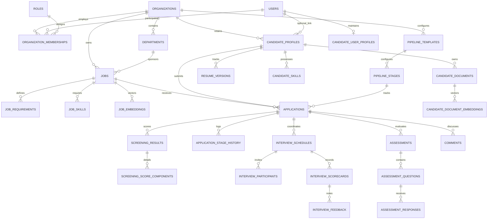
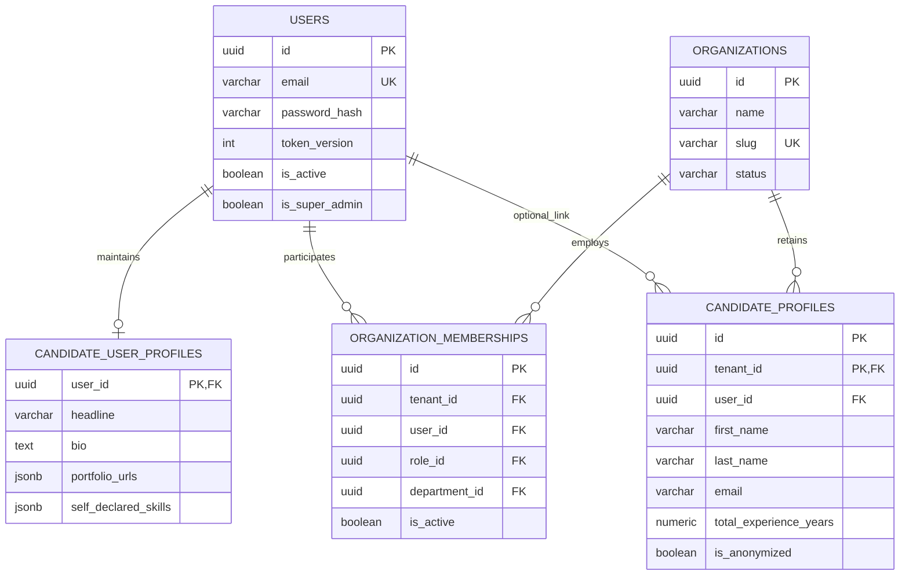
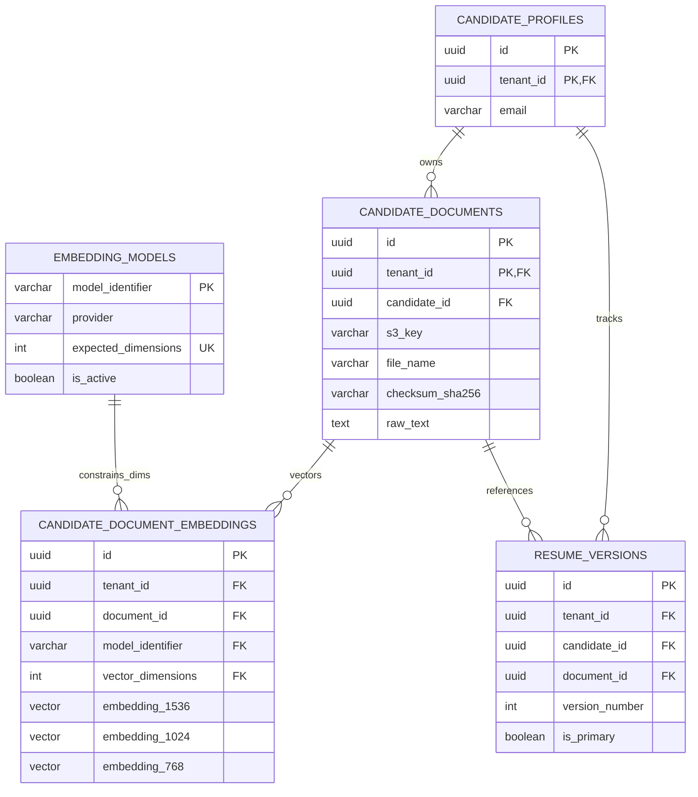
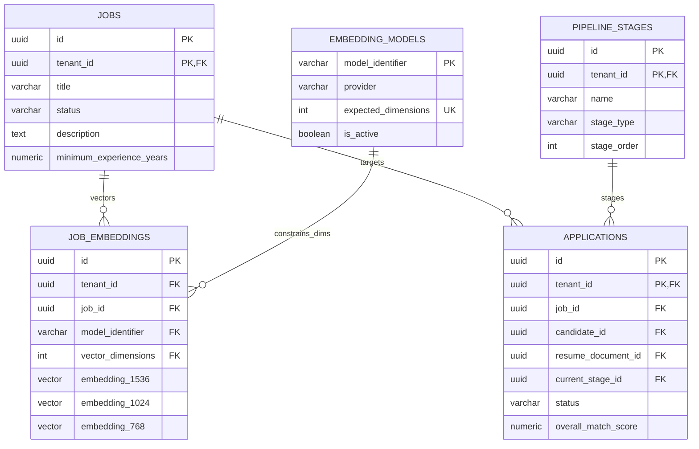
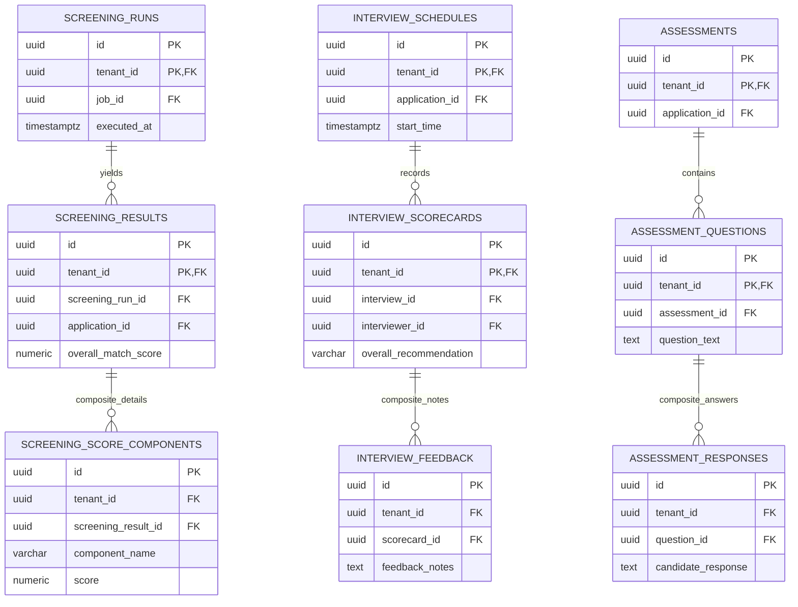

# Entity Relationship Diagrams (ERD)

This document provides visual domain-by-domain entity relationships and an overall system relationship model using Mermaid diagrams, reflecting composite tenant-safe foreign keys, typed embedding tables, and candidate global identity separation.

---

## 1. High-Level System Domain Relationship Model

---

## 2. Detailed Sub-Domain ERDs (Enforcing Composite Foreign Keys)

### Sub-Domain A: Identity, Candidate Profiles & Tenancy

---

### Sub-Domain B: Documents, Typed Embeddings & Resumes

---

### Sub-Domain C: Jobs, Typed Job Embeddings & Applications

---

### Sub-Domain D: AI Screening, Interviews & Assessments (Composite Keys Enforced)

