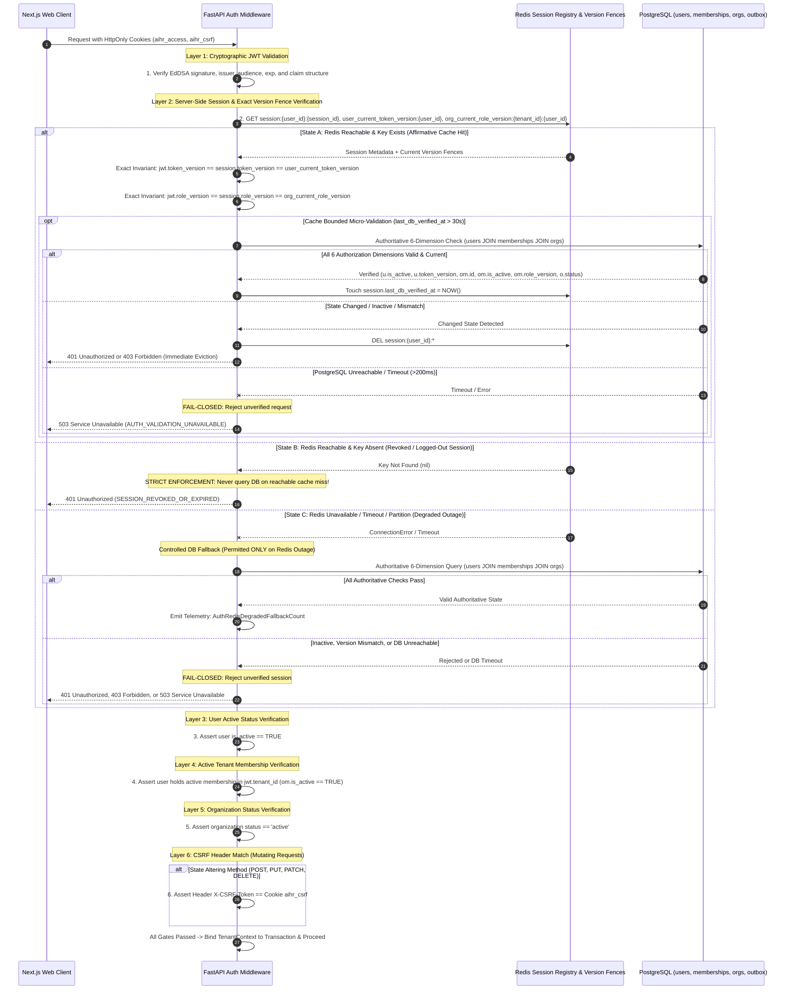

# Authentication, Session Lifecycle and Revocation Architecture

This document specifies the enterprise authentication lifecycle, multi-layer request verification, authoritative multi-dimensional session revocation mechanics, operational latency objectives (SLOs), transactional invalidation outbox, and fail-closed security behaviors.

---

## 1. Multi-Layer Request Validation Sequence

Every incoming authenticated API request must successfully pass through a **strict 6-layer validation pipeline** before any business logic executes:



---

## 2. Resolving Stale Authorization State: Transactional Outbox, Version Fences & Multi-Dimension Freshness

### A. The Core Stale-Cache Vulnerability
In a distributed SaaS architecture, user authorization depends on multiple independently mutable dimensions:
1. **User Global Status & Credentials**: Global logout, password reset, account deactivation (`users.token_version`, `users.is_active`).
2. **Organization Membership Status**: Employee offboarding, access suspension (`organization_memberships.is_active`).
3. **Role & Capability Scope**: Role demotion, custom permission modification (`organization_memberships.role_version`).
4. **Tenant Organization Status**: Non-payment suspension, compliance freeze (`organizations.status`).

If PostgreSQL successfully commits a modification to any of these dimensions but the subsequent Redis cache invalidation fails (network partition, timeout, or Redis crash/recovery from an older disk snapshot), **a naive cache comparing only client JWT claims to cached session claims would continue authorizing stale or revoked permissions**.

To eliminate this vulnerability without subjecting PostgreSQL to unsustainable query volumes on every micro-request, the platform implements a **Transactional Revocation Outbox with Exact Version Fences and Bounded 6-Dimension Micro-Validation**:

```mermaid
flowchart TD
    subgraph MutationTx ["1. Authoritative PostgreSQL Transaction"]
        Mutate["Execute Security Mutation<br/>(Global Logout / Role Demotion / Org Suspension)"]
        IncrVer["Increment users.token_version<br/>or membership.role_version"]
        SetForce["Atomically Set users.force_authoritative_check = TRUE<br/>(BEFORE COMMIT)"]
        Outbox["INSERT INTO auth_revocation_outbox<br/>(event_type, entity_id, new_version, processed_at=NULL)"]
        Commit["COMMIT TRANSACTION<br/>(Authoritative State & Force Flag Durably Persisted)"]
        
        Mutate --> IncrVer --> SetForce --> Outbox --> Commit
    end

    subgraph SyncBarrier ["2. Post-Commit Synchronous Invalidation Barrier"]
        Commit --> TryRedis{"Synchronous Redis Pipeline"}
        TryRedis -->|Success| AckRedis["1. DEL session:{user_id}:*<br/>2. SET user_current_token_version:{user_id} = new_version<br/>3. SET org_current_role_version:{tenant_id}:{user_id} = new_role_ver<br/>4. Transaction-Safe Clearing Protocol:<br/>UPDATE auth_revocation_outbox SET processed_at = NOW() WHERE id = :event_id<br/>IF zero pending outbox events remain for user THEN users.force_authoritative_check = FALSE"]
        TryRedis -->|Failure / Timeout| OutboxPending["Outbox row remains unprocessed (processed_at = NULL)<br/>force_authoritative_check REMAINS TRUE in DB"]
    end

    subgraph MultiDimDefense ["3. Multi-Dimensional Freshness & Invariant Enforcement"]
        AckRedis --> LiveReq["Incoming API Request"]
        OutboxPending --> Dispatcher["Celery Outbox Dispatcher<br/>Retries invalidation every 500ms<br/>Executes Transaction-Safe Clearing Protocol upon confirmed Redis Ack"]
        
        LiveReq --> CheckCache{"Cached Session in Redis?"}
        CheckCache -->|Found| ExactFence{"Exact Version Fence Check<br/>jwt.token_version == user_current_token_version<br/>AND jwt.role_version == org_current_role_version?"}
        CheckCache -->|Key Missing / Evicted| MicroValQuery["Execute Authoritative DB Query<br/>Check u.is_active, token_version, memberships"]
        
        ExactFence -->|Mismatch| Reject401["401 Unauthorized (VERSION_MISMATCH)"]
        ExactFence -->|Exact Match| MicroVal{"Bounded Micro-Validation<br/>NOW() - session.last_db_verified_at > 30s?"}
        
        MicroVal -->|Yes (>30s)| QueryDB["Execute Authoritative DB Query<br/>Asserts u.force_authoritative_check, versions, status"]
        MicroValQuery --> ValidateAll
        QueryDB --> ValidateAll{"Assert All Dimensions:<br/>u.force_authoritative_check == FALSE<br/>u.is_active == TRUE<br/>u.token_version == jwt.token_version<br/>om.id IS NOT NULL<br/>om.is_active == TRUE<br/>om.role_version == jwt.role_version<br/>o.status == 'active'"}
        
        ValidateAll -->|All Valid| TouchCache["Touch session.last_db_verified_at = NOW()<br/>Proceed to Request Execution"]
        ValidateAll -->|force_authoritative_check OR Inactive OR Mismatch| EvictState["Evict Stale Redis State -> 401 / 403"]
        ValidateAll -->|DB Down / Timeout| FailClosed["FAIL-CLOSED: 503 Service Unavailable"]
        
        MicroVal -->|No (<=30s)| FastPath["Proceed via Sub-Millisecond Cache"]
    end
```

### B. Multi-Level Outbox-to-User Tracking Architecture
To guarantee that user session invalidation accounts for all authorization dimensions, the `auth_revocation_outbox` table explicitly models entity scopes:

```sql
CREATE TABLE auth_revocation_outbox (
    id UUID PRIMARY KEY, -- UUIDv7
    event_type VARCHAR(50) NOT NULL, -- 'GLOBAL_LOGOUT', 'USER_SUSPENDED', 'PASSWORD_CHANGED', 'ROLE_CHANGED', 'ORG_SUSPENDED', 'MEMBERSHIP_REMOVED'
    entity_type VARCHAR(50) NOT NULL, -- 'USER', 'ORGANIZATION', 'MEMBERSHIP'
    entity_id UUID NOT NULL, -- Target primary entity ID
    user_id UUID NULL, -- Specific user affected (populated for USER and MEMBERSHIP events)
    organization_id UUID NULL, -- Specific tenant affected (populated for MEMBERSHIP and ORGANIZATION events)
    new_version INT NULL, -- Target version number (token_version or role_version)
    payload JSONB NOT NULL DEFAULT '{}'::jsonb,
    created_at TIMESTAMPTZ NOT NULL DEFAULT CURRENT_TIMESTAMP,
    processed_at TIMESTAMPTZ NULL,

    -- Referential integrity constraints (RESTRICT prevents cascading destruction of pending events)
    CONSTRAINT fk_auth_outbox_user FOREIGN KEY (user_id) REFERENCES users(id) ON DELETE RESTRICT,
    CONSTRAINT fk_auth_outbox_org FOREIGN KEY (organization_id) REFERENCES organizations(id) ON DELETE RESTRICT
);

-- Fast partial indexes for outbox dispatcher and race-free clearing lookups
CREATE INDEX idx_auth_outbox_unprocessed ON auth_revocation_outbox (created_at) WHERE processed_at IS NULL;
CREATE INDEX idx_auth_outbox_pending_user ON auth_revocation_outbox (user_id, created_at) WHERE processed_at IS NULL;
CREATE INDEX idx_auth_outbox_pending_org ON auth_revocation_outbox (organization_id, created_at) WHERE processed_at IS NULL;
CREATE INDEX idx_auth_outbox_retention_purge ON auth_revocation_outbox (processed_at) WHERE processed_at IS NOT NULL;

-- Table-level Deletion Guard: Unprocessed outbox events must NEVER be deleted under any circumstances
CREATE OR REPLACE FUNCTION public.fn_prevent_delete_pending_outbox()
RETURNS TRIGGER
LANGUAGE plpgsql
SECURITY DEFINER
SET search_path = pg_catalog, pg_temp
AS $$
BEGIN
    IF OLD.processed_at IS NULL THEN
        RAISE EXCEPTION 'CANNOT_DELETE_PENDING_OUTBOX_EVENT: Outbox event % (entity_type=%, entity_id=%) has not been acknowledged by Redis.', 
            OLD.id, OLD.entity_type, OLD.entity_id
            USING ERRCODE = 'restrict_violation';
    END IF;
    RETURN OLD;
END;
$$;

CREATE TRIGGER trg_prevent_delete_pending_outbox
BEFORE DELETE ON public.auth_revocation_outbox
FOR EACH ROW
EXECUTE FUNCTION public.fn_prevent_delete_pending_outbox();
```

#### 1. Scope-Aware Outbox Invalidation Lifecycle:
- **USER Events** (`GLOBAL_LOGOUT`, `USER_SUSPENDED`, `PASSWORD_CHANGED`):
  * Sets `users.token_version = token_version + 1` (or `is_active = FALSE`).
  * Sets `users.force_authoritative_check = TRUE`.
  * Writes outbox row: `user_id = :user_id, organization_id = NULL`.
- **MEMBERSHIP Events** (`ROLE_CHANGED`, `MEMBERSHIP_REMOVED`):
  * Sets `organization_memberships.role_version = role_version + 1`.
  * Sets `users.force_authoritative_check = TRUE` for that user.
  * Writes outbox row: `user_id = :user_id, organization_id = :tenant_id`.
- **ORGANIZATION Events** (`ORG_SUSPENDED`, `ORG_COMPLIANCE_FREEZE`):
  * Sets `organizations.status = 'suspended'`.
  * Atomically flags `users.force_authoritative_check = TRUE` across **all active members of that organization**:
    ```sql
    UPDATE public.users u
    SET force_authoritative_check = TRUE,
        updated_at = CURRENT_TIMESTAMP
    FROM public.organization_memberships om
    WHERE om.user_id = u.id 
      AND om.tenant_id = :tenant_id
      AND om.is_active = TRUE;
    ```
  * Writes outbox row: `user_id = NULL, organization_id = :tenant_id`.

#### 2. Dedicated Least-Privilege Execution Role & Concurrency Protocol:
To preserve least-privilege security boundaries and prevent deadlocks across concurrent workers:
- **Separation of Database Roles**:
  - `aihr_deletion_guard_role`: Strictly read-only (`SELECT`), `BYPASSRLS`. Owns deletion triggers (`fn_protect_user_cascade_deletion`, `fn_protect_organization_deletion`). Has zero write permissions.
  - `aihr_revocation_processor_role`: Dedicated execution role for outbox processing, `BYPASSRLS`, with minimal column grants:
    `GRANT SELECT, UPDATE (processed_at) ON public.auth_revocation_outbox;`
    `GRANT SELECT (id, force_authoritative_check, is_active), UPDATE (force_authoritative_check, updated_at) ON public.users;`
    `GRANT SELECT (id, tenant_id, user_id, is_active) ON public.organization_memberships;`
- **Stored PL/pgSQL Function**: `public.fn_process_auth_revocation_event(p_outbox_id UUID)` is owned by `aihr_revocation_processor_role`. To eliminate the critical lock-inversion deadlock with concurrent user deletion (`DELETE FROM users`) and organization deletion (`DELETE FROM organizations`), the function enforces a strict **Top-Down Lock Sequence**:
  1. **Step 1 (Snapshot Read)**: Inspects target entity coordinates (`entity_type`, `user_id`, `organization_id`) via a non-locking `SELECT`. Acquires zero tuple locks.
  2. **Step 2 (Parent Locks First)**:
     - For User/Membership events: Acquires `FOR NO KEY UPDATE` on `users` (Level 1) *before* touching the outbox row.
     - For Organization events: Acquires `FOR SHARE OF o` on `organizations` (Level 0), and acquires `FOR NO KEY UPDATE` on all affected members in deterministic ascending UUID order (`ORDER BY u.id ASC`) (Level 1).
  3. **Step 3 (Outbox Row Locked Second)**: Acquires exclusive lock on the Level 5 outbox row (`UPDATE auth_revocation_outbox SET processed_at = CURRENT_TIMESTAMP WHERE id = p_outbox_id AND processed_at IS NULL`).
  4. **Step 4 (Flag Reset)**: Evaluates pending events across all scopes and safely resets `force_authoritative_check = FALSE` on eligible users.
- **Standalone Executable SQL (for ORM / Celery Workers)**:
  - **Pattern A (Individual User / Membership Event)**:
    ```sql
    BEGIN;
    -- Step 1: Pre-lock target user FIRST in Level 1 of Global Lock Hierarchy
    SELECT 1 FROM public.users u WHERE u.id = :user_id FOR NO KEY UPDATE;

    -- Step 2: Now acquire exclusive lock on Level 5 outbox row and mark processed
    UPDATE public.auth_revocation_outbox 
    SET processed_at = CURRENT_TIMESTAMP 
    WHERE id = :outbox_event_id AND processed_at IS NULL;

    -- Step 3: Conditionally reset force_authoritative_check if 0 pending events remain
    UPDATE public.users u
    SET force_authoritative_check = FALSE, updated_at = CURRENT_TIMESTAMP
    WHERE u.id = :user_id
      AND NOT EXISTS (
          SELECT 1 
          FROM public.auth_revocation_outbox o
          WHERE o.processed_at IS NULL
            AND (
                o.user_id = :user_id
                OR 
                (o.entity_type = 'ORGANIZATION' AND o.organization_id IN (
                    SELECT om.tenant_id 
                    FROM public.organization_memberships om 
                    WHERE om.user_id = :user_id AND om.is_active = TRUE
                ))
            )
      );
    COMMIT;
    ```
  - **Pattern B (Organization Event with Ascending User Locking)**:

    > **Organization-Level Locking & Phantom Prevention Invariant**:
    > 1. Step 1 acquires `FOR UPDATE` on `organizations(id)` (Level 0). This conflicts with
    >    `FOR KEY SHARE` acquired by PostgreSQL's foreign-key engine check during concurrent
    >    `INSERT INTO organization_memberships`, physically blocking concurrent phantom inserts.
    >    It also conflicts with `FOR NO KEY UPDATE` acquired by membership mutation workflows
    >    (reactivations, deactivations, deletions), freezing the organization's membership set.
    > 2. Step 2 locks affected active member users individually in deterministic ascending UUID
    >    order without aggregates (`SELECT u.id ... ORDER BY u.id ASC FOR NO KEY UPDATE`).
    >    The client application fetches the returned rows into `:locked_user_ids`.
    > 3. After Step 3 acquires the Level 5 outbox lock, no subsequent statement may acquire
    >    any new row lock on `organizations`, `organization_memberships`, or `users`.
    > 4. Step 4 restricts its `UPDATE` strictly to `:locked_user_ids`, guaranteeing that the
    >    locked set equals the updated set without re-deriving from `organization_memberships`.

    ```sql
    BEGIN;

    -- Step 1: Acquire exclusive lock on target organization (Level 0).
    -- Blocks concurrent membership insertions (via FK FOR KEY SHARE conflict),
    -- membership mutations (via FOR NO KEY UPDATE conflict), and org deletions.
    SELECT 1 FROM public.organizations o WHERE o.id = :org_id FOR UPDATE;

    -- Step 2: Lock affected users individually in deterministic ascending UUID order (Level 1).
    -- Executed without aggregates. The client application fetches the returned list
    -- into an array parameter: :locked_user_ids.
    SELECT u.id
    FROM public.users u
    WHERE u.id IN (
        SELECT om.user_id 
        FROM public.organization_memberships om 
        WHERE om.tenant_id = :org_id AND om.is_active = TRUE
    )
    ORDER BY u.id ASC
    FOR NO KEY UPDATE;

    -- Step 3: Acquire exclusive lock on Level 5 outbox row and mark processed.
    -- Invariant: After this statement, no new row lock on organizations or users may be acquired.
    UPDATE public.auth_revocation_outbox 
    SET processed_at = CURRENT_TIMESTAMP 
    WHERE id = :outbox_event_id AND processed_at IS NULL;

    -- Step 4: Conditionally reset force_authoritative_check for EXACTLY :locked_user_ids.
    -- Update is bound strictly to :locked_user_ids with zero re-derivation from
    -- organization_memberships, ensuring locked set == updated set.
    UPDATE public.users u
    SET force_authoritative_check = FALSE, updated_at = CURRENT_TIMESTAMP
    WHERE u.id = ANY(:locked_user_ids)
      AND NOT EXISTS (
        SELECT 1 FROM public.auth_revocation_outbox o
        WHERE o.processed_at IS NULL
          AND (
              o.user_id = u.id
              OR 
              (o.entity_type = 'ORGANIZATION' AND o.organization_id IN (
                  SELECT om2.tenant_id FROM public.organization_memberships om2 
                  WHERE om2.user_id = u.id AND om2.is_active = TRUE
              ))
          )
    );

    COMMIT;
    ```

---

## 3. Corrected Version-Fence Invariants & Atomic Monotonic Redis Strategy

### A. Defect of Minimum-Version Comparisons (`>=`)
Previously, the version check asserted `jwt.token_version >= user_min_token_version`. This had two critical weaknesses:
1. **Unissued / Future Tokens**: If an attacker presented a token with an artificially inflated future version (e.g., $9999$), it would pass a `>=` check.
2. **Ambiguity on Rollbacks or Resets**: It permitted version drift and out-of-order claims.

### B. The Authoritative Exact Equality Invariants
The platform strictly mandates **Exact Equality (`==`)** across all authorization verification layers:

$$\text{User Token Invariant:} \quad \text{jwt.token\_version} == \text{session.token\_version} == \text{user\_current\_token\_version}$$

$$\text{Role & Membership Invariant:} \quad \text{jwt.role\_version} == \text{session.role\_version} == \text{org\_current\_role\_version}$$

### C. Evaluation Rules:
1. **Strict Equality Required**: An access token is valid if and only if its embedded `token_version` and `role_version` **exactly match** the authoritative current versions registered in the session cache and version fences.
2. **Stale Tokens ($< \text{Current}$)**: Rejected immediately with `401 Unauthorized (TOKEN_VERSION_STALE)`.
3. **Future / Forged Tokens ($> \text{Current}$)**: Rejected immediately with `401 Unauthorized (TOKEN_VERSION_INVALID)`.
4. **Consistency Guarantee**: JWT validation, Redis session metadata, Redis version fences, and PostgreSQL database records maintain 100% semantic alignment.

---

### D. Atomic Monotonic-Version Strategy for Redis Updates
In a distributed environment with concurrent Celery workers, duplicate message delivery, and out-of-order network transit, naive `SET key value` operations create critical race conditions. If an older event (Version 2) is processed after a newer event (Version 3), a plain `SET` would overwrite Version 3 with Version 2, accepting stale revoked tokens and rejecting legitimate current tokens.

To mathematically eliminate version regression, all Redis version fence updates and session invalidations execute via **Atomic Lua Scripts** that guarantee strict monotonicity:

#### 1. User Token Version Monotonic Script (`update_user_token_version.lua`):
```lua
-- KEYS[1]: user_current_token_version:{user_id}
-- ARGV[1]: new_version (string/int)
-- ARGV[2]: user_id (string)

local current_ver = redis.call('GET', KEYS[1])
local new_ver = tonumber(ARGV[1])

-- Invariant: Version numbers are strictly monotonically increasing
if not current_ver or tonumber(current_ver) < new_ver then
    -- 1. Advance the authoritative version fence
    redis.call('SET', KEYS[1], new_ver)
    
    -- 2. Atomically evict all active sessions for this user across all tenants/devices
    local cursor = "0"
    repeat
        local result = redis.call('SCAN', cursor, 'MATCH', 'session:' .. ARGV[2] .. ':*', 'COUNT', 100)
        cursor = result[1]
        local keys = result[2]
        if #keys > 0 then
            redis.call('DEL', unpack(keys))
        end
    until cursor == "0"
    
    return 1 -- Success: Version advanced and sessions purged
else
    -- Out-of-order delivery, duplicate retry, or older event: NO-OP
    return 0 -- Ignored: Current Redis version is already >= new_version
end
```

#### 2. Organization Role Version Monotonic Script (`update_org_role_version.lua`):
```lua
-- KEYS[1]: org_current_role_version:{tenant_id}:{user_id}
-- ARGV[1]: new_version (string/int)
-- ARGV[2]: tenant_id (string)
-- ARGV[3]: user_id (string)

local current_ver = redis.call('GET', KEYS[1])
local new_ver = tonumber(ARGV[1])

if not current_ver or tonumber(current_ver) < new_ver then
    redis.call('SET', KEYS[1], new_ver)
    
    -- Evict tenant-specific cached session for this user
    local cursor = "0"
    repeat
        local result = redis.call('SCAN', cursor, 'MATCH', 'session:' .. ARGV[3] .. ':*:' .. ARGV[2], 'COUNT', 100)
        cursor = result[1]
        local keys = result[2]
        if #keys > 0 then
            redis.call('DEL', unpack(keys))
        end
    until cursor == "0"
    
    return 1 -- Success: Role version advanced
else
    return 0 -- Ignored: Monotonic invariant preserved
end
```

#### 3. Concrete Concurrency Scenarios & Verification:

| Concurrency Scenario | Operational Timeline | Lua Script Execution & Result | Final State & Security Invariant |
|:---|:---|:---|:---|
| **Race: Concurrent Workers (Out-of-Order)** | 1. User password reset (ver 2).<br/>2. User suspended immediately after (ver 3).<br/>3. Worker B (ver 3) executes first.<br/>4. Worker A (ver 2) executes second. | - Worker B calls Lua with `new_ver = 3`. `current_ver = nil`. Sets `key = 3`, evicts sessions, returns `1`.<br/>- Worker A calls Lua with `new_ver = 2`. `current_ver = 3`. Because `3 < 2` is FALSE, script takes no action and returns `0`. | **Fence remains 3**. Stale version 2 is prevented from regressing Redis state. Client holding token ver 2 is rejected with `401 Unauthorized`. |
| **Duplicate Delivery (Worker Retries)** | 1. Worker processes Outbox event (ver 3).<br/>2. Redis Ack succeeds, but worker crashes before clearing outbox.<br/>3. Celery redelivers task. Worker retries ver 3. | - First execution: `current_ver = 2 < 3`. Updates fence to `3`, returns `1`.<br/>- Retry execution: `current_ver = 3`. `3 < 3` is FALSE. Script returns `0`. | **Fence remains 3**. Duplicate delivery is completely idempotent and safe against repeated processing. |
| **Network Packet Reordering** | Invalidation event for Version 4 arrives over network before delayed packet for Version 3. | - Packet for Ver 4 sets Redis fence to `4`.<br/>- Delayed packet for Ver 3 evaluates `4 < 3` (FALSE), returns `0`. | **Fence remains 4**. Monotonicity is mathematically guaranteed regardless of network arrival order. |

---

## 4. Multi-Dimensional Bounded Freshness: The 6-Dimension Authoritative Validation

### A. Authoritative Validation Query
Whenever the 30-second bounded micro-validation interval elapses, or when Redis is degraded (State C), or when Redis invalidation is pending, the authentication middleware executes the **Authoritative 6-Dimension Validation Query**:

```sql
SELECT 
    u.id AS user_id,
    u.token_version,
    u.is_active AS user_active,
    u.force_authoritative_check,
    om.id AS membership_id,
    om.is_active AS membership_active,
    om.role_version,
    o.status AS organization_status
FROM users u
LEFT JOIN organization_memberships om 
    ON om.user_id = u.id AND om.tenant_id = :tenant_id
LEFT JOIN organizations o 
    ON o.id = :tenant_id
WHERE u.id = :user_id;
```

*(For platform-global endpoints where `:tenant_id` is null, the query omits the `LEFT JOIN` clauses and verifies `u.token_version`, `u.is_active`, and `u.force_authoritative_check`).*

#### Invalidation Barrier Evaluation (`force_authoritative_check`):
- If `u.force_authoritative_check == TRUE`: A security mutation has committed in PostgreSQL, but Redis invalidation has not yet been confirmed by the outbox worker for all pending events. The middleware **immediately bypasses cached session data**, enforces the authoritative PostgreSQL attributes, and issues an immediate asynchronous eviction command to Redis for this user's keys.
- **Transaction-Safe Clearing Mechanism**: When an outbox event confirms Redis invalidation, the worker marks `auth_revocation_outbox.processed_at = CURRENT_TIMESTAMP`. It resets `users.force_authoritative_check = FALSE` **if and only if zero unprocessed revocation events remain for that user** (`NOT EXISTS (SELECT 1 FROM auth_revocation_outbox WHERE entity_id = :user_id AND processed_at IS NULL)`). This guarantees that a successful acknowledgement for one event never prematurely clears the flag while other events for that user remain pending.

### B. Multi-Dimension Staleness Protection Matrix:

| Authorization Dimension | Mutating Event | Authoritative DB Column | Redis Cache Key / Field | Staleness Boundary | Middleware Enforcement & Failure Behavior |
|:---|:---|:---|:---|:---:|:---|
| **1. User Global Status** | User account suspension | `users.is_active` | `session.user_status` | $\le 30\text{ s}$ | If `user_active == FALSE`: reject with `401 Unauthorized (ACCOUNT_SUSPENDED)`, evict all Redis keys. |
| **2. User Token Version** | Global logout, password reset | `users.token_version` | `session.token_version`, `user_current_token_version` | $\le 30\text{ s}$ | If `token_version != jwt.token_version`: reject with `401 Unauthorized (TOKEN_VERSION_MISMATCH)`, evict session. |
| **3. Membership Existence** | User removed from organization | `om.id IS NOT NULL` | `session.tenant_memberships` | $\le 30\text{ s}$ | If `membership_id IS NULL`: reject with `403 Forbidden (MEMBERSHIP_NOT_FOUND)`, evict tenant session. |
| **4. Membership Active Status** | Employee deactivation in org | `om.is_active` | `session.membership_active` | $\le 30\text{ s}$ | If `membership_active == FALSE`: reject with `403 Forbidden (MEMBERSHIP_DEACTIVATED)`, evict tenant session. |
| **5. Membership Role Version** | Role change, permission demotion | `om.role_version` | `session.role_version`, `org_current_role_version` | $\le 30\text{ s}$ | If `om.role_version != jwt.role_version`: reject with `401 Unauthorized (ROLE_VERSION_MISMATCH)`, triggering silent token refresh. |
| **6. Organization Status** | Tenant suspension / non-payment | `organizations.status` | `org_status:{tenant_id}` | $\le 30\text{ s}$ | If `organization_status != 'active'`: reject with `403 Forbidden (ORGANIZATION_SUSPENDED)`, set `org_status:{tenant_id} = suspended`. |

### C. Fail-Closed Posture on Validation Failure:
- If PostgreSQL is unreachable, experiences a network partition, or the query times out ($>200\text{ ms}$):
  - **The system FAILS CLOSED**.
  - Request is immediately terminated with `503 Service Unavailable (AUTH_VALIDATION_UNAVAILABLE)`.
  - Unverified credentials are never allowed to execute business logic.

---

## 5. Redis / Database Failure Decision Matrix

| Operational State | PostgreSQL State | Redis State | Middleware Action | PostgreSQL Fallback Permitted? | Resulting Status & HTTP Response | Security Guarantee |
|:---|:---|:---|:---|:---:|:---:|:---|
| **Normal Fast Path** | Healthy | Healthy (Session exists, versions match exact fence, `age <= 30s`) | Validate matching exact versions. | **NO** | `200 OK` (Proceed) | Sub-millisecond latency; cryptographically and authoritatively valid. |
| **Micro-Validation Elapsed** | Healthy | Healthy (Session exists, `age > 30s`) | Execute 6-dimension authoritative query. If all pass and `force_authoritative_check = FALSE`, touch `last_db_verified_at`. | **YES (Periodic)** | `200 OK` (Proceed) | All independently mutable dimensions verified within $\le 30\text{ s}$. |
| **Logged-Out Session** | Healthy | Reachable, Key Absent (`nil` Cache Miss) | **Strictly reject session**. Clear cookies. | **NO (FORBIDDEN)** | `401 Unauthorized` (`SESSION_REVOKED`) | Authoritative negative assertion. No DB query allowed to prevent resurrection. |
| **Stale Cache Detected** | Dimension updated in DB | Redis retains stale session or fence | Detected via exact fence mismatch or 6-dimension query. | **YES** | `401 Unauthorized` or `403 Forbidden` | Immediate eviction of stale key; token rejected; forces re-auth or refresh. |
| **Redis Invalidation Failed on Mutation** | DB transaction committed with `force_authoritative_check = TRUE`; Outbox row written | Redis write timed out during invalidation | Endpoint enqueues outbox retry. On request: 6-dimension query detects `force_authoritative_check = TRUE`, rejects cached claims, and executes DB check. | **YES (via Outbox/Micro-Val)** | Mutation returns `200 OK`; stale session rejected $\le 30\text{ s}$. | Outbox worker repairs Redis within $\le 500\text{ ms}$ average; staleness ceiling strictly bounded to $\le 30\text{ s}$. |
| **Transient Redis Outage** | PostgreSQL Healthy | Redis Unreachable / Timeout | Catch exception; fallback to 6-dimension authoritative query. | **YES (Outage Only)** | `200 OK` (Degraded mode) | Preserves enterprise availability with durable verification. Telemetry alert fired. |
| **Redis Outage with Revoked User/Tenant** | User or Org Inactive in DB | Redis Unreachable | Query DB; detect inactive status. | **YES (Outage Only)** | `401 Unauthorized` or `403 Forbidden` | Durable PostgreSQL check guarantees deactivated entities cannot exploit Redis outage. |
| **Total System Partition / DB Timeout** | PostgreSQL Timeout ($>200\text{ ms}$) | Redis Unreachable / Stale | Authoritative state cannot be verified. | N/A | `503 Service Unavailable` (`AUTH_UNAVAILABLE`) | **Strict Fail-Closed Posture**: Unverified credentials are never accepted. |
| **Redis Recovery from Old Snapshot** | PostgreSQL Healthy | Redis boots with stale AOF/RDB | Initialization script detects epoch mismatch; purges stale cache; outbox replays pending revocations. | **YES (Replay)** | Clean cache state restored before traffic routing. | Zero zombie session resurrection across server restarts. |

---

## 6. Lifecycle Specifications across Security Triggers

| Trigger Event | Database Transaction (Authoritative, Pre-Commit) | Synchronous Redis Action (Post-Commit) | Outbox & Replay Action | End-User Latency & Request Impact |
|:---|:---|:---|:---|:---|
| **Single-Session Logout** | Atomically updates session record `revoked_at = NOW()`. | `DEL session:{user_id}:{session_id}` | If Redis fails, outbox ensures eviction within $500\text{ ms}$. | Targeted session terminated immediately; other active devices unaffected. |
| **Global Logout ("All Devices")** | `UPDATE users SET token_version = token_version + 1, force_authoritative_check = TRUE WHERE id = :u`. Inserts outbox row. | 1. `DEL session:{user_id}:*`<br/>2. `SET user_current_token_version:{user_id} = new_ver`<br/>3. Transaction-safe clearing resets `force_authoritative_check = FALSE` only if zero pending events remain for user. | Outbox dispatcher verifies all session keys evicted; clears flag via transaction-safe check only after all pending user events acknowledged. | All active sessions across all browsers invalidated; cache bounded to $\le 5\text{ ms}$ (nominal) or $\le 30\text{ s}$ (degraded). |
| **Password Change & Suspension** | `UPDATE users SET is_active = FALSE, force_authoritative_check = TRUE WHERE id = :u` (or `token_version++`). Inserts outbox row. | Evicts all user session keys and updates `user_current_token_version`. Transaction-safe clearing resets `force_authoritative_check = FALSE` only if zero pending events remain. | High-priority outbox task broadcasts eviction to all Redis replicas. | Immediate termination of all in-flight API traffic; bounded fallback ensures revoked user blocked. |
| **Membership Removal** | `DELETE FROM organization_memberships WHERE user_id = :u AND tenant_id = :t; UPDATE users SET token_version = token_version + 1, force_authoritative_check = TRUE WHERE id = :u;`. | `DEL session:{user_id}:*` (scoped to tenant). Transaction-safe clearing resets `force_authoritative_check = FALSE` only if zero pending events remain. | Outbox event broadcasts membership drop. | Next request fails Layer 4 tenant membership verification immediately. |
| **Role & Permission Changes** | `UPDATE organization_memberships SET role_version = role_version + 1 WHERE ...; UPDATE users SET force_authoritative_check = TRUE WHERE id = :u;`. | Updates session key `role_version` and updates `org_current_role_version`. Transaction-safe clearing resets `force_authoritative_check = FALSE` only if zero pending events remain. | Outbox worker ensures synchronization. | Next request receives `401 ROLE_VERSION_MISMATCH`; triggers silent refresh for new token. |
| **Organization Suspension** | `UPDATE organizations SET status = 'suspended' WHERE id = :t`. Inserts outbox row. | `SET org_status:{tenant_id} 'suspended' EX 86400` | Outbox broadcasts tenant lock. | Layer 5 blocks all tenant requests with `403 Forbidden` (`ORGANIZATION_SUSPENDED`). |

---

## 7. Organization Switching Protocol

When a multi-tenant user switches between enterprise organizations:
1. Client calls `POST /api/v1/auth/switch-organization` with `{ "target_tenant_id": "uuid" }`.
2. The endpoint verifies:
   - User has an active, non-suspended record in `organization_memberships` for `target_tenant_id`.
   - The target organization has `status = 'active'`.
3. If verified, the server:
   - Updates the active tenant field and `role_version` in the Redis session registry.
   - Issues a **fresh `aihr_access` cookie** containing `tenant_id = target_tenant_id` and the user's specific role in that target organization.
   - Sets a fresh `aihr_csrf` token.
4. Old access tokens stamped with the prior tenant ID are rejected if presented against the new organization's endpoints due to RLS context mismatch and Layer 4 tenant membership validation.
