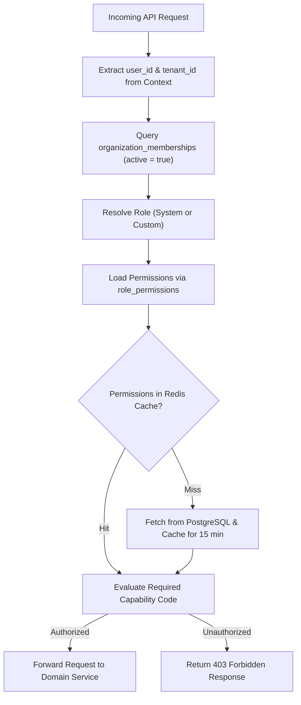

# User Roles and Permissions Framework

This document outlines the role-based access control (RBAC) governance framework, default system roles, organization-specific custom roles, and permission resolution lifecycle.

---

## 1. System Role Definitions

The platform provides five immutable **System Roles** configured at the platform level (`is_system = TRUE` in `roles` table):

### 1. `candidate`
- **Scope**: User level (Global / Direct applicant).
- **Assigned To**: Individual job applicants and candidates registering through the careers portal.
- **Key Capabilities**: Manage own profile, upload/delete own resume versions, apply to published jobs, book interview slots, download personal data, request account deletion.

### 2. `recruiter`
- **Scope**: Tenant level (`tenant_id`).
- **Assigned To**: In-house talent acquisition specialists, sourcers, and HR generalists.
- **Key Capabilities**: Create/edit job requisitions, view and search full organization candidate talent pool, trigger AI screening runs, manage pipeline Kanban boards, coordinate interview panels, generate assessments, and export reports.

### 3. `hiring_manager`
- **Scope**: Tenant level (`tenant_id`) with requisition-level scoping.
- **Assigned To**: Department leads, team leads, and technical interviewers.
- **Key Capabilities**: View candidates applied to their assigned jobs, inspect explainable screening breakdowns, participate in interview rounds, submit scorecards, and make hiring recommendations.

### 4. `org_admin`
- **Scope**: Tenant level (`tenant_id`).
- **Assigned To**: VP of HR, Chief People Officer, or IT administrators managing the corporate ATS subscription.
- **Key Capabilities**: Full administrative control over organization settings, user invitations and seat assignments, custom pipeline stage definitions, custom role creation, audit trail review, and billing management.

### 5. `platform_super_admin`
- **Scope**: Platform level (Global).
- **Assigned To**: SaaS operations and DevOps engineers.
- **Key Capabilities**: Global tenant lifecycle management (provisioning, suspension), subscription plan management, AI provider API key configuration, Celery worker monitoring, global error monitoring. **No default access to tenant resumes or candidate PII.**

---

## 2. Organization-Specific Custom Roles

Enterprise tenants on advanced subscription tiers can define **Custom Roles** (`is_system = FALSE`, `organization_id = tenant_id`):

### Examples of Common Custom Roles:
- **`recruitment_coordinator`**: Permitted to schedule interviews, send messages, and book rooms, but restricted from viewing executive compensation notes or modifying job requirements.
- **`external_interviewer` / `panelist`**: Permitted strictly to view assigned candidate resumes and submit scorecards, with candidate contact details (phone, email, address) automatically masked.
- **`compliance_auditor`**: Read-only access to organization audit logs, applicant stage histories, and EEOC / diversity reports without write permissions.

---

## 3. Permission Inheritance and Resolution Logic

---

## 4. Administrative Role Delegation Safeguards

To prevent privilege escalation within multi-tenant organizations:
1. **Ceiling Rule**: An `org_admin` can only assign permissions that their own role currently possesses. They cannot create a role with global platform administrative capabilities.
2. **Sole Admin Protection**: An organization must have at least one active `org_admin`. The system will reject any deactivation, deletion, or role change that leaves an active organization without an administrator.
3. **Audit Immutability**: All role creations, permission modifications, and user assignments emit structured events to `organization_audit_logs`.
