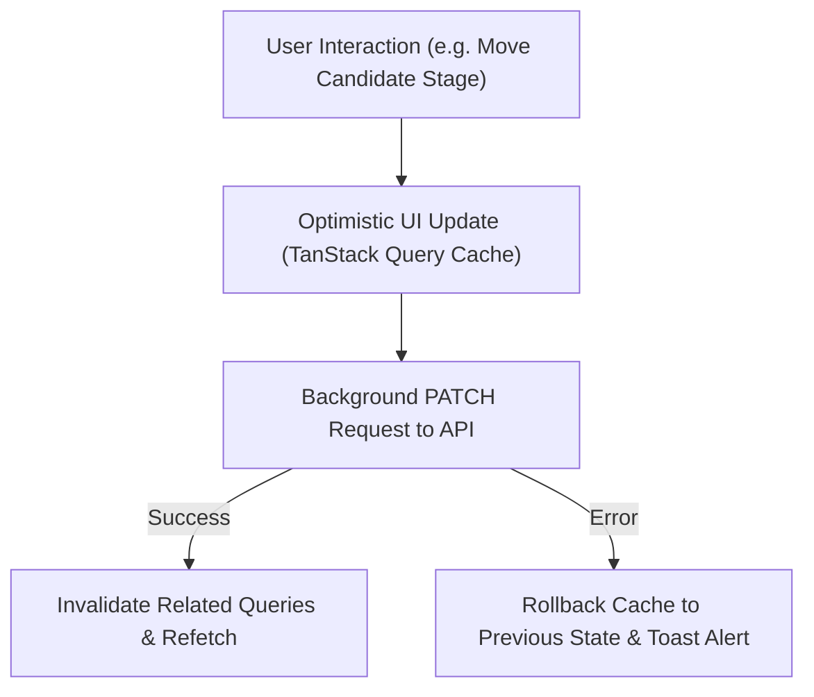

# Frontend Information Architecture

This document details the frontend route structure, component composition, state management strategy, and design systems for the Next.js 14 web application.

---

## 1. Technology Stack & Design System

- **Framework**: Next.js 14 with App Router (React Server Components + Client Components).
- **Language**: TypeScript (strict type checking enabled).
- **Styling**: Tailwind CSS with custom enterprise design tokens.
- **Component Primitives**: `shadcn/ui` (accessible Radix UI primitives).
- **Server State Management**: **TanStack Query (React Query v5)** for optimistic UI updates, cache invalidation, and background refetching.
- **Form Management**: **React Hook Form** paired with **Zod** schema validation.
- **Data Visualization**: **Recharts** for responsive, theme-aware analytics dashboards.

---

## 2. Directory & Route Organization

The Next.js application organizes routes using route groups `(...)` to provide dedicated root layouts for each portal:

```
frontend/src/app/
├── (auth)/                       # Authentication & Identity Flows
│   ├── login/page.tsx
│   ├── register/page.tsx
│   ├── verify-email/page.tsx
│   └── reset-password/page.tsx
│
├── (public)/                     # Public Careers & Job Board
│   ├── jobs/page.tsx
│   └── jobs/[jobId]/page.tsx
│
├── (candidate)/                  # Candidate Portal
│   ├── layout.tsx                # Candidate navigation bar & footer
│   ├── dashboard/page.tsx
│   ├── profile/page.tsx
│   ├── resumes/page.tsx
│   ├── applications/page.tsx
│   ├── interviews/page.tsx
│   └── privacy/page.tsx
│
├── (recruiter)/                  # Recruiter / HR Portal
│   ├── layout.tsx                # Collapsible sidebar, header, global search
│   ├── dashboard/page.tsx
│   ├── jobs/
│   │   ├── page.tsx
│   │   ├── new/page.tsx
│   │   └── [jobId]/
│   │       ├── pipeline/page.tsx # Drag-and-drop Kanban board
│   │       ├── screening/page.tsx# AI matching review studio
│   │       └── settings/page.tsx
│   ├── candidates/
│   │   ├── page.tsx              # Talent pool data table
│   │   └── [candidateId]/page.tsx# Comprehensive candidate dossier
│   ├── interviews/page.tsx
│   ├── assessments/page.tsx
│   └── reports/page.tsx
│
├── (hiring-manager)/             # Hiring Manager Portal
│   ├── layout.tsx                # Scoped navigation header
│   ├── dashboard/page.tsx
│   ├── jobs/[jobId]/shortlist/page.tsx
│   └── interviews/[interviewId]/scorecard/page.tsx
│
├── (org-admin)/                  # Organization Admin Portal
│   ├── layout.tsx                # Admin management sidebar
│   ├── settings/page.tsx
│   ├── members/page.tsx
│   ├── pipelines/page.tsx        # Visual workflow builder
│   ├── audit-logs/page.tsx
│   └── billing/page.tsx
│
└── (super-admin)/                # Platform Super Admin Portal
    ├── layout.tsx                # High-security operational layout
    ├── tenants/page.tsx
    ├── ai-providers/page.tsx
    └── system-health/page.tsx
```

---

## 3. UI State Hierarchy & UX Patterns



### UX & Interface Design Standards:
1. **Loading States**: All data-fetching views utilize skeleton loader components (`shadcn/ui Skeleton`) matching the exact geometric footprint of the incoming data, eliminating layout shifts.
2. **Empty States**: Clear, actionable empty states with illustrations and primary action buttons (e.g. *"No jobs published yet — Create your first requisition"*).
3. **Error Boundaries**: Granular React Error Boundaries wrap each domain widget. A failure in an analytics chart does not crash the candidate table or navigation bar.
4. **Responsive Accessibility (a11y)**: WCAG 2.1 Level AA compliance, semantic HTML5 elements, full keyboard navigation for the pipeline Kanban board, and screen-reader accessible ARIA labels.
