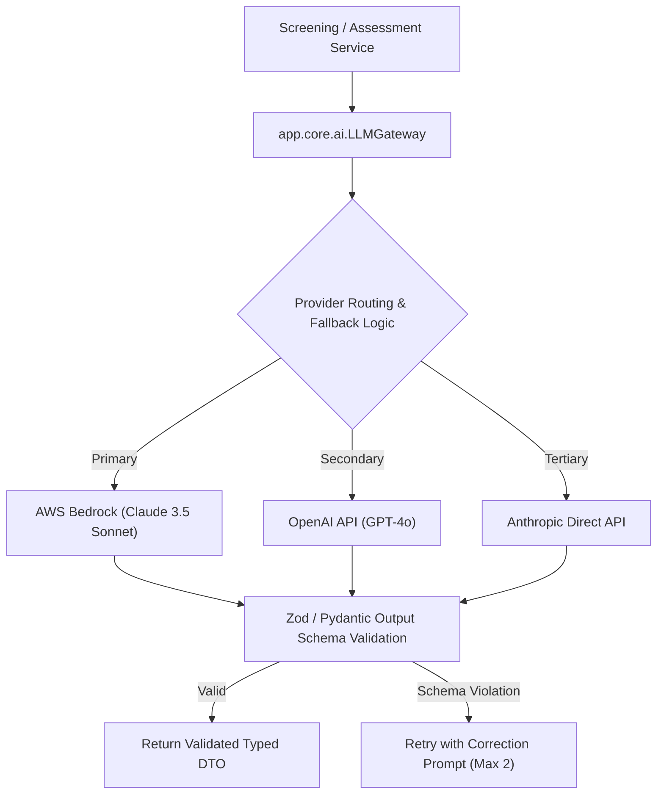

# Artificial Intelligence & Recruitment Intelligence Architecture

This document defines the responsible AI framework, candidate-job matching methodology, LLM provider abstraction, and algorithmic bias safeguards.

---

## 1. Responsible AI Principles & Human-in-the-Loop Governance

1. **Assisted Decision Support**: AI outputs (match scores, extracted skills, generated questions) are strictly decision-support aids for human recruiters. **The system will never execute autonomous hiring or rejection decisions.**
2. **Prohibition of Sensitive Attributes**: All candidate scoring formulas, vector representations, and matching algorithms are strictly prohibited from evaluating:
   - Age, date of birth, or graduation years used as age proxies.
   - Gender, gender identity, or marital status.
   - Race, ethnicity, nationality, or caste.
   - Religion or philosophical beliefs.
   - Disability or medical history.
3. **Auditability & Explainability**: Every score displayed to a recruiter or hiring manager is decomposed into constituent sub-scores with verifiable resume evidence excerpts.

---

## 2. LLM Provider Abstraction Layer

To ensure vendor independence, resiliency, and cost control, all LLM operations are routed through a provider-agnostic interface:

### Gateway Responsibilities:
1. **Prompt Versioning**: All prompt templates are stored as versioned files (e.g. `prompts/question_gen_v2.jinja2`) with tracked Git history.
2. **Structured Output Enforcement**: All completions utilize native JSON Schema / Function Calling to guarantee predictable output typing.
3. **Data Privacy Guardrails**: 
   - Resumes sent to external LLMs are sanitized to remove phone numbers, email addresses, and residential street addresses.
   - Zero-retention agreements: Zero training on customer prompts is enforced via enterprise cloud agreements (AWS Bedrock / Azure OpenAI).
4. **Token & Budget Limits**: Automatic token budgeting per tenant with hard monthly budget caps configured in `org-admin/settings`.

---

## 3. High-Dimensional Vector Embeddings (pgvector)

- **Embedding Model**: `text-embedding-3-small` (1,536 dimensions) or AWS Bedrock Titan Embeddings G1.
- **Indexing Strategy**: PostgreSQL `pgvector` with **HNSW (Hierarchical Navigable Small World)** indexing using `vector_cosine_ops`:
  - `m = 16` (connections per node)
  - `ef_construction = 64` (construction exploration depth)
- **Search Latency Target**: $\le 100\text{ ms}$ for $k\text{-NN}$ searches across $100,000$ tenant candidate documents.
