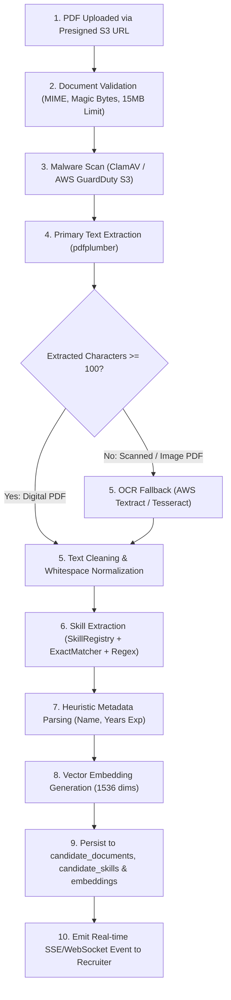

# Resume Processing Pipeline Specification

This document defines the multi-tier resume ingestion, document validation, text extraction, OCR fallback, and structured skill parsing pipeline.

---

## 1. End-to-End Processing Pipeline

---

## 2. Text Extraction & OCR Evaluation

| Feature / Criteria | Tier 1: `pdfplumber` (In-Process Worker) | Tier 2A: AWS Textract (Cloud Managed) | Tier 2B: Tesseract (Self-Hosted Worker) |
|:---|:---|:---|:---|
| **Primary Use Case** | Native digital PDFs with embedded text fonts | Scanned images, complex multi-column layouts, low-res scans | Scanned PDFs on air-gapped / cost-sensitive deployments |
| **Throughput & Speed** | Extremely fast ($< 0.5\text{ s}$ per resume) | Moderate ($2.0 - 4.5\text{ s}$ per document) | Slow ($3.0 - 8.0\text{ s}$ per document on CPU) |
| **Cost Profile** | $0.00$ marginal infrastructure cost | $\$0.0015$ per page scanned | High CPU / RAM allocation on worker containers |
| **Accuracy on Scans**| Fails on scanned/image-only PDFs | Industry-leading OCR and layout detection | Moderate; struggles with multi-column table resumes |
| **Recommendation** | **Default Tier 1 Parser** | **Recommended Tier 2 OCR Fallback** | Secondary fallback if AWS Textract is unavailable |

### Execution Logic:
1. The Celery worker runs `pdfplumber.open(bytes)`. If total extracted non-whitespace text exceeds 100 characters, Tier 1 is marked successful.
2. If total extracted text is $<100$ characters, the document is flagged as a scanned image or rasterized PDF, automatically invoking Tier 2 (AWS Textract `StartDocumentTextDetection`).

---

## 3. Duplicate Detection & Version Management

1. **Cryptographic Checksum**: The SHA-256 hash of the binary file is computed upon upload.
2. **Duplicate Ingestion Handling**:
   - If a duplicate checksum is detected within the same candidate profile: The system informs the user and links the existing document record without duplicating S3 storage.
   - If a candidate uploads an updated resume for an existing profile: The previous document's `is_current_version` flag is set to `FALSE`, and the new document is linked as the active primary version.
