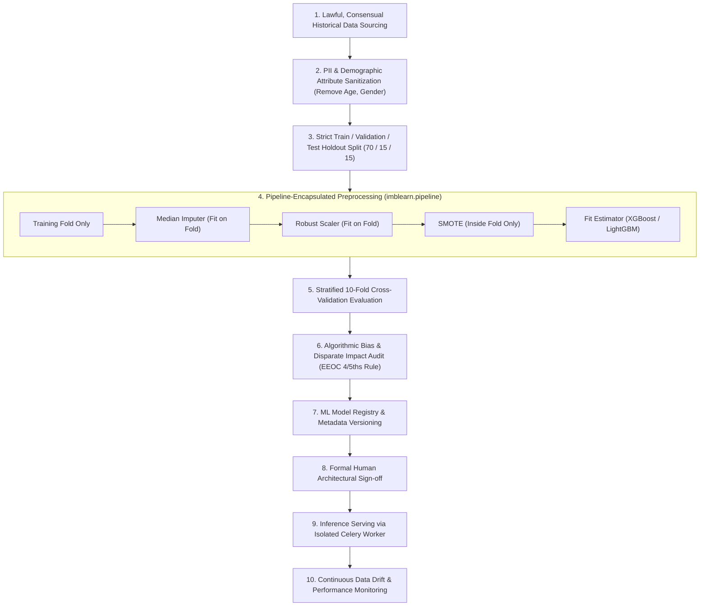

# Machine Learning Lifecycle and Governance Blueprint

This document defines the formal Machine Learning governance framework, addressing the methodological flaws identified during the Step 1 discovery audit and establishing enterprise standards for future model development.

---

## 1. Remediation of Existing Prototype ML Flaws

The Step 1 discovery audit revealed critical methodological flaws in `train_models.py` and `preprocessing.py`:
1. **Synthetic Ground Truth**: The target variable was generated via a synthetic polynomial formula with artificial boundary noise flips.
2. **Pre-Split Data Leakage**: Scalers, imputers, and variance selectors were fitted across all 1,200 rows prior to train/test partitioning.
3. **Contaminated Cross-Validation**: SMOTE over-sampling was applied before K-fold splitting, smearing synthetic samples across validation folds.
4. **Optimistic Selection Bias**: Winning models were chosen based on test-set accuracy rather than holdout cross-validation.

---

## 2. Enterprise ML Governance Lifecycle

Any future supervised machine learning model deployed within the platform must adhere to the following strict governance lifecycle:

---

## 3. Algorithmic Fairness & Bias Evaluation Protocol

Before any machine learning model is approved for production deployment, it must pass an automated **Disparate Impact Analysis**:

- **Selection Rate Ratio (Four-Fifths Rule)**: For any protected group $g$, the selection rate ratio must satisfy:
$$\text{Disparate Impact Ratio} = \frac{\text{Selection Rate}_{\text{unprotected}}}{\text{Selection Rate}_{\text{protected}}} \ge 0.80$$
- If a model exhibits a disparate impact ratio below $0.80$, it is **automatically blocked from deployment** in the Model Registry.
- Feature importance audits must verify that zero weight is attributed to latent proxy variables correlating with protected demographic categories.
