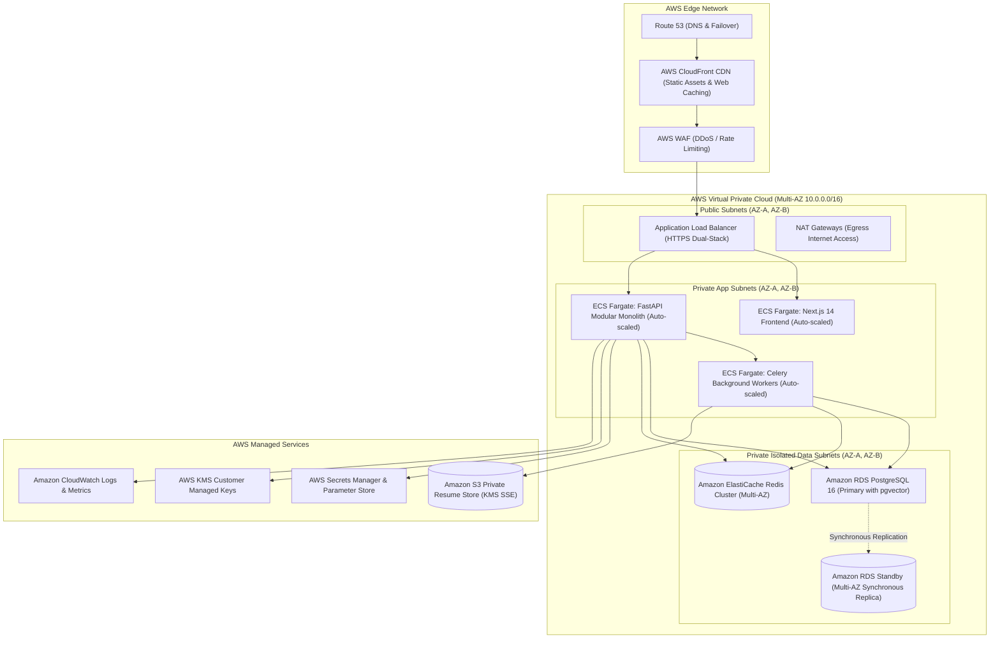

# Infrastructure and AWS Cloud Deployment Architecture

This document defines the AWS cloud architecture, container orchestration, networking topology, CI/CD pipeline, and disaster recovery strategy.

---

## 1. Cloud Infrastructure Topology

---

## 2. Environment Matrix & Scaling Strategy

| Environment | Purpose | Database Tier | Compute / Worker Tier | Redis Tier | High Availability |
|:---|:---|:---|:---|:---|:---:|
| **Development** | Feature testing, unit/integration runs | Local Docker Compose (Postgres + pgvector) | Local Docker containers | Local Redis container | Single-node |
| **Staging** | Pre-production testing, UAT, load tests | RDS `db.t4g.medium` (Single-AZ) | ECS Fargate (2 API, 2 Workers) | ElastiCache `cache.t4g.micro` | Single-AZ |
| **Production** | Live multi-tenant SaaS commercial traffic | RDS `db.r6g.xlarge` (Multi-AZ Synchronous) | ECS Fargate (4–16 API, 4–24 Workers) | ElastiCache `cache.r6g.large` Multi-AZ | **Full Multi-AZ Failover** |

### Auto-Scaling Policies:
- **FastAPI Web Service**: Scales out on ALB Target Response Time $>250\text{ ms}$ or CPU Utilization $>70\%$.
- **Celery Worker Fleet**: Scales out on Redis Queue Backlog (queue length $>100$ items) via AWS CloudWatch Metric Alarms.

---

## 3. Disaster Recovery & Backup Strategy

- **RPO (Recovery Point Objective)**: $\le 5\text{ minutes}$ via AWS RDS continuous Point-in-Time Recovery (PITR) with automated WAL archiving.
- **RTO (Recovery Time Objective)**: $\le 15\text{ minutes}$ for automated RDS Multi-AZ failover; $\le 2\text{ hours}$ for full region rebuild via Terraform / AWS CDK.
- **S3 Versioning & Replication**: S3 buckets enforce Object Versioning and Cross-Region Replication (CRR) to a secondary backup region.
