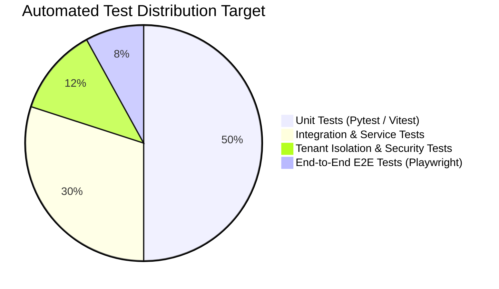

# Comprehensive Testing Strategy

This document defines the automated testing hierarchy, tenant isolation verification protocols, release gates, and code coverage requirements.

---

## 1. Testing Pyramid & Coverage Targets



### Coverage Minimums:
- **Core Domain Services (`modules/`)**: Minimum **85%** statement and branch coverage.
- **Tenant Context & RLS Policies**: Minimum **100%** coverage across all tenant-scoped tables.
- **Authentication & Security Handlers**: Minimum **95%** coverage.

---

## 2. Specialized Multi-Tenant & Security Testing Suite

### Protocol A: RLS Bypass & Leakage Assertion Tests
Every tenant-scoped table is tested with an automated cross-tenant leakage assertion:
```python
# Conceptual test structure (Pytest)
@pytest.mark.asyncio
async def test_tenant_isolation_prevents_cross_tenant_read(db_session, tenant_a, tenant_b):
    # 1. Insert application as Tenant A
    app_a = await create_application(db_session, tenant_id=tenant_a.id)
    
    # 2. Switch connection session to Tenant B context
    await set_session_tenant(db_session, tenant_b.id)
    
    # 3. Query all applications
    results = await db_session.execute(select(Application))
    retrieved = results.scalars().all()
    
    # 4. Assert Tenant A's application is completely invisible
    assert app_a.id not in [r.id for r in retrieved]
```

### Protocol B: Unauthenticated Direct Object Reference (IDOR) Checks
Every API endpoint accepting a UUID path parameter (e.g. `GET /api/v1/candidates/{id}`) is tested using an authenticated session belonging to a different tenant to verify that it returns `404 Not Found` (never `200` or `403` which leaks record existence).

---

## 3. CI/CD Release Quality Gates

Before any pull request can merge into `main` or deploy to staging/production, the following automated checks must pass in GitHub Actions:

1. **Static Analysis & Linting**: `ruff check`, `black --check`, `mypy --strict` (Python); `eslint`, `prettier` (TypeScript).
2. **Security & Vulnerability Scanning**: `pip-audit`, `npm audit`, `trivy` container scan, `bandit` AST security scan.
3. **Automated Test Matrix**: 100% pass rate across unit, integration, and tenant isolation test suites.
4. **Database Migration Verification**: Spin up a transient PostgreSQL container, apply all Alembic migrations (`alembic upgrade head`), and test downgrade (`alembic downgrade base`).
