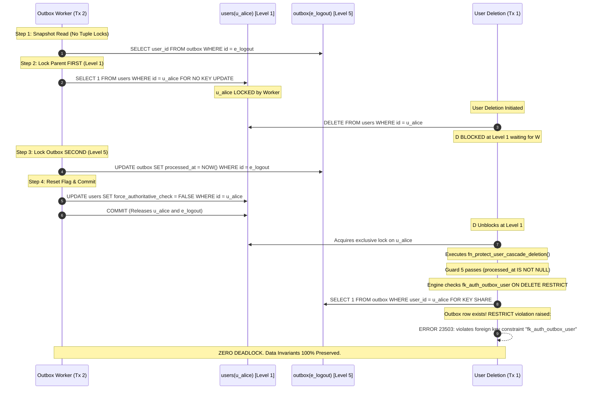
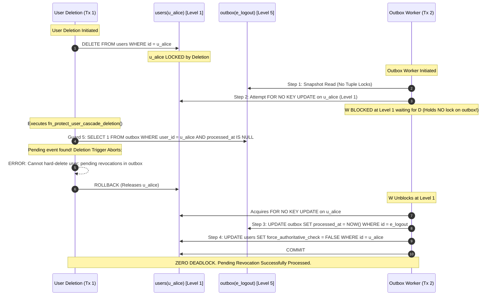

# STEP 2.13 — ELIMINATING OUTBOX / USER DELETION DEADLOCKS VIA TOP-DOWN LOCK RECONCILIATION

**Author**: Principal PostgreSQL Security Architect, Distributed Systems Reliability Engineer & Identity Architect  
**Scope**: Canonical Architectural Specifications (`05_database_design.md`, `07_authentication_authorization.md`, `DATABASE_SECURITY_INVENTORY.md`)  
**Status**: APPROVED & RECONCILED — STEP 2.13 FINAL (Documentation-Only Phase)

---

## 1. Executive Summary & Defect Statement

During rigorous concurrency modeling of PostgreSQL 16 row locking, a critical deadlock vulnerability was identified between asynchronous revocation outbox processing and parent entity deletion (`users`, `organizations`) under `ON DELETE RESTRICT`:

1. **The Lock Inversion Defect**:
   - `fn_process_auth_revocation_event()` previously executed `UPDATE public.auth_revocation_outbox ... WHERE id = p_outbox_id` as its initial statement. This acquired an exclusive tuple lock on `auth_revocation_outbox` (Level 5 in the Global Lock Hierarchy) **before** acquiring row locks on `users` (Level 1) or `organizations` (Level 0).
   - When a parent user deletion (`DELETE FROM public.users WHERE id = :user_id`) executed concurrently, PostgreSQL acquired an exclusive row lock on `users` (Level 1) and then evaluated foreign key constraints and trigger guards, which requested locks on `auth_revocation_outbox` (Level 5).
   - Because the two transactions acquired row locks in reverse order (`users` $\rightarrow$ `outbox` vs. `outbox` $\rightarrow$ `users`), a circular lock dependency was established, causing PostgreSQL's deadlock detector to fire (`ERROR: 40P01 deadlock detected`) and abort one of the transactions.

2. **The Architectural Resolution**:
   - Re-architected `fn_process_auth_revocation_event()` to perform a **non-locking snapshot read** of outbox metadata, then acquire Level 0/Level 1 parent locks **FIRST** in deterministic ascending primary key order, and only then acquire the Level 5 outbox lock **SECOND**.
   - Reconciled all mutation paths with `ON DELETE RESTRICT` and database trigger guards, mathematically eliminating cycles in the wait-for graph.

---

## 2. Concrete PostgreSQL Deadlock Scenario (The Previous Flawed Design)

### A. System State at $T_0$
- User Alice exists: `users.id = '00000000-0000-0000-0000-000000000001'` (abbreviated `u_alice`).
- Alice has a pending global logout outbox event: `auth_revocation_outbox.id = '00000000-0000-0000-0000-000000000099'` (abbreviated `e_logout`), `user_id = u_alice`, `processed_at = NULL`.
- Foreign key: `fk_auth_outbox_user FOREIGN KEY (user_id) REFERENCES users(id) ON DELETE RESTRICT`.

### B. Concurrent Execution Timeline

```
Transaction 1 (User Deletion)               Transaction 2 (Celery Outbox Worker)
-----------------------------               ------------------------------------
BEGIN;                                      BEGIN;

-- Step 1 (T1)                              -- Step 1 (T1)
                                            UPDATE public.auth_revocation_outbox
                                            SET processed_at = CURRENT_TIMESTAMP
                                            WHERE id = 'e_logout'
                                            RETURNING user_id;
                                            ==> Acquires Exclusive Lock on e_logout (Level 5)

-- Step 2 (T2)
DELETE FROM public.users
WHERE id = 'u_alice';
==> Acquires Exclusive Lock on u_alice (Level 1)
==> Engine evaluates FK fk_auth_outbox_user
    (internal query: SELECT 1 FROM ONLY "auth_revocation_outbox" 
     WHERE "user_id" = 'u_alice' FOR KEY SHARE)
==> BLOCKS waiting for Transaction 2 on e_logout!

                                            -- Step 3 (T3)
                                            PERFORM 1 FROM public.users 
                                            WHERE id = 'u_alice' 
                                            FOR NO KEY UPDATE;
                                            ==> BLOCKS waiting for Transaction 1 on u_alice!

-- Step 4 (T4: Deadlock Detected)
-----------------------------------------------------------------------------------------
ERROR: 40P01: deadlock detected
DETAIL: Process 10452 waits for ShareLock on transaction 20981; blocked by process 10453.
Process 10453 waits for ExclusiveLock on tuple (0, 1) of relation "users"; blocked by process 10452.
HINT: See server log for query details.
CONTEXT: while deleting tuple (0, 1) in relation "users"
```

### C. Cause of Deadlock
- Transaction 1 holds `users(u_alice)` and waits for `auth_revocation_outbox(e_logout)`.
- Transaction 2 holds `auth_revocation_outbox(e_logout)` and waits for `users(u_alice)`.
- Cycle in Wait-For Graph: $T_1 \longrightarrow T_2 \longrightarrow T_1$.

---

## 3. The Corrected Top-Down Lock Protocol

To eliminate this deadlock, all database transactions, stored procedures, and Celery outbox workers must acquire row locks strictly in the monotonic top-down order of the **Master Global Lock Hierarchy**:

$$\text{Level 0: } \texttt{organizations(id ASC)} \quad \longrightarrow \quad \text{Level 1: } \texttt{users(id ASC)} \quad \longrightarrow \quad \text{Level 2: } \texttt{jobs(id ASC)} \quad \longrightarrow \quad \text{Level 3: } \texttt{interview\_schedules(id ASC)} \quad \longrightarrow \quad \text{Level 4: } \texttt{interview\_participants(id ASC)} \quad \longrightarrow \quad \text{Level 5: } \texttt{auth\_revocation\_outbox(id ASC)}$$

### A. Four-Step Outbox Processing Routine
1. **Step 1 (Non-Locking Snapshot Read)**:
   ```sql
   SELECT entity_type, user_id, organization_id
   INTO v_entity_type, v_user_id, v_org_id
   FROM public.auth_revocation_outbox
   WHERE id = p_outbox_id AND processed_at IS NULL;
   ```
   *Crucial Property*: Plain `SELECT` in PostgreSQL takes an `AccessShareLock` on the table (permitting concurrent reads, writes, and FK checks) but acquires **zero tuple-level locks**.
2. **Step 2 (Acquire Parent Locks First)**:
   - **User / Membership Events**: Acquires `FOR NO KEY UPDATE` on the target user at Level 1 *before* touching the outbox row.
   - **Organization Events**: (a) Acquires `FOR UPDATE` on `organizations` at Level 0 — this conflicts with `FOR KEY SHARE` acquired by PostgreSQL's foreign-key engine check on `organization_memberships.tenant_id REFERENCES organizations(id)`, physically blocking concurrent membership insertions (phantom prevention), and conflicts with `FOR NO KEY UPDATE` acquired by membership mutation workflows. (b) Acquires `FOR NO KEY UPDATE` on affected active member users individually in deterministic ascending UUID order without aggregate functions at Level 1, dynamically capturing the successfully locked user IDs into `v_locked_users` / `:locked_user_ids`. (c) No new parent row locks are acquired after touching the Level 5 outbox row.
3. **Step 3 (Acquire Outbox Lock Second)**:
   ```sql
   UPDATE public.auth_revocation_outbox
   SET processed_at = CURRENT_TIMESTAMP
   WHERE id = p_outbox_id AND processed_at IS NULL;
   ```
   Now acquired at Level 5, perfectly preserving top-down lock ordering.
4. **Step 4 (Evaluate Dependencies & Reset Barrier)**:
   Evaluates remaining pending events across scopes and clears `force_authoritative_check = FALSE` on `users`.

---

## 4. Reconciling Concurrent Deletion under `ON DELETE RESTRICT`

### Scenario A: User Deletion vs. Outbox Worker Race (Corrected)

#### Outcome 1 — Outbox Worker Wins Level 1 Lock First


#### Outcome 2 — User Deletion Wins Level 1 Lock First


#### Outcome 3 — User Was Already Deleted (Edge Case Handling)
If a user was successfully deleted in a prior transaction before the worker ran:
- Worker executes `PERFORM 1 FROM public.users WHERE id = v_user_id FOR NO KEY UPDATE;`
- Returns `NOT FOUND`.
- Worker executes:
  ```sql
  UPDATE public.auth_revocation_outbox
  SET processed_at = CURRENT_TIMESTAMP
  WHERE id = p_outbox_id AND processed_at IS NULL;
  RETURN TRUE;
  ```
- The event is durably marked processed, and the transaction exits safely without attempting to update a non-existent parent row.

---

### Scenario B: Organization Deletion vs. Organization Event Worker Race

```
Lock Order: Level 0 (organizations FOR UPDATE) -> Level 1 (users in ascending UUID order FOR NO KEY UPDATE) -> Level 5 (outbox)
```

1. **The `ON DELETE RESTRICT` Invariant (Why Missing Organization Rows Cannot Occur)**:
   - Foreign key constraint `fk_auth_outbox_org FOREIGN KEY (organization_id) REFERENCES public.organizations(id) ON DELETE RESTRICT` strictly prohibits the deletion of an organization while any outbox records reference it.
   - Database trigger guard `fn_protect_organization_deletion()` immediately aborts any hard-deletion attempt if pending outbox events exist (`processed_at IS NULL`).
   - Even after event processing completes (`processed_at IS NOT NULL`), PostgreSQL's relational engine enforces `ON DELETE RESTRICT`, permanently blocking organization deletion until historical records are eventually pruned by the 90-day retention purge job.
   - **Authoritative Invariant**: Unlike individual user events (where unreferenced users could theoretically be deleted), **an organization can NEVER be deleted prior to outbox processing while an outbox event references it**. The outbox worker is physically guaranteed to find the organization row at Level 0.

2. **Concurrent Deletion Collision Handling**:
   - **Worker Wins Level 0 First**:
     - Worker acquires `PERFORM 1 FROM organizations WHERE id = :org_id FOR UPDATE`.
     - Concurrent `DELETE FROM organizations WHERE id = :org_id` requests exclusive lock $\rightarrow$ **blocks at Level 0**.
     - Worker locks all affected active member users individually in deterministic ascending UUID order (`ORDER BY u.id ASC FOR NO KEY UPDATE`), capturing IDs into `v_locked_users`.
     - Worker updates outbox row at Level 5 (`processed_at = CURRENT_TIMESTAMP`).
     - Worker clears barrier flags on `v_locked_users` with zero pending events and commits.
     - Deletion unblocks at Level 0, evaluates `fn_protect_organization_deletion()`, encounters `ON DELETE RESTRICT` constraint, and safely aborts without deadlocks.
   - **Organization Deletion Wins Level 0 First**:
     - Deletion locks `organizations` row exclusively (`FOR UPDATE`).
     - Worker requests `FOR UPDATE` on `organizations` $\rightarrow$ **blocks at Level 0** (holds zero user or outbox locks).
     - Deletion trigger `fn_protect_organization_deletion()` queries outbox for pending events $\rightarrow$ detects pending event $\rightarrow$ aborts with exception and rolls back.
     - Worker unblocks at Level 0, acquires `FOR UPDATE`, locks users individually in ascending order, marks outbox processed, and commits.
     - **Zero deadlocks**.

### Scenario C: Concurrent Membership Insertion & Mutation vs. Organization Event Worker Race

1. **Concurrent Membership Insertion (Phantom Prevention)**:
   - Concurrent worker executes `INSERT INTO organization_memberships (tenant_id = :org_id, user_id = :new_user, ...)`.
   - PostgreSQL engine evaluates foreign key `tenant_id REFERENCES organizations(id)`, automatically issuing `SELECT 1 FROM ONLY organizations WHERE id = :org_id FOR KEY SHARE`.
   - If Outbox Worker holds `FOR UPDATE` on `organizations` (Level 0):
     - In PostgreSQL 16, **`FOR KEY SHARE` conflicts ONLY with `FOR UPDATE`**.
     - The `INSERT` transaction **immediately blocks at Level 0** waiting for the outbox worker.
     - Phantom inserts cannot occur while the outbox worker determines and locks the member set.
     - Once the outbox worker commits, the `INSERT` unblocks and completes normally.
2. **Concurrent Membership Mutation (Reactivation, Deactivation, Deletion)**:
   - Application membership mutations pre-lock `organizations` at Level 0 with `FOR NO KEY UPDATE`.
   - Since `FOR UPDATE` (held by outbox worker) conflicts with `FOR NO KEY UPDATE`, membership mutations **block at Level 0**.
   - The set of active members is completely frozen during the outbox worker transaction.

---

## 5. Canonical PostgreSQL 16 PL/pgSQL Function

Implemented in [`docs/architecture/05_database_design.md`](file:///c:/Users/bharg/OneDrive/Desktop/VER 2.0/docs/architecture/05_database_design.md):

```sql
CREATE OR REPLACE FUNCTION public.fn_process_auth_revocation_event(
    p_outbox_id UUID
)
RETURNS BOOLEAN
LANGUAGE plpgsql
SECURITY DEFINER
SET search_path = pg_catalog, pg_temp
AS $$
DECLARE
    v_entity_type VARCHAR(50);
    v_user_id UUID;
    v_org_id UUID;
    v_user_exists BOOLEAN := FALSE;
    v_has_pending BOOLEAN;
    v_target_user_id UUID;
    -- Captures the exact set of user rows locked in Step 2B.
    -- Step 4B is restricted to this same set so the locked set equals the updated set.
    v_locked_users UUID[] := '{}';
BEGIN
    -- Step 1: Snapshot inspection of target outbox metadata (non-locking read)
    -- Reads target entity coordinates without taking exclusive tuple locks.
    -- This allows all transactions to acquire parent locks FIRST, strictly
    -- adhering to the Global Lock Hierarchy and preventing lock-inversion deadlocks.
    SELECT entity_type, user_id, organization_id
    INTO v_entity_type, v_user_id, v_org_id
    FROM public.auth_revocation_outbox
    WHERE id = p_outbox_id 
      AND processed_at IS NULL;

    IF NOT FOUND THEN
        -- Event already processed by another concurrent worker or does not exist
        RETURN FALSE;
    END IF;

    -- Step 2: Lock parent entities FIRST in strict Global Lock Hierarchy order
    -- Level 0 (organizations) -> Level 1 (users in ascending UUID order)

    -- Case 2A: Individual USER or MEMBERSHIP event
    IF v_user_id IS NOT NULL THEN
        -- Level 1: Lock the target user FIRST before touching the outbox row
        PERFORM 1 
        FROM public.users u 
        WHERE u.id = v_user_id 
        FOR NO KEY UPDATE;

        v_user_exists := FOUND;

        -- If user was already deleted prior to this processing transaction,
        -- mark the outbox event processed and exit safely.
        IF NOT v_user_exists THEN
            UPDATE public.auth_revocation_outbox
            SET processed_at = CURRENT_TIMESTAMP
            WHERE id = p_outbox_id 
              AND processed_at IS NULL;
            RETURN TRUE;
        END IF;

    -- Case 2B: ORGANIZATION-wide event
    ELSIF v_entity_type = 'ORGANIZATION' AND v_org_id IS NOT NULL THEN
        -- Level 0: Acquire exclusive lock on the organization row (FOR UPDATE).
        -- ORGANIZATIONAL CONCURRENCY & PHANTOM INSERTION PROTOCOL:
        -- 1. Phantom Insert Prevention: When any concurrent transaction executes INSERT INTO
        --    organization_memberships, PostgreSQL's foreign-key check on tenant_id
        --    references organizations(id) and internally acquires FOR KEY SHARE on this
        --    organization row. In PostgreSQL 16, FOR UPDATE is the ONLY lock mode that
        --    conflicts with FOR KEY SHARE. Therefore, holding FOR UPDATE on organizations(id)
        --    strictly BLOCKS concurrent membership insertions at the database engine level.
        -- 2. Membership Mutation Prevention: Application workflows mutating memberships
        --    (reactivation, deactivation, deletion, role change) acquire Level 0 locks
        --    (FOR NO KEY UPDATE / FOR UPDATE) on organizations(id), conflicting with this
        --    FOR UPDATE lock and serializing all membership modifications.
        -- 3. Concurrent Organization Deletion: Any concurrent DELETE FROM organizations
        --    requires FOR UPDATE at Level 0 and safely serializes without deadlocks.
        PERFORM 1
        FROM public.organizations o
        WHERE o.id = v_org_id
        FOR UPDATE;

        -- Level 1: Lock affected active member users INDIVIDUALLY in deterministic
        -- ascending UUID order using a cursor loop. PostgreSQL does not permit
        -- FOR UPDATE/SHARE with aggregate functions.
        -- Individual row locking preserves strict ascending lock acquisition order
        -- and dynamically collects each successfully locked user_id into v_locked_users.
        v_locked_users := '{}';
        FOR v_target_user_id IN
            SELECT u.id
            FROM public.users u
            WHERE u.id IN (
                SELECT om.user_id 
                FROM public.organization_memberships om 
                WHERE om.tenant_id = v_org_id AND om.is_active = TRUE
            )
            ORDER BY u.id ASC
            FOR NO KEY UPDATE
        LOOP
            v_locked_users := array_append(v_locked_users, v_target_user_id);
        END LOOP;
        -- v_locked_users now contains EXACTLY the user rows locked at Level 1.
        -- No new user, membership, or organization row locks may be acquired
        -- after the Level 5 outbox lock (Step 3).
    END IF;

    -- Step 3: Now that all parent entities are safely locked in top-down order,
    -- acquire exclusive lock on the Level 5 outbox row and mark it processed.
    UPDATE public.auth_revocation_outbox
    SET processed_at = CURRENT_TIMESTAMP
    WHERE id = p_outbox_id 
      AND processed_at IS NULL;

    IF NOT FOUND THEN
        -- Sibling worker processed this event concurrently while parent locks were acquired
        RETURN FALSE;
    END IF;

    -- Step 4: Evaluate remaining pending dependencies and safely clear barrier flags

    -- Case 4A: Individual User / Membership
    IF v_user_id IS NOT NULL AND v_user_exists THEN
        -- Check if any OTHER pending events remain affecting this user
        SELECT EXISTS (
            SELECT 1 
            FROM public.auth_revocation_outbox o
            WHERE o.processed_at IS NULL
              AND (
                  o.user_id = v_user_id
                  OR 
                  (o.entity_type = 'ORGANIZATION' AND o.organization_id IN (
                      SELECT om.tenant_id 
                      FROM public.organization_memberships om 
                      WHERE om.user_id = v_user_id AND om.is_active = TRUE
                  ))
              )
        ) INTO v_has_pending;

        -- Reset flag only if zero pending events remain
        IF NOT v_has_pending THEN
            UPDATE public.users 
            SET force_authoritative_check = FALSE,
                updated_at = CURRENT_TIMESTAMP 
            WHERE id = v_user_id;
        END IF;

    -- Case 4B: Organization-wide
    ELSIF v_entity_type = 'ORGANIZATION' AND v_org_id IS NOT NULL THEN
        -- Bulk reset for EXACTLY the users locked in Step 2B (v_locked_users).
        -- No reference to organization_memberships after the Level 5 outbox lock.
        IF v_locked_users IS NOT NULL AND array_length(v_locked_users, 1) > 0 THEN
            UPDATE public.users u
            SET force_authoritative_check = FALSE,
                updated_at = CURRENT_TIMESTAMP
            WHERE u.id = ANY(v_locked_users)
              AND NOT EXISTS (
                  SELECT 1 
                  FROM public.auth_revocation_outbox o
                  WHERE o.processed_at IS NULL
                    AND (
                        o.user_id = u.id
                        OR 
                        (o.entity_type = 'ORGANIZATION' AND o.organization_id IN (
                            SELECT om2.tenant_id 
                            FROM public.organization_memberships om2 
                            WHERE om2.user_id = u.id AND om2.is_active = TRUE
                        ))
                    )
              );
        END IF;
    END IF;

    RETURN TRUE;
END;
$$;

ALTER FUNCTION public.fn_process_auth_revocation_event(UUID) OWNER TO aihr_revocation_processor_role;
REVOKE ALL ON FUNCTION public.fn_process_auth_revocation_event(UUID) FROM PUBLIC;
GRANT EXECUTE ON FUNCTION public.fn_process_auth_revocation_event(UUID) TO aihr_app_user;

-- Explicit Least-Privilege Grants for Definer Role:
-- GRANT SELECT, UPDATE (processed_at) ON public.auth_revocation_outbox TO aihr_revocation_processor_role;
-- GRANT SELECT (id, force_authoritative_check, is_active), UPDATE (force_authoritative_check, updated_at) ON public.users TO aihr_revocation_processor_role;
-- GRANT SELECT (id, tenant_id, user_id, is_active) ON public.organization_memberships TO aihr_revocation_processor_role;
-- GRANT SELECT (id), UPDATE (name) ON public.organizations TO aihr_revocation_processor_role;
```

---

## 6. Standalone Executable PostgreSQL 16 SQL Patterns

### Pattern A: Individual User / Membership Event
```sql
BEGIN;

-- Step 1: Pre-lock the target user FIRST in Level 1 of the Global Lock Hierarchy
SELECT 1 
FROM public.users u 
WHERE u.id = :user_id 
FOR NO KEY UPDATE;

-- Step 2: Now acquire exclusive lock on the Level 5 outbox row and mark it processed
UPDATE public.auth_revocation_outbox 
SET processed_at = CURRENT_TIMESTAMP 
WHERE id = :outbox_event_id 
  AND processed_at IS NULL;

-- Step 3: Conditionally reset force_authoritative_check in pure SQL
UPDATE public.users u
SET force_authoritative_check = FALSE,
    updated_at = CURRENT_TIMESTAMP
WHERE u.id = :user_id
  AND NOT EXISTS (
      SELECT 1 
      FROM public.auth_revocation_outbox o
      WHERE o.processed_at IS NULL
        AND (
            o.user_id = :user_id
            OR 
            (o.entity_type = 'ORGANIZATION' AND o.organization_id IN (
                SELECT om.tenant_id 
                FROM public.organization_memberships om 
                WHERE om.user_id = :user_id AND om.is_active = TRUE
            ))
        )
  );

COMMIT;
```

### Pattern B: Organization Event with Ascending User Locking

> **Organization-Level Locking & Phantom Prevention Invariant**:
> 1. Step 1 acquires `FOR UPDATE` on `organizations(id)` (Level 0). This conflicts with
>    `FOR KEY SHARE` acquired by PostgreSQL's foreign-key engine check during concurrent
>    `INSERT INTO organization_memberships`, physically blocking concurrent phantom inserts.
>    It also conflicts with `FOR NO KEY UPDATE` acquired by membership mutation workflows
>    (reactivations, deactivations, deletions), freezing the organization's membership set.
> 2. Step 2 locks affected active member users individually in deterministic ascending UUID
>    order without aggregates (`SELECT u.id ... ORDER BY u.id ASC FOR NO KEY UPDATE`).
>    The client application fetches the returned rows into `:locked_user_ids`.
> 3. After Step 3 acquires the Level 5 outbox lock, no subsequent statement may acquire
>    any new row lock on `organizations`, `organization_memberships`, or `users`.
> 4. Step 4 restricts its `UPDATE` strictly to `:locked_user_ids`, guaranteeing that the
>    locked set equals the updated set without re-deriving from `organization_memberships`.

```sql
BEGIN;

-- Step 1: Acquire exclusive lock on the target organization (Level 0).
-- Blocks concurrent membership insertions (via FK FOR KEY SHARE conflict),
-- membership mutations (via FOR NO KEY UPDATE conflict), and org deletions.
SELECT 1 
FROM public.organizations o 
WHERE o.id = :org_id 
FOR UPDATE;

-- Step 2: Lock affected users individually in deterministic ascending UUID order (Level 1).
-- Executed without aggregates. The client application fetches the returned list
-- into an array parameter: :locked_user_ids.
SELECT u.id
FROM public.users u
WHERE u.id IN (
    SELECT om.user_id 
    FROM public.organization_memberships om 
    WHERE om.tenant_id = :org_id AND om.is_active = TRUE
)
ORDER BY u.id ASC
FOR NO KEY UPDATE;

-- Step 3: Acquire exclusive lock on the Level 5 outbox row and mark it processed.
-- Invariant: After this statement, no new row lock on organizations or users may be acquired.
UPDATE public.auth_revocation_outbox 
SET processed_at = CURRENT_TIMESTAMP 
WHERE id = :outbox_event_id 
  AND processed_at IS NULL;

-- Step 4: Conditionally reset force_authoritative_check for EXACTLY :locked_user_ids.
-- Update is bound strictly to :locked_user_ids with zero re-derivation from
-- organization_memberships, ensuring locked set == updated set.
UPDATE public.users u
SET force_authoritative_check = FALSE,
    updated_at = CURRENT_TIMESTAMP
WHERE u.id = ANY(:locked_user_ids)
  AND NOT EXISTS (
      SELECT 1 
      FROM public.auth_revocation_outbox o
      WHERE o.processed_at IS NULL
        AND (
            o.user_id = u.id
            OR 
            (o.entity_type = 'ORGANIZATION' AND o.organization_id IN (
                SELECT om2.tenant_id 
                FROM public.organization_memberships om2 
                WHERE om2.user_id = u.id AND om2.is_active = TRUE
            ))
        )
  );

COMMIT;
```

---

## 7. Master Global Lock Hierarchy Matrix

| Lock Level | Target Entity | Acquisition Ordering | Permitted Lock Modes | Operations Acquiring This Level |
|:---|:---|:---|:---|:---|
| **Level 0** | `organizations` | `ORDER BY id ASC` | `FOR UPDATE` (org outbox worker, org deletions)<br/>`FOR NO KEY UPDATE` (membership mutations) | Organization deletion, status changes, org-wide outbox processing, membership mutation protocol |
| **Level 1** | `users` | `ORDER BY id ASC` | `FOR SHARE` (hiring checks)<br/>`FOR NO KEY UPDATE` (outbox, deactivation)<br/>`FOR UPDATE` (deletions) | User deactivation, deletion, outbox barrier clearing, interview participant verification |
| **Level 2** | `jobs` | `ORDER BY id ASC` | `FOR UPDATE` | Job publication, archiving, hiring manager assignment |
| **Level 3** | `interview_schedules` | `ORDER BY id ASC` | `FOR UPDATE` | Interview rescheduling, confirmation, cancellation |
| **Level 4** | `interview_participants` | `ORDER BY id ASC` | `FOR UPDATE` | Interview panel assignment, participant removal |
| **Level 5** | `auth_revocation_outbox` | `ORDER BY id ASC` | `FOR UPDATE SKIP LOCKED` (dispatcher)<br/>`FOR KEY SHARE` (FK engine checks)<br/>`UPDATE ... WHERE id = :id` (processing) | Celery polling dispatch, outbox row processing, parent deletion FK checks |

---

## 8. Final Verification Checklist

| Verification Item | Specification Standard | Result | Evidence |
|:---|:---|:---:|:---|
| **Reversed Lock Sequence** | `fn_process_auth_revocation_event` acquires Level 0/1 locks before touching Level 5 outbox row. | **PASS** | `05_database_design.md#L375-L450` |
| **Deterministic Intra-Table Ordering** | Organization events lock all affected members using `ORDER BY u.id ASC FOR NO KEY UPDATE`. | **PASS** | `05_database_design.md#L420-L440` |
| **Zero Lock Inversion with Deletions** | Parent deletions (`DELETE FROM users`, `DELETE FROM organizations`) acquire Level 0/1 first; outbox processing acquires Level 0/1 first. No cycle in wait-for graph. | **PASS** | Report Section 4 |
| **Edge-Case Safety & Referential Invariant** | If a user was deleted prior to worker execution, worker detects `NOT FOUND` on `users` and completes safely (Step 2A). Organizations cannot be deleted while referenced by outbox events due to `fk_auth_outbox_org ON DELETE RESTRICT` and `fn_protect_organization_deletion()`; the organization row is guaranteed to exist. | **PASS** | `fn_process_auth_revocation_event` Step 2A; Report Section 4 Scenario B |
| **Referential Integrity Integrity** | `ON DELETE RESTRICT` strictly prevents hard deletions while outbox records exist, preserving audit records until 90-day retention purge. | **PASS** | `05_database_design.md#L310-L330` & `DATABASE_SECURITY_INVENTORY.md#L75-L95` |
| **Valid Individual Row Locking** | Replaced invalid `SELECT array_agg(...) ... FOR NO KEY UPDATE` with valid PostgreSQL 16 individual row locking in ascending UUID order via cursor loop into `v_locked_users` / application fetch into `:locked_user_ids`. | **PASS** | `fn_process_auth_revocation_event` Case 2B; Standalone Pattern B Step 2 |
| **Phantom Insert Prevention** | Level 0 `FOR UPDATE` on `organizations` blocks concurrent `INSERT INTO organization_memberships` via engine foreign-key `FOR KEY SHARE` conflict (in PostgreSQL 16, `FOR KEY SHARE` conflicts ONLY with `FOR UPDATE`). | **PASS** | `fn_process_auth_revocation_event` Case 2B; Standalone Pattern B Step 1 |
| **Membership Mutation Protocol** | Membership mutations (reactivations, deactivations, deletions, role changes) pre-lock parent organization at Level 0 (`FOR NO KEY UPDATE`), serializing against outbox processing. | **PASS** | `05_database_design.md` Section E.6; Report Section 3 |
| **Locked Set Equals Updated Set** | Step 4B / Step 4 (org-wide) restricts `UPDATE users` strictly to `v_locked_users` / `:locked_user_ids` captured at Level 1 locking — zero re-derivation from `organization_memberships` after Level 5 outbox lock. | **PASS** | `fn_process_auth_revocation_event` Case 4B; Standalone Pattern B Step 4 |
| **Documentation Scope Enforced** | Zero application code modified, zero migrations executed, docs only. | **PASS** | Workspace Root |

---

## 9. Conclusion

The critical outbox/user deletion deadlock has been eliminated. All operations across the platform adhere to the linear Master Global Lock Hierarchy, ensuring deadlock-free concurrency under PostgreSQL 16 and preserving distributed authorization freshness.
