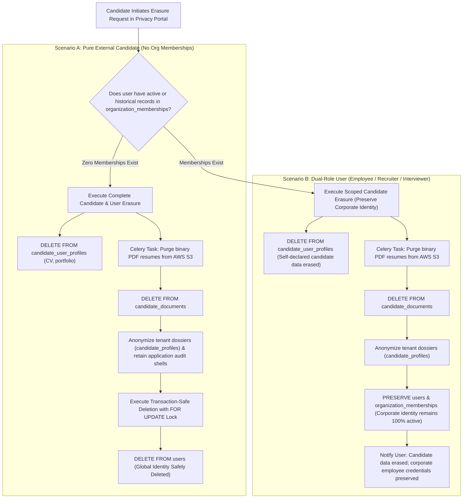

# Candidate Identity, Privacy Boundaries and Data Lifecycle Governance

This document resolves candidate data lifecycle workflows, defining the precise technical mechanisms for candidate-owned profile erasure, account deactivation, pseudonymization, transaction-safe deletion workflows, employer dossier anonymization, and corporate identity preservation.

---

## 1. Dual-Identity Reality: Candidate Identity vs. Organizational Memberships

A fundamental flaw in naive user deletion workflows occurs when an individual holds **both** a candidate role (applying for jobs) and an organizational membership (e.g. an existing internal employee, recruiter, hiring manager, or interviewer).

If a candidate erasure request triggered an unmediated `DELETE FROM users`, the `ON DELETE CASCADE` constraint on `organization_memberships` would **catastrophically delete the user's corporate account, revoking their employee access, interviewer assignments, and administrative roles**.

The platform prevents this by decoupling **Candidate-Owned Profile Erasure** from **Global User Identity Deletion**:



---

## 2. Precise Definitions: Deactivation, Pseudonymization, Anonymization & Retention

To maintain rigorous legal and architectural accuracy under GDPR (Recital 26, Art. 4(5), Art. 17) and international data protection frameworks, the platform strictly distinguishes the following six privacy and lifecycle concepts:

1. **Account Deactivation**:
   - Disabling active access (`users.is_active = FALSE`, session keys evicted, `token_version` incremented).
   - Personal data remains intact in the operational database for administrative, contractual, or auditing purposes.
2. **Pseudonymization**:
   - The processing of personal data such that it can no longer be attributed to a specific data subject without additional information (GDPR Art. 4(5)).
   - Replacing `email` with `'scrambled_' || encode(sha256(id::text::bytea), 'hex') || '@redacted.invalid'` and names with `'Deactivated User'` in the operational database is **pseudonymization**, NOT complete anonymization. The internal UUID and relational linkages remain.
3. **Anonymization**:
   - The permanent, irreversible alteration of personal data such that the data subject can no longer be identified directly or indirectly by any means reasonably likely to be used (GDPR Recital 26).
   - True anonymized records fall outside the scope of data protection legislation.
4. **Candidate-Profile Erasure**:
   - The targeted hard-deletion of candidate-owned data (`candidate_user_profiles`, default resume drafts, self-declared skills), asynchronous purging of binary resume files from AWS S3, and anonymization of tenant-scoped employer dossiers (`candidate_profiles`).
5. **Corporate Identity Retention**:
   - Preserving an individual's corporate user account (`users`), authentication credentials, and employer memberships (`organization_memberships`) when they request erasure of candidate applications.
6. **Legally Required Record Retention**:
   - The retention of historical recruitment decisions, adverse impact data, and interviewer scorecards under statutory mandates (Title VII, EEOC 29 CFR Part 1602, OFCCP) pursuant to GDPR Art. 17(3)(b) & (e).

> [!WARNING]
> **Data Lifecycle Boundaries: Backups, Object Storage & Logs**
> Scrambling or updating a database row in PostgreSQL does **NOT** automatically anonymize or erase data across the broader cloud infrastructure:
> - **Database Backups & Write-Ahead Logs (WAL)**: Point-in-time recovery archives retain historical snapshots until statutory backup retention expires (e.g., 30 days). Under EDPB / CNIL guidance, backup data is overwritten by lifecycle rotation, and erasure requests must be logged to be re-applied if a backup restore occurs.
> - **Object Storage (AWS S3)**: Binary resume PDFs, portfolios, and avatar images require explicit asynchronous Celery tasks invoking S3 `DeleteObject` / `DeleteObjects` APIs, backed by S3 bucket lifecycle expiration rules.
> - **Immutable System Logs (`platform_audit_logs`, AWS CloudTrail)**: Immutable security audit trails retain historical event records for SOC 2 and ISO 27001 compliance. PII is minimized at ingestion, but immutable audit logs are not retroactively modified.

---

## 3. Concurrency-Safe User Deletion Workflow

### A. The Concurrency Flaw with Relational `ON DELETE CASCADE`
In `05_database_design.md`, `organization_memberships` defines:
```sql
user_id UUID NOT NULL REFERENCES users(id) ON DELETE CASCADE
```
The database engine foreign key **does not enforce the precondition** that memberships must be zero. If an application or background worker executes `DELETE FROM users WHERE id = :user_id`, PostgreSQL will silently cascade and delete all corporate memberships.

Furthermore, in a concurrent environment under default `READ COMMITTED` isolation:
1. Transaction A checks `SELECT COUNT(*) FROM organization_memberships WHERE user_id = :user_id` and observes `0`.
2. Concurrently, Transaction B adds the user to Acme Corp (`INSERT INTO organization_memberships`).
3. Transaction A proceeds to `DELETE FROM users`, silently wiping out Transaction B's newly created corporate membership.

### B. The Transaction-Safe Deletion Protocol & Hierarchical Locking
To guarantee that deletion checks are race-condition-free and safe from concurrent mutations (such as an admin publishing an archived job or rescheduling an interview during user deletion), locks must be acquired in the strict global hierarchical order: `users` $\rightarrow$ `jobs` $\rightarrow$ `interview_schedules` $\rightarrow$ `interview_participants`.

Furthermore, all application services updating child entities must adhere to the **Enforceable Application Pre-Locking Protocol** (acquiring `FOR SHARE` on parent `users` rows *before* modifying child records), ensuring all application workflows acquire locks from top to bottom and serialize against concurrent deactivations (`users.is_active = FALSE`). If an un-ordered direct SQL write bypasses the protocol and collides concurrently with deletion, PostgreSQL's deadlock detector (`40P01`) safely aborts the colliding transaction, guaranteeing that referential and business invariants are never violated.

```sql
-- Transaction-Safe User Erasure Execution with Hierarchical Multi-Table Locking
BEGIN;

-- Level 1: Acquire exclusive row lock on the user identity record
-- In PostgreSQL, foreign key checks acquire FOR KEY SHARE on 'users', while child updates acquire FOR SHARE.
-- Because FOR UPDATE conflicts with both FOR KEY SHARE and FOR SHARE, this lock immediately blocks
-- any concurrent transaction attempting to INSERT, update, or link organization_memberships,
-- candidate_profiles, jobs, or interview_participants for this user!
SELECT id, is_active, litigation_hold 
FROM public.users 
WHERE id = :user_id 
FOR UPDATE;

-- Level 2: Lock all jobs assigned to this user (archived or active) in ascending primary key order
-- This prevents concurrent transactions from activating an archived job (updating status to 'published')
SELECT id, status 
FROM public.jobs 
WHERE hiring_manager_id = :user_id 
ORDER BY id ASC 
FOR UPDATE;

-- Level 3: Lock all interview schedules associated with this user
-- This prevents concurrent transactions from rescheduling or activating upcoming interview rounds
SELECT s.id, s.status 
FROM public.interview_schedules s
JOIN public.interview_participants ip ON ip.interview_id = s.id
WHERE ip.user_id = :user_id 
ORDER BY s.id ASC 
FOR UPDATE;

-- Level 4: Lock all participant mapping rows
SELECT id 
FROM public.interview_participants 
WHERE user_id = :user_id 
ORDER BY id ASC 
FOR UPDATE;

-- Step 2: Concurrency-Safe Precondition Assertions under Lock
-- Assert 1: Check ALL active and inactive corporate memberships
SELECT COUNT(*) AS membership_count 
FROM public.organization_memberships 
WHERE user_id = :user_id;

-- Assert 2: Check interviewer scorecards (Statutory compliance check)
SELECT COUNT(*) AS scorecard_count 
FROM public.interview_scorecards 
WHERE interviewer_id = :user_id;

-- Assert 3: Check scheduled upcoming interviews
SELECT COUNT(*) AS upcoming_interview_count
FROM public.interview_participants ip
JOIN public.interview_schedules s ON s.id = ip.interview_id
WHERE ip.user_id = :user_id 
  AND s.scheduled_at >= CURRENT_TIMESTAMP
  AND s.status IN ('scheduled', 'confirmed');

-- Assert 4: Check active jobs where user is hiring manager
SELECT COUNT(*) AS active_job_count
FROM public.jobs 
WHERE hiring_manager_id = :user_id 
  AND status IN ('published', 'draft', 'internal');

-- Assert 5: Check sole active administrator ownership across all tenant organizations
SELECT COUNT(*) AS sole_admin_org_count
FROM (
    SELECT om.tenant_id
    FROM public.organization_memberships om
    JOIN public.roles r ON r.id = om.role_id
    WHERE om.user_id = :user_id AND r.name IN ('org_admin', 'system_admin')
    GROUP BY om.tenant_id
    HAVING (
        SELECT COUNT(*) 
        FROM public.organization_memberships om2 
        JOIN public.roles r2 ON r2.id = om2.role_id 
        WHERE om2.tenant_id = om.tenant_id AND r2.name IN ('org_admin', 'system_admin') AND om2.is_active = TRUE
    ) = 1
) sole_admin;

-- Assert 6: Verify litigation hold
-- users.litigation_hold MUST be FALSE.

-- Step 3: Branching Resolution
-- Case A: Unresolved corporate dependencies exist (memberships > 0, jobs > 0, upcoming interviews > 0, sole admin > 0):
-- -> If candidate erasure requested: execute Scoped Candidate Erasure (preserves users & memberships).
-- -> If full user delete requested: ROLLBACK and return 409 Conflict (CORPORATE_DEPENDENCIES_EXIST).

-- Case B: Statutory scorecards exist (scorecard_count > 0) with zero corporate ties:
-- -> Execute Account Scrambling & Deactivation (Section 5). COMMIT.

-- Case C: Zero dependencies across all checks:
-- -> Safe to execute hard deletion:
DELETE FROM public.candidate_user_profiles WHERE user_id = :user_id;
DELETE FROM public.users WHERE id = :user_id;

COMMIT;
```

### C. Database Trigger Guard with Cross-Tenant RLS Bypass (Defense-in-Depth)
To ensure that direct administrative scripts, migration tasks, or background workers cannot execute an unmediated `DELETE FROM users` that silently cascades corporate data across ANY tenant, a dedicated RLS-aware database trigger guard is enforced.

#### 1. RLS Visibility Resolution inside the Trigger:
Because tenant-scoped tables (`organization_memberships`, `jobs`, `interview_participants`, `interview_schedules`) enforce `FORCE ROW LEVEL SECURITY`, a standard trigger function executing under the caller's identity (`SECURITY INVOKER`) is constrained by the caller's active tenant session (`app.current_tenant_id`). It would be **blind to rows in other tenants**, allowing unintended cascade deletions across tenants!

To solve this securely:
- A dedicated non-login role `aihr_deletion_guard_role` with `BYPASSRLS` is created.
- The role is granted strictly read-only (`SELECT`) permissions on the required tables (no mutation privileges).
- The trigger function `fn_protect_user_cascade_deletion()` is marked `SECURITY DEFINER` and owned by `aihr_deletion_guard_role`.
- **Public Schema Hardening**: `REVOKE CREATE ON SCHEMA public FROM PUBLIC;` prevents object-shadowing, and the function sets `search_path = pg_catalog, pg_temp` with all user tables explicitly schema-qualified as `public.<table_name>`.
- Execution is granted to `aihr_app_user` while ordinary application sessions remain strictly subject to RLS.

```sql
-- Step 1: Secure public schema against unauthorized object creation
REVOKE CREATE ON SCHEMA public FROM PUBLIC;

-- Step 2: Dedicated non-login role with BYPASSRLS
CREATE ROLE aihr_deletion_guard_role WITH 
    NOLOGIN 
    NOINHERIT 
    NOSUPERUSER 
    NOCREATEDB 
    NOCREATEROLE 
    BYPASSRLS;

GRANT SELECT ON public.organization_memberships TO aihr_deletion_guard_role;
GRANT SELECT ON public.jobs TO aihr_deletion_guard_role;
GRANT SELECT ON public.interview_participants TO aihr_deletion_guard_role;
GRANT SELECT ON public.interview_schedules TO aihr_deletion_guard_role;
GRANT SELECT ON public.interview_scorecards TO aihr_deletion_guard_role;

CREATE OR REPLACE FUNCTION public.fn_protect_user_cascade_deletion()
RETURNS TRIGGER 
LANGUAGE plpgsql 
SECURITY DEFINER 
SET search_path = pg_catalog, pg_temp
AS $$
BEGIN
    -- 1. Block deletion if statutory litigation hold is flagged
    IF OLD.litigation_hold THEN
        RAISE EXCEPTION 'Cannot hard-delete user %: active statutory litigation hold.', OLD.id
            USING ERRCODE = 'restrict_violation';
    END IF;

    -- 2. Block deletion if corporate organization memberships exist across ANY tenant (active or inactive)
    -- Operates under aihr_deletion_guard_role (BYPASSRLS) to inspect all tenants
    IF EXISTS (
        SELECT 1 
        FROM public.organization_memberships 
        WHERE user_id = OLD.id
    ) THEN
        RAISE EXCEPTION 'Cannot hard-delete user %: corporate organization memberships exist across one or more tenants. User must be offboarded via corporate administrator workflow.', OLD.id
            USING ERRCODE = 'restrict_violation';
    END IF;
    
    -- 3. Block deletion if assigned as hiring manager on active/open jobs across ANY tenant
    IF EXISTS (
        SELECT 1 
        FROM public.jobs 
        WHERE hiring_manager_id = OLD.id 
          AND status IN ('published', 'draft', 'internal')
    ) THEN
        RAISE EXCEPTION 'Cannot hard-delete user %: active job requisitions assigned as hiring manager. Jobs must be reassigned first.', OLD.id
            USING ERRCODE = 'restrict_violation';
    END IF;

    -- 4. Block deletion if participant in upcoming scheduled interview(s) across ANY tenant
    IF EXISTS (
        SELECT 1 
        FROM public.interview_participants ip
        JOIN public.interview_schedules s ON s.id = ip.interview_id
        WHERE ip.user_id = OLD.id 
          AND s.scheduled_at >= CURRENT_TIMESTAMP
          AND s.status IN ('scheduled', 'confirmed')
    ) THEN
        RAISE EXCEPTION 'Cannot hard-delete user %: assigned as participant in upcoming scheduled interview(s). User must be unassigned or interview rescheduled.', OLD.id
            USING ERRCODE = 'restrict_violation';
    END IF;
    
    RETURN OLD;
END;
$$;

ALTER FUNCTION public.fn_protect_user_cascade_deletion() OWNER TO aihr_deletion_guard_role;
REVOKE ALL ON FUNCTION public.fn_protect_user_cascade_deletion() FROM PUBLIC;
GRANT EXECUTE ON FUNCTION public.fn_protect_user_cascade_deletion() TO aihr_app_user;

CREATE TRIGGER trg_protect_user_cascade_deletion
BEFORE DELETE ON public.users
FOR EACH ROW
EXECUTE FUNCTION public.fn_protect_user_cascade_deletion();
```

---

## 4. Master Relational Dependency Inventory for `users(id)`

Across the entire relational database, exactly **9 relational tables** enforce foreign key constraints pointing to `users(id)`, alongside **2 application-level / compliance dependencies**:

| # | Referencing Table | Referencing Column | Foreign-Key Constraint Name | ON DELETE Behavior | Database Deletion Mechanism & Backstop | Required Deletion Precondition | Action on User Erasure Workflow |
|:---:|:---|:---|:---|:---|:---|:---|:---|
| 1 | `candidate_user_profiles` | `user_id` | `fk_cand_user_prof_user` | `CASCADE` | **Allowed CASCADE**: Safe to delete on candidate erasure. | Explicit consent / Right-to-be-Forgotten request verified. | **Hard-Deleted** automatically via database cascade. |
| 2 | `organization_memberships` | `user_id` | `fk_org_mem_user` | `CASCADE` | **STRICTLY REJECTED by DB Trigger Guard** (`BYPASSRLS`) if count > 0. | User must have zero active or historical corporate memberships. | **Retained**: User account cannot be deleted via candidate erasure if corporate memberships exist. |
| 3 | `candidate_profiles` | `user_id` | `fk_cand_prof_user` | `SET NULL` | **Deliberate SET NULL**: Gracefully unlinks dossier. | None (unlinks gracefully at database level). | **Retained & Anonymized**: Dossier unlinks (`user_id = NULL`) and is anonymized in place under statutory retention. |
| 4 | `jobs` | `hiring_manager_id` | `fk_jobs_hiring_manager` | `SET NULL` | **STRICTLY REJECTED by DB Trigger Guard** (`BYPASSRLS`) if active jobs exist. | Open/published jobs where `hiring_manager_id = user_id` must be reassigned. | **Reassigned**: Jobs must be formally reassigned before user deletion; archived jobs allow `SET NULL`. |
| 5 | `screening_runs` | `created_by` | `fk_screen_runs_user` | `SET NULL` | **Deliberate SET NULL**: Preserves batch execution audit. | None (unlinks gracefully). | **Retained**: Historical run audit trail retained with `created_by = NULL` ("Former Employee"). |
| 6 | `interview_participants` | `user_id` | `fk_int_part_user` | `CASCADE` | **STRICTLY REJECTED by DB Trigger Guard** (`BYPASSRLS`) if upcoming interviews exist; historical allowed to cascade. | User must be unassigned from future schedules (`scheduled_at >= NOW()`). | **Reassigned / Deleted**: Removed from future interviews; historical attendance records cascade. |
| 7 | `interview_scorecards` | `interviewer_id` | `fk_int_score_user` | **`RESTRICT`** | **STRICTLY REJECTED by Relational Engine** (`ON DELETE RESTRICT`). | Historical hiring scorecards must be preserved for statutory compliance. | **Retained (Blocks Hard Delete)**: Statutory recruitment compliance requires scorecard preservation. Triggers **Account Scrambling & Deactivation**. |
| 8 | `comments` | `author_id` | `fk_comments_user` | `SET NULL` | **Deliberate SET NULL**: Preserves discussion trail. | None (unlinks gracefully). | **Retained**: Recruiter candidate notes preserved for compliance with `author_id = NULL` ("Former Employee"). |
| 9 | `platform_audit_logs` | `actor_id` | `fk_audit_actor` | `SET NULL` | **Deliberate SET NULL**: Preserves immutable compliance log. | None (immutable system compliance log). | **Retained**: System audit trail preserved with `actor_id = NULL`. |

### Application-Level & Policy Dependencies:

| # | Dependency Name | Evaluation Mechanism | Enforcement Layer | Required Deletion Precondition | Resolution Action |
|:---:|:---|:---|:---:|:---|:---|
| 10 | **Organization Sole Administrator** | RBAC Role Count Query across all active organizations | Application Service Gate | **STRICT BLOCK**: User must not be the sole active `org_admin` or `system_admin` of any organization. | Admin ownership must be formally transferred to another verified user or organization cancelled. |
| 11 | **Statutory Litigation Hold** | `users.litigation_hold == TRUE` flag | Application Gate & **DB Trigger Guard** | **STRICT BLOCK**: No active litigation hold, EEOC dispute, or regulatory subpoena pending against user. | Deletion request placed into `SUSPENDED_LEGAL_HOLD` status until formal legal release. |

---

## 5. Comprehensive Personal Attribute Scrambling Matrix (Operational Pseudonymization)

When a user account cannot be hard-deleted due to relational dependencies (such as historical `interview_scorecards` under `ON DELETE RESTRICT`) or statutory retention mandates, the system executes **Account Scrambling and Deactivation**:

| User Entity Attribute | Relational Column Type | Anonymization / Scrambling Strategy | Scrambled Replacement Value / Action | Legal Basis & Audit Retention |
|:---|:---|:---|:---|:---|
| **Email Address** | `VARCHAR(255) UNIQUE` | Deterministic Pseudonymization | `'scrambled_' || encode(sha256(id::text::bytea), 'hex') || '@redacted.invalid'` | Prevents unique constraint collisions; breaks all linkage to individual. |
| **Password Hash** | `VARCHAR(255)` | Overwrite with Unmatchable Token | `'*ACCOUNT_PERMANENTLY_DEACTIVATED*'` | Eliminates hash dictionary attack surface; renders login impossible. |
| **First Name** | `VARCHAR(100)` | Static Redaction | `'Deactivated'` | Clears personal identity. |
| **Last Name** | `VARCHAR(100)` | Static Redaction | `'User'` | Clears personal identity. |
| **Phone Number** | `VARCHAR(30)` | Full Nullification | `NULL` | Personal contact data permanently scrubbed. |
| **Avatar URL & Image** | `VARCHAR(512)` | S3 Binary Purge & Nullification | `NULL` (Celery deletes image from S3 bucket via `DeleteObject`) | Biometric/photographic PII permanently eradicated. |
| **MFA Secret & Codes** | `VARCHAR(255)` | Full Nullification | `NULL` | Authentication credentials purged. |
| **OAuth Subject ID** | `VARCHAR(255)` | Full Nullification | `NULL` | Severed from third-party identity providers (Google, Microsoft). |
| **OAuth Provider** | `VARCHAR(50)` | Full Nullification | `NULL` | Provider link severed. |
| **Last Login IP** | `INET` | Full Nullification | `NULL` | Geolocation and network telemetry scrubbed. |
| **Active Status** | `BOOLEAN` | Account Deactivation | `is_active = FALSE` | Database-enforced rejection across all authentication paths. |
| **Super Admin Flag** | `BOOLEAN` | Revocation of Privileges | `is_super_admin = FALSE` | Administrative privileges permanently stripped. |
| **Token Version** | `INT` | Version Increment | `token_version = token_version + 1` | Invalidates all existing JWT access and refresh tokens. |
| **Redis Sessions** | Redis Cache | Instant Eviction | `DEL session:{user_id}:*` + Invalidation Fence | Terminates all active browser sessions immediately. |

---

## 6. Five Operational Scenarios for Identity Erasure and Retention

### Scenario 1: Pure External Candidate Account Erasure (Zero Dependencies)
- **Applicability**: User has zero `organization_memberships`, zero `interview_scorecards`, zero assigned jobs, and zero litigation holds.
- **Workflow**:
  1. `DELETE FROM candidate_user_profiles WHERE user_id = :user_id`.
  2. Celery tasks purge binary resume and portfolio files from AWS S3.
  3. `candidate_documents` and pgvector embeddings rows are deleted.
  4. Employer candidate dossiers (`candidate_profiles`) unlinked (`user_id = NULL`) and anonymized in place.
  5. The global identity row in `users` is safely hard-deleted under exclusive `FOR UPDATE` lock.
  6. All active Redis sessions evicted.

### Scenario 2: Dual-Role User Candidate Erasure (Corporate Identity Preserved)
- **Applicability**: User is an employee, recruiter, interviewer, or admin in Acme Corp, but also submitted job applications as a candidate.
- **Workflow**:
  1. Candidate personal portfolio (`candidate_user_profiles`) is hard-deleted.
  2. Application resumes in S3 and `candidate_documents` are purged.
  3. Employer candidate dossiers are anonymized.
  4. **The `users` table record is 100% PRESERVED**: `email`, `password_hash`, `first_name`, `last_name`, and corporate credentials remain active.
  5. All corporate `organization_memberships`, permissions, audit records, and interviewer assignments remain **completely intact**.
  6. The user receives written confirmation that their candidate profile and resumes were erased while their corporate employee access remains unaffected.

### Scenario 3: Global User Account Deactivation (Relational Retention Dependencies Exist)
- **Applicability**: User requests full account erasure, but historical `interview_scorecards` exist (`ON DELETE RESTRICT`) or statutory recruitment compliance requires record retention.
- **Workflow**:
  1. Relational engine blocks `DELETE FROM users WHERE id = :user_id` due to `fk_int_score_user`.
  2. The system automatically routes to **Full Account Scrambling and Deactivation** (Section 5).
  3. All 14 personal attributes are scrambled, nullified, and evicted.
  4. The deactivated record satisfies GDPR Art. 17(3)(b) (statutory compliance defense) while guaranteeing no identifiable human data remains in active records.

### Scenario 4: Historical Recruitment & Scorecard Record Retention
- **Legal Basis**: Title VII of the Civil Rights Act, EEOC Regulations (29 CFR Part 1602), and OFCCP mandates require retaining candidate evaluation records, interviewer scorecards, and adverse impact metrics for 1 to 2 years following hiring decisions.
- **Workflow**:
  1. Candidate dossiers in `candidate_profiles` are stripped of direct identifiers (`first_name = 'Anonymized'`, `email = redacted`, `phone = NULL`, `is_anonymized = TRUE`).
  2. Associated `applications`, `application_status_history`, `screening_results`, and `interview_scorecards` are preserved under statutory legal exemption.
  3. Interviewer attribution remains linked to the scrambled user ID or active employee ID.

### Scenario 5: Legal Retention / Litigation Hold Suspension
- **Applicability**: `users.litigation_hold = TRUE` or employer is subject to a formal subpoena or pending discrimination complaint.
- **Workflow**:
  1. Erasure request is placed into `SUSPENDED_LEGAL_HOLD` status.
  2. Erasure and scrambling workflows are strictly halted.
  3. Candidate is formally notified of lawful processing suspension under GDPR Art. 17(3)(e).
  4. User profile and application dossiers are quarantined into restricted-access audit storage.
