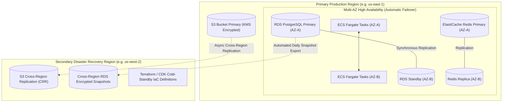

# Cloud Architecture, High Availability and Disaster Recovery Blueprint

This document details the deployment architecture on AWS, distinguishing high availability (HA) from cross-region disaster recovery (DR), and specifying cloud provider commitments and verification requirements.

---

## 1. High Availability (HA) vs. Cross-Region Disaster Recovery (DR)

It is critical to distinguish multi-AZ high availability within a primary cloud region from catastrophic cross-region disaster recovery:

### High Availability (HA) Profile (Inside Primary Region):
- **RDS PostgreSQL Multi-AZ**: Synchronous physical replication across Availability Zones. In the event of an AZ loss, AWS automatically fails over DNS to the standby replica in $\le 60\text{ seconds}$ with **zero data loss (RPO = 0)**.
- **ElastiCache Redis Multi-AZ**: Redis cluster with automatic failover and Multi-AZ enabled.
- **ECS Fargate Compute**: Container tasks load-balanced across multiple subnets via AWS Application Load Balancer.

### Disaster Recovery (DR) Profile (Catastrophic Regional Outage):
- **Target RPO (Recovery Point Objective)**: $\le 15\text{ minutes}$ (governed by cross-region S3 replication lag and snapshot copy intervals).
- **Target RTO (Recovery Time Objective)**: $\le 2\text{ hours}$ (governed by automated spin-up of ECS Fargate clusters and RDS snapshot restoration via Terraform / AWS CDK in the secondary region).

---

## 2. Cloud & Third-Party AI Provider Verification Requirements

The platform does **not** assume that all cloud providers or LLM services automatically satisfy customer compliance constraints. Prior to enterprise onboarding, the following verification gates must be confirmed:

| Provider / Service | Architectural Assumption | Deployment Verification Requirement |
|:---|:---|:---|
| **AWS Bedrock** (Claude 3.5 Sonnet / Haiku) | Data does not leave the customer's cloud boundary. | Verify that Bedrock model execution is configured in the selected primary AWS region and enterprise contract confirms zero customer data retention for model retraining. |
| **OpenAI Direct API** (GPT-4o) | Zero data retention on API calls. | Must execute a formal Business Associate Agreement (BAA) / Data Processing Addendum (DPA) with OpenAI verifying Zero Data Retention (ZDR) configuration. |
| **AWS Textract** (OCR Fallback) | Document images processed locally within region. | Verify Textract regional availability in the deployment region; confirm AWS Data Privacy Addendum for Textract is active. |
| **Data Residency** (EU / India / US) | Tenant data remains within jurisdiction. | For EU tenants, infrastructure must be deployed in AWS Frankfurt/Ireland (`eu-central-1` / `eu-west-1`). For India tenants, in AWS Mumbai (`ap-south-1`). |
