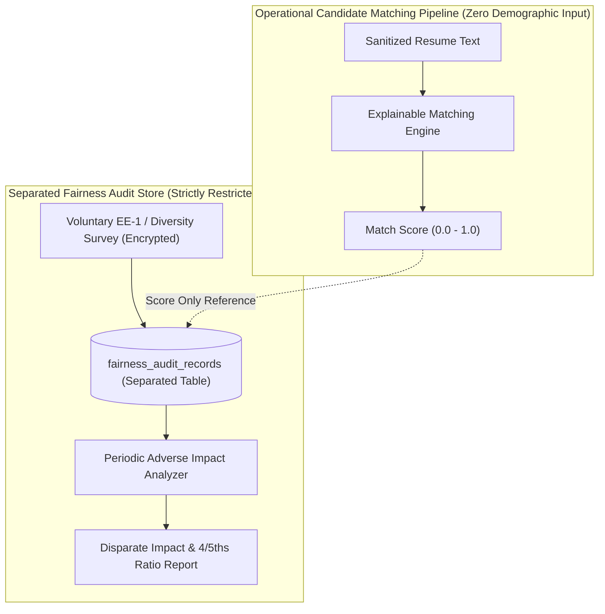

# Responsible AI, Fairness Auditing and Algorithmic Governance

This document establishes the responsible AI framework, algorithmic fairness audit architecture, disparate impact analysis, and compliance standards.

---

## 1. Algorithmic Neutrality & The "Proxy Variable" Reality

Excluding explicit demographic columns (e.g. `age`, `gender`, `race`) is a necessary baseline, but it **does not alone guarantee legal compliance or freedom from bias**.

Machine learning and NLP models can easily learn latent proxies:
- Certain educational institutions or student organizations correlate with race or gender.
- Graduation years or employment start dates act as direct mathematical proxies for age.
- Gaps in employment or part-time work history may correlate with parental leave or disability.

### Architectural Controls Against Proxy Bias:
1. **Feature Stripping**: Candidate matching inputs strictly omit graduation years, dates of birth, photos, gendered honorifics, and extracurricular affiliations.
2. **Explainable Matching over Black-Box Scoring**: The primary screening engine evaluates deterministic skill coverage and verified qualification criteria, rather than opaque embeddings alone.
3. **Prohibition of Autonomous Rejection**: AI outputs serve strictly as decision-support aids for human recruiters. **Autonomous rejection of candidates based on AI scores is strictly prohibited.**

---

## 2. Controlled Fairness-Audit Architecture

To evaluate algorithmic fairness lawfully without contaminating the candidate matching pipeline, the platform implements a **physically separated Fairness Audit Store**:

### Access & Security Controls for Fairness Audit Data:
- Operational recruiters, hiring managers, and AI matching algorithms have **zero read access** to `fairness_audit_records`.
- Access is restricted exclusively to authorized enterprise Compliance Officers / Internal Auditors.
- Diversity survey data is collected on a strictly voluntary basis, stored with customer-managed KMS encryption, and decoupled from candidate profiles.

---

## 3. Disparate Impact Evaluation & Statistical Limitations

### A. The Four-Fifths (80%) Rule
The platform calculates the selection rate ratio across demographic cohorts:
$$\text{Adverse Impact Ratio} = \frac{\text{Selection Rate}_{\text{adverse\_group}}}{\text{Selection Rate}_{\text{highest\_group}}}$$

### B. Statistical Caveats & Small Sample Size Safeguards
- **Small Sample Size Warning**: When a demographic cohort contains fewer than 30 candidates, the four-fifths ratio becomes statistically unreliable. In such cases, the system flags the result as *"Statistically Insufficient Cohort"* and suppresses automated alerts to avoid false-positive alarms.
- **Statistical Significance Testing**: In enterprise compliance reports, the platform pairs the four-fifths ratio with Fisher's Exact Test / Two-Standard-Deviation analysis to verify whether observed differences are statistically significant.
- **Independent Legal Review**: These statistical analyses serve as diagnostic tools for HR compliance teams and do not replace formal legal assessments by qualified employment counsel.
