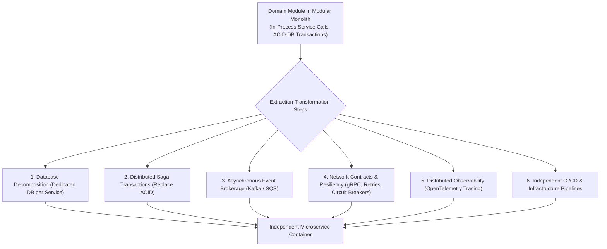

# Future Microservice Extraction Architecture & Complexity Guide

This document formally details the technical prerequisites, distributed systems complexity, and architectural requirements for extracting individual domain modules from the Asynchronous Modular Monolith into independent microservices.

---

## 1. The Reality of Microservice Extraction

Extracting a domain module (such as `modules/screening` or `modules/documents`) into an independent microservice is **not merely a deployment configuration change**. It is a major architectural transformation that fundamentally changes the data consistency, transaction management, and networking model of the application.

Claims that modular monoliths can be extracted into microservices "without application rewrites" are incorrect. Extraction requires substantial refactoring across six architectural dimensions:

---

## 2. Six Required Architectural Workstreams for Extraction

### 1. Database Decomposition & Data Ownership
- **Monolith State**: Modules share a PostgreSQL database and can perform controlled read projections across tables.
- **Microservice State**: The extracted service **must own its database completely**. Foreign key constraints connecting to the main database must be completely severed. Cross-domain queries must be replaced with API calls, event projections, or data replication.

### 2. Distributed Transactions & Saga Coordination
- **Monolith State**: A recruiter moving a candidate stage, scheduling an interview, and dispatching a notification executes within a single ACID transaction (`session.begin()`).
- **Microservice State**: Multi-service updates require implementing the **Saga Pattern** (orchestrated or choreographed) with explicit compensating transactions to handle partial failures (e.g. if the interview schedule fails, compensating events must roll back the pipeline stage).

### 3. Asynchronous Event-Driven Architecture
- **Monolith State**: Celery background tasks dispatch jobs directly through Redis.
- **Microservice State**: Services must integrate an enterprise event broker (e.g. Apache Kafka or AWS SQS/SNS) publishing versioned domain events (`CandidateScreenedEvent_v1`, `ApplicationTransitionedEvent_v2`) with outbox pattern guarantees.

### 4. Network Contracts, Resiliency & Latency
- In-process Python method execution ($\le 0.1\text{ ms}$) is replaced with remote network calls (HTTP/REST or gRPC) introducing $5–30\text{ ms}$ latency per hop.
- The system must introduce circuit breakers (e.g. Resilience4j / pybreaker), exponential retry policies with jitter, and dead-letter handling.

### 5. Distributed Observability
- Distributed tracing (W3C TraceContext propagation via OpenTelemetry) must be implemented across all service hops to enable end-to-end latency profiling and root-cause analysis.

### 6. Independent CI/CD & Contract Testing
- Independent repository or monorepo sub-projects requiring Consumer-Driven Contract Testing (e.g. Pact) to prevent breaking API changes across decoupled deployment lifecycles.

---

## 3. Approved Implementation Posture

Because the platform is in its initial commercial phase, **microservices must NOT be implemented at this time**. The platform will strictly remain an **Asynchronous Modular Monolith**, preserving clean domain module boundaries so that if a specific scale bottleneck emerges in the future, the team can undertake this documented extraction path with full awareness of the required investment.
