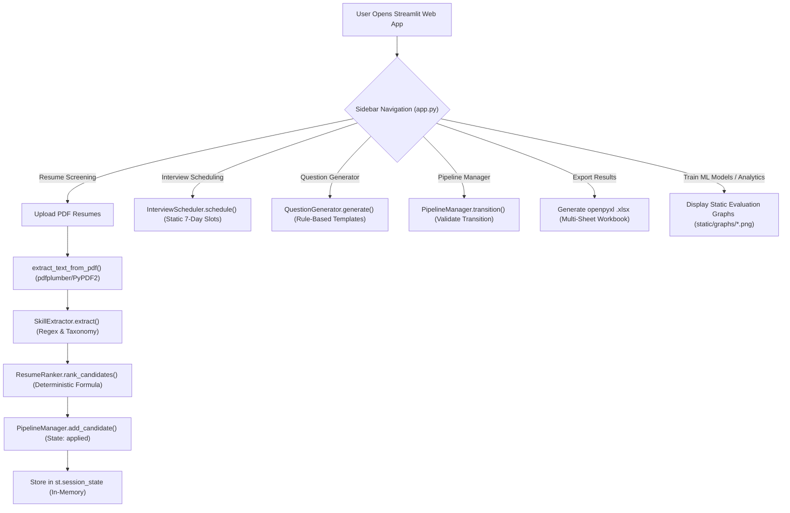

# Project Overview

**Project Name:** AI HR (Recruitment Assistant Prototype)

**Current Architecture & Stack**
- **Runtime & UI**: Python 3.9+ with Streamlit.
- **Machine Learning**: scikit‑learn, imbalanced‑learn (SMOTE), optional XGBoost (academic/demo comparison only).
- **Data Manipulation**: pandas, numpy.
- **Document Text Extraction**: pdfplumber with PyPDF2 fallback.
- **Visualizations**: matplotlib and seaborn (dark theme charts saved as static PNGs).

**Key Stakeholders**
- Hiring managers and recruiters (end-user personas).
- Engineering and architecture team (evaluating technical debt and migration).
- Future enterprise SaaS tenants (requiring multi-tenant isolation, RBAC, and durable persistence).

---

## Verified Functional Scope (Current Prototype)

| Feature Area | Implementation Status | Technical Reality in Codebase |
|:---|:---:|:---|
| **Resume Ingestion** | **Implemented (PDF Only)** | Uses `st.file_uploader(type=["pdf"])` in `app.py:679`. DOCX/TXT uploads are **not supported**. |
| **Document Text Extraction** | **Implemented** | `extract_text_from_pdf()` (`app.py:33-49`) attempts extraction via `pdfplumber`, falling back to `PyPDF2`, then raw UTF-8 bytes. |
| **Skill Extraction** | **Implemented** | `SkillExtractor` (`skill_extractor.py:1-647`) matches text against a 250+ skill taxonomy using regex token boundaries and canonical alias normalization. |
| **Candidate Ranking** | **Implemented (Deterministic Heuristic)** | `ResumeRanker.rank_candidates()` (`hr_agent.py:122-156`) evaluates: $$0.55 \times \text{coverage} + 0.10 \times \text{kw\_sim} + 0.10 \times \text{breadth} + 0.25 \times \text{exp\_sc}$$. **The serialized ML models are not used for candidate ranking.** |
| **ML Model Evaluation** | **Isolated Demonstration** | `train_models.py` trains 6–7 classifiers against synthetically generated target labels and saves static metric charts to `static/graphs/`. The models are showcased on the ML dashboard tabs only. |
| **Interview Scheduling** | **Prototype** | `InterviewScheduler` (`hr_agent.py:162-190`) generates an in-memory list of dates for the next 7 days and assigns slots via `.pop(0)`. No external calendar integration (Google Calendar, Outlook) exists. |
| **Question Generation** | **Implemented / Prototype** | Rule-based question generation from hardcoded templates is implemented (`question_generator.py:1-450`). LLM-backed generation (`question_generator.py:700-800`) is a prototype stub requiring an external API key. |
| **Candidate Pipeline Management** | **Implemented (In-Memory)** | `PipelineManager` (`hr_agent.py:196-244`) implements a finite state machine enforcing valid transitions (`applied` $\rightarrow$ `shortlisted` $\rightarrow$ `interview_scheduled` $\rightarrow$ `interviewed` $\rightarrow$ `selected`/`rejected`). |
| **Export Capabilities** | **Implemented** | `app.py:1451-1493` generates a multi-sheet Excel file (`.xlsx`) via `openpyxl` covering candidate pipeline status, interview slots, ML model summaries, and questions. |
| **Authentication & Authorization** | **Absent** | No login, session tokens, tenant context, or RBAC. The prototype runs open to any local user. |
| **Durable Data Persistence** | **Absent** | No database exists. All application state is transient within Streamlit's `st.session_state` and resets upon page refresh or process restart. |

---

## High-Level Prototype User Workflow

---

## Purpose of this Discovery Phase

This technical audit rigorously documents the existing codebase, identifies technical debt and ML methodology flaws, and plans the transformation into an enterprise-grade **Asynchronous Modular Monolith SaaS** (FastAPI, Next.js, PostgreSQL, pgvector, Redis, Celery, AWS S3). Implementation will begin only upon formal approval of this audit.
