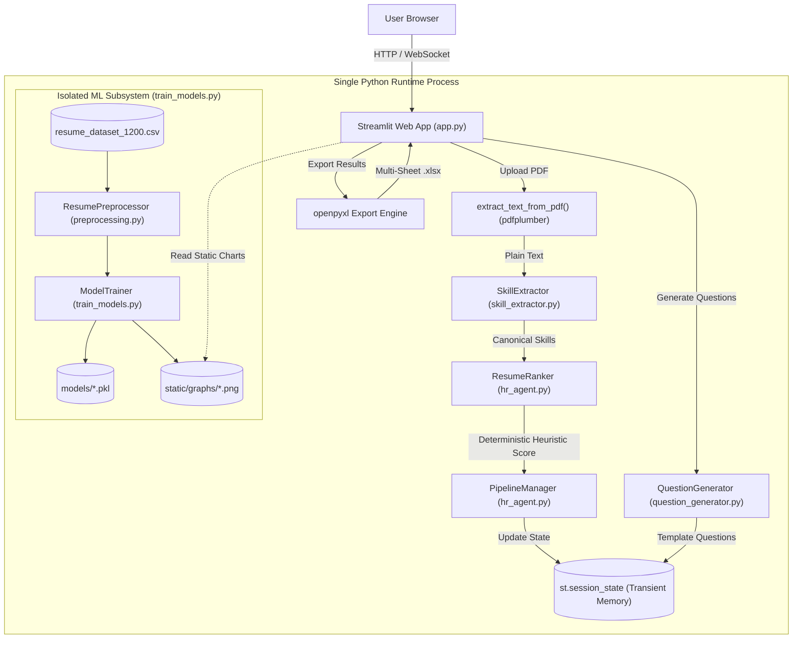

# Existing Architecture

This document details the architectural layout, data flows, and runtime characteristics of the existing AI HR Streamlit prototype.

---

## 1. Component Overview

- **Streamlit Frontend & Controller (`app.py`)**: Entry point of the prototype. Configures page layout, custom dark-mode CSS, sidebar navigation (`st.radio`), PDF resume uploading, and orchestrates calls to business-logic modules.
- **Master HR Agent (`hr_agent.py`)**: Central orchestration facade composed of:
  - `ResumeRanker`: Extracts skills and computes deterministic match scores against a job description.
  - `PipelineManager`: In-memory finite state machine tracking candidate status across `VALID_TRANSITIONS`.
  - `InterviewScheduler`: In-memory slot manager allocating time slots over the next 7 business days.
  - `QuestionGenerator`: Generates skill- and seniority-aware interview questions.
- **Skill Extraction Engine (`skill_extractor.py`)**: Taxonomy-driven matcher containing `SkillRegistry` (250+ canonical skills and aliases) and `SkillExtractor` (token-boundary regex matching with optional semantic similarity flag).
- **ML Preprocessing Pipeline (`preprocessing.py`)**: `ResumePreprocessor` builds feature vectors (79 raw $\rightarrow$ 37 selected features), constructs synthetic binary target labels with boundary noise flips, and persists scikit-learn transformers.
- **Model Training Pipeline (`train_models.py`)**: Trains 6–7 classifiers (`LogisticRegression`, `RandomForest`, `GradientBoosting`, `LinearSVC`, `KNN`, `MLP`, optional `XGBoost`), generates 16 dark-theme metric comparison plots, and serializes artifacts to `models/`.
- **Question Generator Engine (`question_generator.py`)**: Contains categorized question banks and template generators (Conceptual, Coding, Scenario, System Design, Behavioral) with an LLM fallback stub.
- **Shared Utilities (`utils.py`)**: Helper functions for reproducible CSV candidate loading (`load_csv_candidates`), demo data generation, status badges, and graph path checks.
- **Static Graph Assets (`static/graphs/`)**: 16 pre-rendered PNG charts used to render the Streamlit analytics and model comparison dashboards.

---

## 2. Runtime Data Flow Diagram

---

## 3. Key Implementation Details & Technical Constraints

1. **Navigation Structure**: Driven by `st.sidebar.radio` (`app.py:288-300`) offering 8 distinct views:
   - `🏠 Overview`, `🧠 Train ML Models`, `📊 Analytics Dashboard`, `📄 Resume Screening`, `🗓 Interview Scheduling`, `❓ Question Generator`, `🔄 Pipeline Manager`, `📤 Export Results`.
2. **File Formats**: Strictly `.pdf` resumes are accepted via `st.file_uploader(type=["pdf"])` (`app.py:679`). Scanned/image-only PDFs fail text extraction as no OCR engine is present.
3. **Candidate Ranking Reality**: Candidate matching in the screening tab is evaluated by `ResumeRanker.rank_candidates()` (`hr_agent.py:122-156`) via a deterministic heuristic equation. The trained ML classifiers in `models/` are **not** invoked during candidate ranking.
4. **Transient Persistence**: The prototype contains **no database**. All candidate data, uploaded texts, interview slots, and pipeline statuses reside in Streamlit's in-memory `st.session_state` (`app.py:235-251`) and are erased on page reload.
5. **Interview Scheduling**: In-memory prototype assigning hardcoded timestamps across the upcoming 7 days (`hr_agent.py:162-190`).
6. **Export Capabilities**: Implemented in `app.py:1451-1493` via `openpyxl`, allowing users to download a comprehensive multi-sheet `.xlsx` report.
7. **Security**: Zero authentication, zero multi-tenant segregation, and hardcoded relative filesystem paths throughout.

---

## 4. Source Evidence References

- Streamlit Entrypoint & Navigation: `app.py:79-84, 288-300`
- PDF Text Extraction: `app.py:33-49`
- Deterministic Candidate Ranking: `hr_agent.py:122-156`
- Pipeline State FSM: `hr_agent.py:196-244`
- In-Memory Interview Scheduler: `hr_agent.py:162-190`
- Question Generator Logic: `question_generator.py:1-450`
- Multi-Sheet Excel Export: `app.py:1451-1493`
- Session State Initialization: `app.py:235-251`
