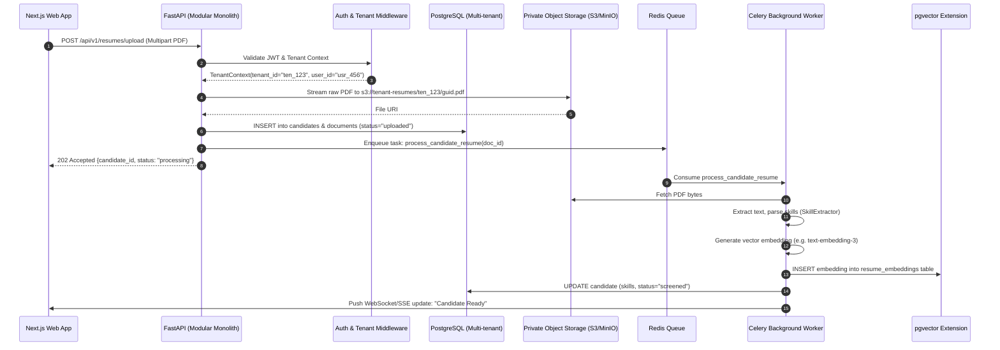

# Migration Mapping: Streamlit Prototype to Modular Monolith SaaS

This document establishes the transition path from the existing single-process Streamlit prototype to the target **Modular Monolith** architecture powered by **FastAPI, PostgreSQL, Redis, Celery, and Next.js**.

---

## 1. Monolith-to-Modular Monolith Paradigm Shift

Instead of jumping directly to distributed microservices—which introduces premature networking complexity, distributed transactions, and high operational overhead—the system will be built as a **single, cleanly decoupled Modular Monolith**.

### Module Boundary & Database Access Guarantees:
1. **Module Package Encapsulation**: Each business domain resides in its own isolated package under `backend/app/modules/<domain>/` (e.g. `auth`, `candidates`, `screening`, `pipeline`, `interviews`, `assessments`, `documents`, `reporting`).
2. **Strict Domain Write Ownership**: Each domain module strictly owns its respective database tables and state mutations. Foreign domains must **never** execute direct INSERT, UPDATE, or DELETE operations on tables owned by another domain. All state modifications must be requested through that domain's public Service API.
3. **Controlled Read Access & Query Projections**: To prevent unnecessary service overhead for complex dashboard aggregations, controlled read-only joins, database views, or read model projections are permitted where architectural performance justifies it. Cross-domain queries should default to public Service interfaces or read repositories.
4. **Asynchronous Compute Offloading**: Heavy computational workloads (PDF OCR/parsing, vector embedding generation, batch candidate scoring, and report generation) are offloaded to **Celery background workers via Redis broker**.

---

## 2. Component Migration Mapping Matrix

| Existing Streamlit Component | Target Modular Monolith Module | Target Layer & Implementation | Migration Strategy |
|:---|:---|:---|:---|
| `app.py` (Navigation & Views) | `frontend/` (Next.js 14 App Router) | React Server & Client Components, Tailwind CSS, shadcn/ui | Replace Streamlit page reruns with client-side routing, optimistic UI updates, and responsive layouts. |
| `st.session_state` (Transient Memory) | `backend/app/modules/auth/` & PostgreSQL | JWT Tokens (HttpOnly cookies) + Multi-Tenant DB Schema | Replace session state with stateless JWT sessions and durable tenant-scoped database records. |
| `extract_text_from_pdf` (`app.py:33-49`) | `backend/app/modules/documents/` | FastAPI endpoint + Celery Task (`tasks/parse_document.py`) | Files stream to private S3 storage. Celery worker handles text extraction & OCR asynchronously. |
| `SkillExtractor` (`skill_extractor.py`) | `backend/app/modules/skills/` | `SkillService` (Domain Service) | Encapsulate taxonomy and matching logic behind a FastAPI REST endpoint & Celery pipeline step. |
| Semantic Matching / JD Matching | `backend/app/modules/screening/` | PostgreSQL `pgvector` Cosine Similarity | Replace in-memory sentence transformer searches with indexed vector embeddings stored directly in PostgreSQL (`pgvector`). |
| `ResumeRanker` (`hr_agent.py:69-156`) | `backend/app/modules/screening/` | `ScreeningService` + Async Celery Batch Ranker | Candidate scoring occurs in background task; results persisted in `candidate_scores` table. |
| `PipelineManager` (`hr_agent.py:196-244`)| `backend/app/modules/pipeline/` | `PipelineService` + SQLAlchemy Models | Persistent State Machine enforcing `VALID_TRANSITIONS` with audit logs in PostgreSQL. |
| `InterviewScheduler` (`hr_agent.py:162-190`)| `backend/app/modules/interviews/`| `InterviewService` + Calendar Provider Sync | Real slot booking backed by DB constraints; integration with Google/Outlook calendar webhooks. |
| `QuestionGenerator` (`question_generator.py`)| `backend/app/modules/assessments/`| `AssessmentService` + LLM Gateway | Rule-based generation with Celery fallback to streaming LLM inference via managed worker. |
| `app.py:1451-1493` (Excel Export) | `backend/app/modules/reporting/` | Background Export Task $\rightarrow$ Pre-signed S3 Download | Long exports generated asynchronously in Celery; uploaded to private object store with expiring pre-signed URL. |

---

## 3. End-to-End Modular SaaS Execution Flow

The sequence diagram below illustrates how an enterprise candidate screening request flows through the Modular Monolith:

---

## 4. Future Microservice Extraction Considerations

While the initial target architecture is strictly a Modular Monolith, individual modules (such as `screening` or `documents`) may eventually be extracted into independent microservices if traffic or organizational scale warrants it. However, extracting a module into an independent service is not merely a deployment change—it requires substantial additional architectural mechanisms:

1. **Independent Database Isolation**: Migrating from shared PostgreSQL schemas to separate databases per service, eliminating cross-module read joins entirely.
2. **Distributed Transaction Management**: Implementing Sagas or outbox patterns with compensating actions to replace single-database ACID transactions across domain workflows.
3. **Formal Network Contracts & Versioning**: Replacing in-process Python Service calls with gRPC or versioned REST endpoints, accompanied by client SDKs, retries, circuit breakers, and rate limiters.
4. **Asynchronous Event Brokerage**: Deploying an enterprise message bus (such as Apache Kafka or AWS SQS/SNS) to broadcast domain events (`CandidateCreated`, `InterviewScheduled`) across service boundaries.
5. **Observability & Operational Overhead**: Establishing distributed tracing (OpenTelemetry), service mesh networking, and independent CI/CD deployment pipelines per service.

Because these requirements introduce significant complexity, the platform will begin as an **Asynchronous Modular Monolith** and only extract services when specific scale thresholds justify this investment.
