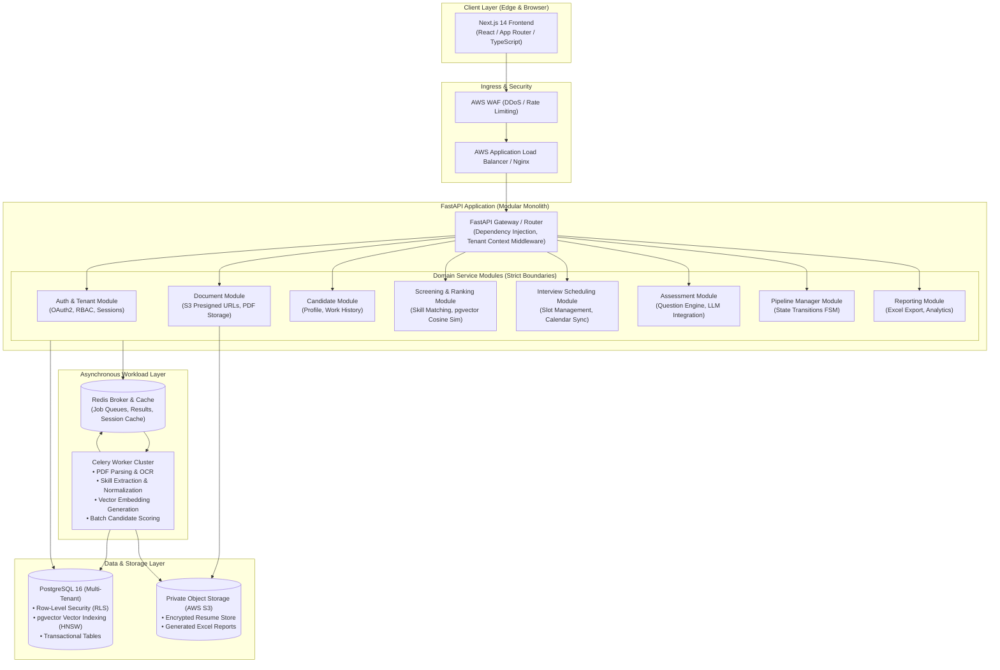

# Target Architecture: Enterprise Modular Monolith SaaS

This document defines the approved initial enterprise architecture for the transformed AI HR SaaS platform.

The architectural paradigm is an **Asynchronous Modular Monolith** deployed via Docker on AWS, featuring:
- **Next.js** Frontend (React / TypeScript).
- **FastAPI** Backend with strict Domain-Driven Module Boundaries.
- **PostgreSQL** with **pgvector** for transactional data and vector search.
- **Redis** as the caching layer and Celery message broker.
- **Celery** background worker pool for compute-heavy ML and NLP tasks.
- **Private Object Storage** (AWS S3) for encrypted resume PDFs and exports.

---

## 1. High-Level Modular Monolith Architecture Diagram



---

## 2. Domain Module Decomposition & Database Ownership

The backend will be structured under a unified Python repository with strict separation of concerns:

```
backend/
├── app/
│   ├── core/                  # Cross-cutting concerns
│   │   ├── config.py          # Pydantic BaseSettings
│   │   ├── database.py        # SQLAlchemy AsyncSession / Engine
│   │   ├── security.py        # JWT, hashing, password verification
│   │   └── middleware.py      # Multi-tenant context injection
│   │
│   ├── modules/               # Domain-Driven Modules
│   │   ├── auth/              # Tenant, User, Role, OAuth2
│   │   ├── documents/         # S3 interaction, presigned upload URLs
│   │   ├── candidates/        # Candidate profiles, metadata
│   │   ├── skills/            # Taxonomy, alias resolution, SkillExtractor
│   │   ├── screening/         # ResumeRanker, pgvector semantic search
│   │   ├── pipeline/          # FSM Pipeline Manager, status transitions
│   │   ├── interviews/        # Scheduling, slot availability, ICS generation
│   │   ├── assessments/       # Question generation engine, LLM prompts
│   │   └── reporting/         # Export generation (Excel, CSV, Metrics)
│   │
│   ├── workers/               # Celery task definitions
│   │   ├── celery_app.py      # Celery initialization with Redis broker
│   │   ├── tasks_documents.py # Async PDF parsing & text extraction
│   │   ├── tasks_screening.py # Async embedding generation & ranking
│   │   └── tasks_reporting.py # Async Excel export builds
│   │
│   └── main.py                # FastAPI entrypoint mounting module routers
```

### Database Ownership & Boundaries:
- **Strict Write Ownership**: Each domain module strictly owns its database tables and write operations. A module must **never** execute direct INSERT, UPDATE, or DELETE operations on tables owned by another domain. State mutations are performed strictly through the owning module's Service API.
- **Controlled Read Models & Cross-Module Queries**: To support efficient reporting and high-performance dashboard views, controlled cross-domain read queries, read models, and materialized projections are permitted. Cross-domain queries should default to public Service interfaces or dedicated read-only repositories.
- **Tenant Isolation**: Every database query enforces the `tenant_id` scope derived from the authenticated request context, backed by PostgreSQL Row-Level Security (RLS).

---

## 3. Future Microservice Extraction Path & Complexity

Because all domains are strictly encapsulated as isolated packages with their own routers, schemas, services, and repositories:
1. **Identified Scale Bottlenecks**: If candidate document parsing or screening semantic matching outgrows the main web process, the `modules/screening/` and `modules/documents/` folders can be extracted into an independent FastAPI microservice container.
2. **Requirements for Microservice Extraction**:
   - Extracting a domain into an independent microservice is **not** simply a deployment toggle. It requires implementing:
     - **Database Decomposition**: Splitting the shared PostgreSQL database into independent databases, fully severing any remaining read joins.
     - **Distributed Saga Coordination**: Managing multi-step workflows across network boundaries with compensating transactions.
     - **Service Contracts & SDKs**: Formalizing gRPC or versioned OpenAPI contracts with retries, timeouts, and circuit breakers.
     - **Event-Driven Infrastructure**: Deploying an asynchronous event broker (e.g. Apache Kafka or AWS SQS/SNS) for reliable eventual consistency.
3. **Architectural Posture**: The asynchronous modular monolith avoids the operational fragility of microservices during early product stages while preserving full architectural readiness for independent service extraction when justified by organizational or traffic scale.
