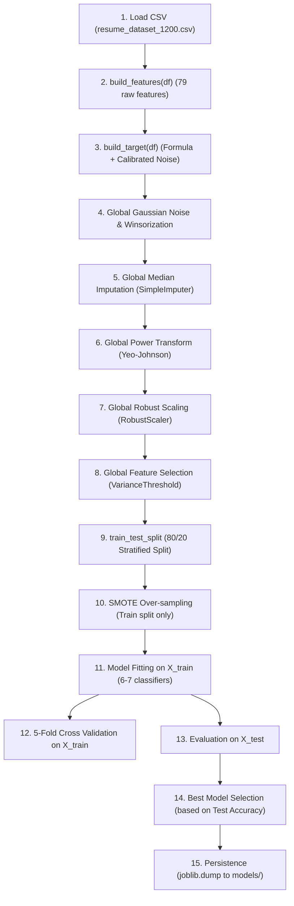

# ML Training Methodology & Pipeline Evaluation Audit

This document details the exact technical audit of `train_models.py` and `preprocessing.py`. It inspects data transformation ordering, data leakage vectors, cross-validation isolation, test-set usage, and model serialization.

---

## 1. End-to-End Pipeline Execution Sequence

From the inspection of `train_pipeline()` (`train_models.py:727-740`) and `load_and_preprocess()` (`preprocessing.py:517-551`), the exact execution order is:



### Detailed Chronological Step Breakdown:
1. **Dataset Loading**: `pd.read_csv("resume_dataset_1200.csv")` loads all 1,200 rows into memory (`preprocessing.py:533`).
2. **Feature Extraction (`build_features`)**: Generates 79 input features (12 core numeric, 8 interaction terms, 6 cluster coverage scores, 13 binary/categorical flags, 40 one-hot skill indicators) across all 1,200 rows.
3. **Synthetic Target Construction (`build_target`)**: Computes `_compute_hr_score()` and applies calibrated boundary noise flips globally across all 1,200 rows.
4. **Noise & Winsorization**: Adds Gaussian noise to the first 12 numeric features (`_add_noise`) and clips extremes to $\pm 3.5\sigma$ (`_winsorize`) globally (`preprocessing.py:421-422`).
5. **Imputation**: `SimpleImputer(strategy="median").fit_transform(X)` is executed **globally across the entire 1,200-row dataset** (`preprocessing.py:423`).
6. **Power Transformation**: `PowerTransformer(method="yeo-johnson").fit_transform(X)` is executed **globally across the entire dataset** (`preprocessing.py:426`).
7. **Scaling**: `RobustScaler().fit_transform(X)` is executed **globally across the entire dataset** (`preprocessing.py:428`).
8. **Feature Selection**: `VarianceThreshold(0.001).fit_transform(X)` prunes near-constant features (79 raw $\rightarrow$ 37 retained features) **globally across the entire dataset** (`preprocessing.py:429`, `models/metadata.json:15-16`).
9. **Train/Test Splitting**: Only after steps 2–8 is `train_test_split(X, y, test_size=0.20, random_state=42, stratify=y)` invoked (`preprocessing.py:539-541`).
10. **Class Rebalancing (SMOTE)**: `apply_smote(X_train, y_train)` is executed **strictly on the training split** (`preprocessing.py:545`).
11. **Model Training**: 6 standard classifiers (`RandomForest`, `LogisticRegression`, `LinearSVC`, `KNN`, `GradientBoosting`, `MLP`) plus optional `XGBoost` are fitted on `X_train` (`train_models.py:165`).
12. **Cross-Validation**: 5-fold CV is executed via `cross_val_score(model, self.X_train, self.y_train, cv=5, scoring="accuracy")` (`train_models.py:194-196`).
13. **Model Evaluation**: Metrics (`accuracy`, `precision`, `recall`, `f1`, `roc_auc`, `confusion_matrix`, `rmse`, `mae`) are computed on `X_test` (`train_models.py:168-222`).
14. **Best Model Selection**: `self.best_model_name = max(self.results, key=lambda k: self.results[k]["test_accuracy"])` selects the production model **directly from the test set evaluation** (`train_models.py:231-233`).
15. **Serialization**: Models and transformers are dumped via `joblib.dump()` into `models/` (`train_models.py:243-248`, `preprocessing.py:461-480`).

---

## 2. Critical Audit Findings: Data Leakage & Evaluation Flaws

### A. Pre-Split Data Leakage (Severe)
- **Finding**: `SimpleImputer`, `PowerTransformer`, `RobustScaler`, and `VarianceThreshold` are all called via `.fit_transform()` inside `ResumePreprocessor.fit_transform(df)` before the train/test split occurs (`preprocessing.py:537-540`).
- **Impact**: 
  - The mean, median, IQR, Yeo-Johnson parameters $\lambda$, and variance statistics calculated on `X` include the 20% test partition (240 test samples).
  - Information from the unseen test split leaks into the training partition.
  - While SMOTE is correctly isolated to `X_train`, the global scaling and imputation constitute classic data leakage.

### B. Test-Set Reuse for Model Selection (Optimism Bias)
- **Finding**: In `train_models.py:231-233`:
  ```python
  self.best_model_name = max(
      self.results, key=lambda k: self.results[k]["test_accuracy"]
  )
  ```
- **Impact**: The test set is used as a validation set to select the winner among 7 models. The test performance reported is therefore optimistically biased. In an enterprise pipeline, model selection must be performed via cross-validation on `X_train`, and `X_test` (or a dedicated hold-out set) must only be evaluated once for final unbiased reporting.

### C. CV Within Fold Leakage
- **Finding**: In `train_models.py:194`:
  ```python
  cv_scores = cross_val_score(model, self.X_train, self.y_train, cv=5, scoring="accuracy")
  ```
- **Impact**: `self.X_train` was already resampled using SMOTE (`preprocessing.py:545`). Applying K-fold cross-validation on a dataset that has *already been synthetically oversampled* leads to synthetic points derived from the same original samples being split across both the training fold and the validation fold. Cross-validation must be executed inside an `imblearn.pipeline.Pipeline` where SMOTE is applied only inside each training fold.

### D. Purpose and Reality of Label Noise
- **Verified Code**: `preprocessing.py:79-82, 253-265`.
- **Why It Exists**: Label noise is deliberately injected because the target variable does not come from real hiring decisions. Without noise, tree-based models reverse-engineer the deterministic formula in `_compute_hr_score` and yield 99.5%+ trivial accuracy.
- **Why It Disqualifies Production Readiness**: The models are not predicting candidate quality; they are fitting a noisy mathematical polynomial generated by the codebase itself.

---

## 3. Production Suitability Verdict

| Criteria | Existing State | Production Standard | Pass/Fail |
|---|---|---|:---:|
| **Data Separation** | Transformers fitted on full dataset | Fitted strictly on `X_train`, then applied to `X_val`/`X_test` | **FAIL** |
| **Model Selection** | Chosen by highest `test_accuracy` | Chosen by CV score on training folds; test set held out | **FAIL** |
| **CV Pipeline** | SMOTE applied prior to K-Fold CV | Transformers & SMOTE wrapped in `imblearn.pipeline.Pipeline` | **FAIL** |
| **Ground Truth** | Synthetic formula with flipped labels | Real historical hiring decisions / verified rubrics | **FAIL** |
| **Ethical & Bias** | Explicit age penalty term | Fair-lending / EEOC audit, PII removal, bias testing | **FAIL** |

**Conclusion**: The existing ML pipeline is a functional academic/prototype demonstration. It is **not production-ready** for enterprise recruitment without complete pipeline restructuring.
