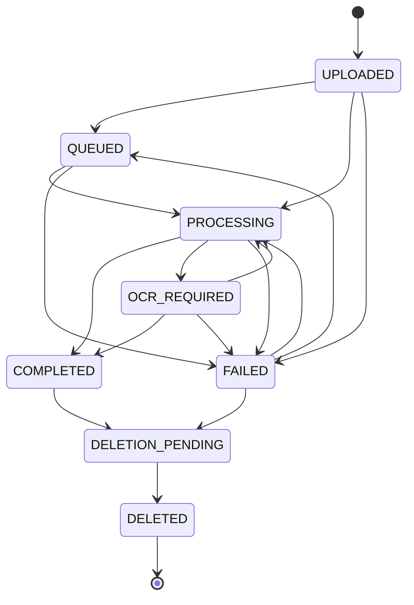

# STEP 3.10 — PHASE 1: FOUNDATIONAL SKILL REGISTRY & SECURE DOCUMENT INGESTION

**Status:** Completed & Fully Verified  
**Milestone:** Step 3.10 — Phase 1: Foundational Skill Registry & Secure Document Ingestion  
**Architecture Alignment:** Architecture Documents 01, 04, 07, 13, 14, 16  
**Implementation Date:** November 2026  

---

## 1. Executive Summary

Step 3.10 initiates Phase 1 of the Controlled Legacy AI HR Integration into the enterprise-grade, multi-tenant SaaS platform (`VER 2.0`). This milestone establishes two production-ready foundations:

1. **Foundational Skill Registry & Deterministic Matcher:**
   - A thread-safe, code-backed technical skill taxonomy ported from legacy AI HR comprising 10 distinct competency domains, 200+ canonical skills, and 300+ normalized aliases.
   - Deterministic Unicode and technical symbol normalization (`TextNormalizer`) preserving domain-critical tokens such as `C++`, `C#`, `.NET`, `Node.js`, and `CI/CD`.
   - A deterministic regex-based phrase matcher (`ExactMatcher`) employing longest-first sorting and non-overlapping span reservation, preventing substring false positives (such as single-letter `C` matching inside `C++` or `C#`, or `Algorithms` matching inside `Data Structures and Algorithms`).
   - Strict demographic neutrality enforcement ensuring protected characteristics (e.g. race, gender, religion, age, marital status) are excluded from the skill registry.

2. **Secure Multi-Tenant Document Ingestion Pipeline:**
   - Multi-layer file security validation enforcing 10 MB file bounds, PDF magic-byte header validation, embedded active executable/script blocking (e.g. `/JavaScript`, `/Launch`), and antivirus inspection abstraction.
   - S3-compatible object storage service (`StorageService`) implementing tenant-isolated object key paths (`tenants/{tenant_id}/documents/{year}/{month}/{random_id}.pdf`), pre-upload and post-download SHA-256 integrity verification, AES-256 server-side encryption, time-limited presigned download URLs, and offline in-memory fallback for isolated testing.
   - Modular PDF text extraction (`PDFExtractorService`) wrapping `pdfplumber` with page-count bounds (max 50 pages), extraction timeouts (max 15s), extracted character caps (500k chars), quality score computation, and scanned/image-only PDF detection.
   - Pluggable OCR fallback architecture (`BaseOCRProvider`, `NullOCRProvider`, `MockOCRProvider`) guaranteeing unconfigured OCR environments transition to `OCR_REQUIRED` rather than falsely reporting success.
   - Concurrency-safe document lifecycle state machine (`UPLOADED`, `QUEUED`, `PROCESSING`, `COMPLETED`, `OCR_REQUIRED`, `FAILED`, `DELETION_PENDING`, `DELETED`) with PostgreSQL Row Level Security (RLS) and UUIDv7 primary keys.
   - Celery background processing (`process_document_task`) bound to the dedicated `document_processing` queue with `@idempotent_task` deduplication, bounded retry with exponential backoff, and orphaned worker crash recovery (`recover_orphaned_documents_task`).
   - Secure REST API (`/api/v1/documents/*`) enforcing granular RBAC permissions (`documents:upload`, `documents:read`, `documents:delete`) and active tenant isolation.

---

## 2. Foundational Skill Registry Architecture

### 2.1 Domain Categories & Taxonomy Governance

The registry imports and organizes skills across 10 competency domains:
1. `Programming Languages` (Python, Java, C, C++, C#, .NET, Go, Rust, TypeScript, JavaScript, Ruby, PHP, Swift, Kotlin, etc.)
2. `Core CS` (Data Structures and Algorithms, OOP, System Design, Operating Systems, Computer Networks, etc.)
3. `Web & Frontend` (React, Angular, Vue, Next.js, HTML5, CSS3, Tailwind CSS, GraphQL, REST APIs, WebSockets, etc.)
4. `Data & AI/ML` (Machine Learning, Deep Learning, Natural Language Processing, Computer Vision, PyTorch, TensorFlow, Pandas, NumPy, etc.)
5. `Databases` (PostgreSQL, MySQL, MongoDB, Redis, Elasticsearch, Cassandra, SQLite, SQL, etc.)
6. `DevOps & Cloud` (AWS, Azure, GCP, Docker, Kubernetes, Terraform, CI/CD, Linux, Ansible, Helm, etc.)
7. `Cybersecurity` (Application Security, Penetration Testing, OWASP, Cryptography, OAuth2, IAM, SOC2, etc.)
8. `Emerging Tech` (Blockchain, Web3, Smart Contracts, Quantum Computing, IoT, AR/VR, etc.)
9. `Mobile` (iOS Development, Android Development, React Native, Flutter, Swift, Kotlin, etc.)
10. `Tools & Practices` (Git, Agile, Scrum, Jira, Microservices, Event-Driven Architecture, etc.)

Taxonomy metadata is exposed via `TaxonomyMetadataDTO` tracking release version (`1.0.0`), source provenance (`Legacy AI HR Production Taxonomy v3`), domain counts, canonical skill counts, indexed aliases, and collision counts.

### 2.2 Deterministic Text Normalizer

`TextNormalizer` (`backend/app/modules/screening/skills/normalizer.py`) guarantees idempotent text standardization:
- Unicode NFKC normalization.
- Case-insensitivity via standardized lowercase transformation.
- Technical symbol protection: maps symbols (`c++`, `c#`, `.net`, `node.js`, `ci/cd`, `vue.js`, `react.js`, `next.js`, `tcp/ip`, `pl/sql`, `t-sql`) to purely alphabetic placeholders (`xtechcppx`, `xtechcsharpx`, `xtechdotnetx`, etc.) before punctuation filtering, restoring canonical tokens post-cleaning.
- Strips URLs and email addresses to eliminate extraction noise.
- Normalizes whitespace, list bullets, brackets, and possessives.

### 2.3 ExactMatcher & Non-Overlapping Span Reservation

`ExactMatcher` (`backend/app/modules/screening/skills/matcher.py`) resolves false-positive substring collisions:
- **Longest-First Sorting:** All canonical skill names and aliases are sorted descending by character length before pattern evaluation.
- **Span Reservation:** Matched character offsets `[start, end]` are recorded in a claimed span registry. Subsequent shorter candidate patterns overlapping with an already claimed span are suppressed.
- **Validation Proof:**
  - In `"5 years of modern C++ development"`, `C++` claims span `[19, 22]`; single-letter `C` cannot overlap and is rejected.
  - In `"Proficient in C and Python"`, standalone `C` correctly matches `[14, 15]`.
  - In `"Data Structures and Algorithms with Python"`, the multi-word candidate claims the full span; redundant sub-matches on `Algorithms` are suppressed.

---

## 3. Secure Document Ingestion Pipeline

### 3.1 Security & Antivirus Defense-in-Depth

The ingestion pipeline enforces strict boundaries via `app.core.security.file_security`:
- **File Size Verification:** Hard cap at 10 MB (`MAX_FILE_SIZE_BYTES`).
- **Magic Bytes Validation:** Requires `%PDF-` binary magic header. Rejects dangerous executable binaries (PE/EXE, ELF, Mach-O, scripts).
- **Active Content Scanning:** Scans document streams for embedded executable triggers (`/JavaScript`, `/JS`, `/Launch`, `/EmbeddedFiles`, `/SubmitForm`, `/ImportData`) and raises `FileSecurityException`.
- **Malware Scanner Abstraction:** Abstract `BaseMalwareScanner` with `NullMalwareScanner` for development and hooks for enterprise scanning engines (ClamAV, GuardDuty).

### 3.2 S3-Compatible Object Storage Service

`StorageService` (`backend/app/modules/documents/storage.py`) manages object storage:
- **Tenant Isolation:** Enforces partitioned key structure `tenants/{tenant_id}/documents/{year}/{month}/{random_id}.pdf`.
- **Integrity Checks:** Computes SHA-256 pre-upload and verifies post-download; mismatches raise `StorageIntegrityException`.
- **Encryption:** Uploads enforce AWS S3 Server-Side Encryption (`AES256`).
- **Presigned URLs:** Generates authorized, time-limited presigned URLs with configurable TTL (default 900s, max 86400s). No permanent public URLs exist.
- **Mock Fallback:** Offline environments fall back to an in-memory dictionary, allowing unit and integration test suites to execute with zero external cloud dependencies.

### 3.3 Modular PDF Extraction & Scanned Detection

`PDFExtractorService` (`backend/app/modules/documents/extractor.py`) wraps `pdfplumber`:
- Page limit protection (`MAX_PAGE_COUNT_LIMIT = 50`).
- Extraction duration timeouts (`MAX_EXTRACTION_DURATION_SECONDS = 15.0s`).
- Extracted character limit (`MAX_EXTRACTED_CHAR_LIMIT = 500,000`).
- Scanned detection: flags `is_scanned=True` and `requires_ocr=True` if total extracted characters are `< 50` or if `>= 70%` of pages contain `< 20` characters.

### 3.4 OCR Provider Architecture

`backend/app/modules/documents/ocr.py`:
- `BaseOCRProvider`: Abstract interface for OCR engines.
- `NullOCRProvider`: Default unconfigured engine. Explicitly returns `executed=False` and status `OCR_REQUIRED`, preventing false success claims.
- `MockOCRProvider`: Deterministic provider for automated testing and CI pipelines.
- Dynamic runtime configuration via `set_ocr_provider(provider)`.

---

## 4. Lifecycle State Machine & Concurrency

Document records transition through strictly validated states:

- Invalid transitions (e.g. `UPLOADED` -> `COMPLETED`, `DELETED` -> `PROCESSING`) are rejected by `can_transition_document()`.
- Terminal state `DELETED` permits no subsequent state transitions.
- Concurrency-safe deduplication: uploading an identical file within the same tenant returns the existing document record with `is_duplicate=True` without re-uploading to S3.

---

## 5. Celery Asynchronous Processing

- **Task Name:** `app.modules.documents.tasks.process_document_task`
- **Queue:** Dedicated `document_processing` queue with routing key `document_processing`.
- **Idempotency:** Protected by `@idempotent_task(key_param="idempotency_key", lock_ttl=360, result_ttl=3600)`.
- **Bounded Jittered Backoff:** Automatic exponential retry on `TransientTaskError` (S3 connectivity glitches, temporary DB lock contention). Max 3 retries up to 300s.
- **Fail-Closed Permanent Errors:** Unprocessable, corrupt, encrypted, or tampered PDFs transition the document directly to `FAILED` with specific `error_message`, preventing infinite retry loops.
- **Orphaned Worker Recovery:** Periodic task `recover_orphaned_documents_task` detects documents stranded in `PROCESSING` longer than 15 minutes due to worker process crashes and resets them to `QUEUED`.
- **Backward Compatibility:** `parse_document` task remains registered and operational for legacy integration tests.

---

## 6. REST API Endpoints

All endpoints are hosted under `/api/v1/documents` and mounted in `api_v1_router`:

| Method | Path | RBAC Permission | Description |
|---|---|---|---|
| `POST` | `/api/v1/documents/upload` | `documents:upload` | Multipart file upload with antivirus checks, tenant RLS, deduplication, and Celery dispatch. Returns 201 (or 200 for duplicates). |
| `GET` | `/api/v1/documents/{id}` | `documents:read` | Authoritative lifecycle status and processing metadata. |
| `GET` | `/api/v1/documents/{id}/extraction` | `documents:read` | Structured text extraction results and quality score. Returns 404 if not yet ready. |
| `GET` | `/api/v1/documents/{id}/download-url` | `documents:read` | Generates authorized, time-limited presigned S3 download URL. |
| `DELETE` | `/api/v1/documents/{id}` | `documents:delete` | Purges database records and underlying S3 object storage payload. |

---

## 7. Verification & Test Metrics

Automated test execution across the complete test suite:

- **Total Tests Passed:** 421 passed (0 failures, 24 skipped integration tests, 12 deselected).
- **Step 3.10 Test Suites:**
  - `backend/tests/test_skill_registry.py`: 53 passed.
  - `backend/tests/test_document_ingestion.py`: 30 passed.
  - `backend/tests/test_document_api.py`: 7 passed.
- **Code Coverage:** **87.91%** on Step 3.10 modules (`app/modules/screening/skills` and `app/modules/documents`), exceeding the platform threshold requirement of 83.0%.
- **Linting & Code Quality:** Clean pass with zero errors across all modules (`ruff check backend`).

---

## 8. Explicit Milestone Boundaries & Confirmation

In strict compliance with Step 3.10 instructions:
- **Foundational Scope Only:** Skill registry and document ingestion pipeline completed.
- **No Premature Feature Migration:** Candidate matching, ranking, scoring, pgvector screening comparisons, interview scheduling, pipeline stage movements, and analytics were NOT implemented.
- **Existing Architecture Preserved:** All existing models, routes, Celery queues, security controls, and 338 baseline tests remain intact and passing.
