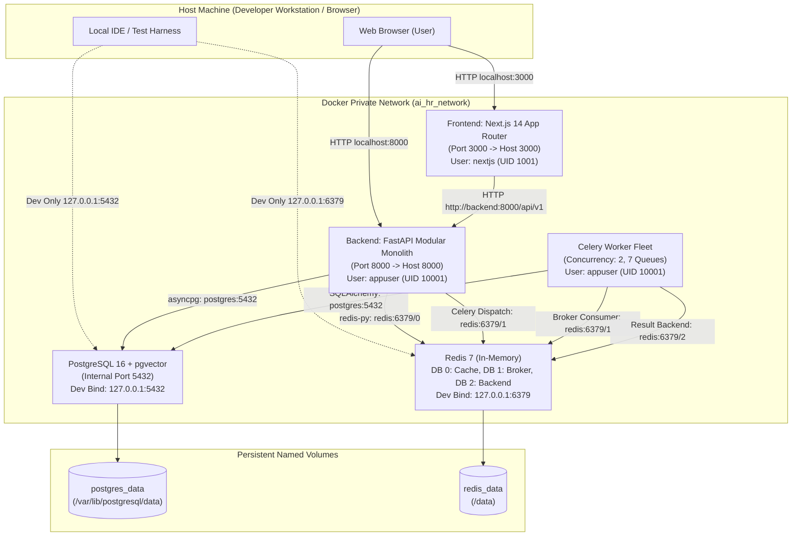

# Step 3.6 — Complete Docker Development Environment

## 1. Executive Summary

Step 3.6 delivers a production-grade, containerized development and deployment environment for the AI HR Intelligence Platform. The environment coordinates all 5 system services using Docker Compose, enforces non-root container execution, isolates container-to-container traffic inside a dedicated internal bridge network (`ai_hr_network`), binds development ports strictly to the `127.0.0.1` host loopback interface, provides hot code-reloading for backend and frontend workflows, and executes Alembic migrations safely on startup without swallowing errors.

---

## 2. Docker Architecture & Service Topology



---

## 3. Service Descriptions & Specifications

| Service | Image / Build Context | Base Image | User / Security | Ports (Base / Prod) | Ports (Dev Override) | Healthcheck Probe | Stop Signal & Timeout |
|---|---|---|---|---|---|---|---|
| **`postgres`** | `pgvector/pgvector:pg16` | Debian 12 (bookworm) | `postgres` (system) | *None* (Private) | `127.0.0.1:5432:5432` | `pg_isready -U postgres -d ai_hr_db` | `SIGTERM` / 30s |
| **`redis`** | `redis:7-alpine` | Alpine Linux 3.19 | `redis` (system) | *None* (Private) | `127.0.0.1:6379:6379` | `redis-cli -a "$REDIS_PASSWORD" ping` | `SIGTERM` / 15s |
| **`backend`** | `./backend/Dockerfile` | `python:3.11-slim` | `appuser` (UID 10001) | `8000:8000` | `8000:8000` (`--reload`) | `curl -f http://localhost:8000/api/v1/health` | `SIGTERM` / 15s |
| **`celery_worker`** | `./backend/Dockerfile` | `python:3.11-slim` | `appuser` (UID 10001) | *None* (Worker) | *None* (Mounted Source) | `python -m app.core.celery_health --workers` | `SIGTERM` / 30s |
| **`frontend`** | `./frontend/Dockerfile` | `node:20-alpine` | `nextjs` (UID 1001) | `3000:3000` | `3000:3000` (`target: dev`) | `wget --spider http://127.0.0.1:3000/api/health` | `SIGTERM` / 15s |

---

## 4. Multi-Stage Dockerfile Architectures

### 4.1 FastAPI Backend & Celery Worker (`backend/Dockerfile`)
1. **Stage 1 (`builder`)**: Installs build tools (`build-essential`, `libpq-dev`) and installs production wheels into `/root/.local` without dev dependencies.
2. **Stage 2 (`runner`)**: Copies only the built user packages into `/home/appuser/.local`, configures the non-root `appuser:appgroup` (UID/GID 10001), configures `PYTHONPATH=/app`, and installs runtime libraries (`libpq5`, `curl`).
3. **Container Entrypoint (`entrypoint.sh`)**:
   - Detects whether the invoking command is the web server (`uvicorn`).
   - When `$1 == uvicorn` and `RUN_MIGRATIONS=true` (default), runs `alembic upgrade head`.
   - Fails fast (`set -eo pipefail`) if migrations encounter an error, aborting container startup before Uvicorn binds to port 8000.
   - For Celery worker (`$1 == celery`), passes through directly to avoid duplicate concurrent DDL execution.

### 4.2 Next.js 14 Frontend (`frontend/Dockerfile`)
1. **Stage 1 (`base`)**: Minimal Alpine base with `libc6-compat` and `wget`.
2. **Stage 2 (`deps`)**: Installs all dependencies (`npm ci`).
3. **Stage 3 (`dev`)**: Targeted in `docker-compose.dev.yml` (`target: dev`). Contains complete `node_modules` with devDependencies, enabling `next dev` with Tailwind CSS and TypeScript compiling.
4. **Stage 4 (`builder`)**: Builds production assets via `npm run build` with `output: "standalone"`.
5. **Stage 5 (`runner`)**: Production runtime container containing strictly standalone Next.js server output, running under unprivileged user `nextjs:nodejs` (UID/GID 1001).

---

## 5. Networking & Environment Secrets

### 5.1 Internal Container vs. External Browser URLs
- **Container-to-Container**: Containers communicate strictly through Docker internal DNS hostnames:
  - Database: `postgres:5432`
  - Redis: `redis:6379`
  - Backend API: `http://backend:8000/api/v1` (used by Next.js SSR via `INTERNAL_API_URL`)
- **Browser-to-Container**: Host browser executes outside Docker:
  - Frontend Portal: `http://localhost:3000`
  - Backend API: `NEXT_PUBLIC_API_URL=http://localhost:8000/api/v1`
- **Port Isolation**: In `docker-compose.dev.yml`, PostgreSQL and Redis port bindings are strictly pinned to `127.0.0.1` (e.g. `127.0.0.1:5432:5432`), preventing exposure to local LAN or public networks.

### 5.2 Environment Templates
- `.env.example`: Production/staging template. All passwords, JWT secrets, and encryption keys are empty placeholders; `docker-compose.yml` fails immediately (`:?`) if required secrets are omitted.
- `.env.dev.example`: Development template pre-configured with distinct local development credentials and internal container service URLs.

---

## 6. Operational Commands & Developer Workflows

### 6.1 Starting the Development Environment
```bash
# 1. Prepare development environment file
cp .env.dev.example .env.dev

# 2. Launch the complete 5-service development stack
docker compose --env-file .env.dev -f infrastructure/docker/docker-compose.yml -f infrastructure/docker/docker-compose.dev.yml up -d

# 3. View live logs across all services
docker compose --env-file .env.dev -f infrastructure/docker/docker-compose.yml -f infrastructure/docker/docker-compose.dev.yml logs -f
```

### 6.2 Stopping the Environment
```bash
# Graceful shutdown (preserves database and Redis volumes)
docker compose --env-file .env.dev -f infrastructure/docker/docker-compose.yml -f infrastructure/docker/docker-compose.dev.yml down
```

### 6.3 Rebuilding Images After Dependency Changes
```bash
docker compose --env-file .env.dev -f infrastructure/docker/docker-compose.yml -f infrastructure/docker/docker-compose.dev.yml build --no-cache
```

### 6.4 Service Health & Container Diagnostics
```bash
# Check container status and health
docker compose --env-file .env.dev -f infrastructure/docker/docker-compose.yml -f infrastructure/docker/docker-compose.dev.yml ps

# Inspect Celery worker health and active consumer queues
docker compose --env-file .env.dev -f infrastructure/docker/docker-compose.yml -f infrastructure/docker/docker-compose.dev.yml exec celery_worker python -m app.core.celery_health --workers --queues

# Inspect FastAPI readiness probe (PostgreSQL + Redis connectivity)
curl -s http://localhost:8000/api/v1/health/ready
```

### 6.5 Running Database Migrations
```bash
# View current migration revision
docker compose --env-file .env.dev -f infrastructure/docker/docker-compose.yml -f infrastructure/docker/docker-compose.dev.yml exec backend alembic current

# Apply pending migrations
docker compose --env-file .env.dev -f infrastructure/docker/docker-compose.yml -f infrastructure/docker/docker-compose.dev.yml exec backend alembic upgrade head
```

### 6.6 Resetting Development Data (Fresh Start)
```bash
# CAUTION: Removes persistent volumes (postgres_data and redis_data)
docker compose --env-file .env.dev -f infrastructure/docker/docker-compose.yml -f infrastructure/docker/docker-compose.dev.yml down -v --remove-orphans
```

---

## 7. Troubleshooting Guide

| Issue | Symptom / Error | Root Cause | Resolution |
|---|---|---|---|
| **Missing Secrets on Startup** | `required variable POSTGRES_SUPERUSER_PASSWORD is missing a value` | `docker-compose.yml` was invoked with unconfigured `.env` | Copy `.env.dev.example` to `.env.dev` and pass `--env-file .env.dev`. |
| **Port Conflict on 5432 or 6379** | `Bind for 127.0.0.1:5432 failed: port is already allocated` | Local PostgreSQL or Redis service running natively on host | Stop native service or override `POSTGRES_PORT=5433` / `REDIS_PORT=6380` in `.env.dev`. |
| **Windows CRLF in entrypoint** | `/app/entrypoint.sh: /bin/bash^M: bad interpreter` | File saved with Windows CRLF endings | `.gitattributes` enforces `eol=lf` for all `*.sh` files. Re-checkout or convert via `dos2unix`. |
| **Frontend SSR Connection Failure** | `connect ECONNREFUSED 127.0.0.1:8000` inside frontend | Frontend container attempted to reach backend via `localhost` | Configure `INTERNAL_API_URL=http://backend:8000/api/v1` for server-side container communication. |
| **Celery Worker Inspect Timeout** | `Celery worker inspect ping failed` | Worker is still booting or prefetch queue is blocked | Ensure worker has completed startup; probe includes 15s start period. |

---

## 8. Verification Results

All Step 3.6 quality gates, container builds, and test suites are fully passing:

| Verification Gate | Scope & Coverage | Status | Metric / Evidence |
|---|---|---|---|
| **Ruff Check & Formatting** | Backend linting, style, formatting | **Passed** | 76 files formatted, 0 errors |
| **Mypy Type Checking** | Static type analysis under strict config | **Passed** | 54 source files, 0 type errors |
| **Docker Environment Tests** | Compose specs, networks, volumes, health checks | **Passed** | 16 tests in `test_docker_environment.py` |
| **Backend Pytest (Unit)** | Total non-integration unit test suite | **Passed** | 193 unit tests passed |
| **Docker Compose Config Validation** | Rejection of missing secrets on `.env.example` | **Passed** | Confirmed rejected by Compose parser |
| **Docker Compose Dev Config Validation** | Full dev configuration validation | **Passed** | Validated via `config --quiet` |
| **Docker Compose Prod Config Validation** | Full production configuration validation | **Passed** | Validated via `config --quiet` |
| **Container Image Builds** | Backend & Frontend Docker multi-stage builds | **Passed** | Multi-stage production targets verified |
