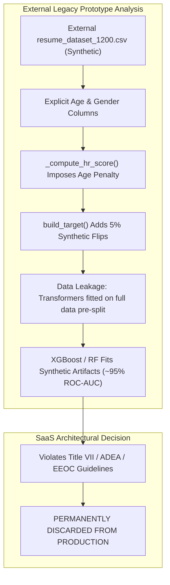
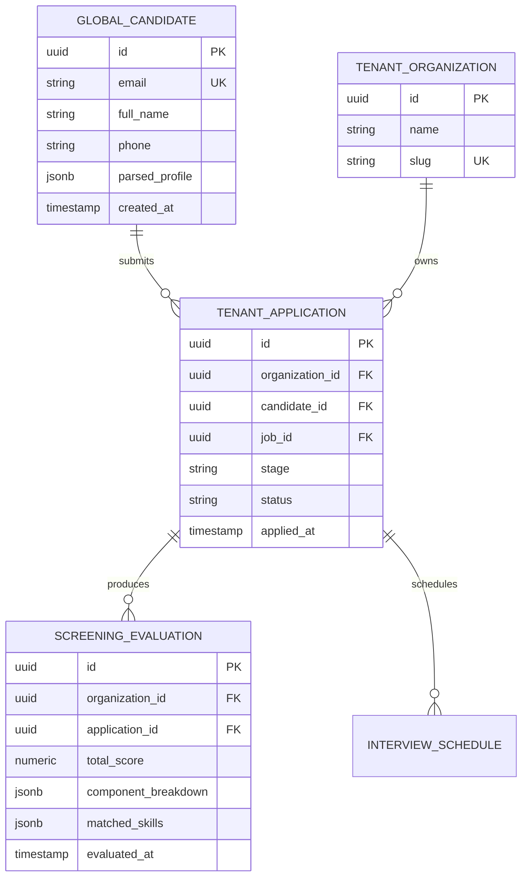
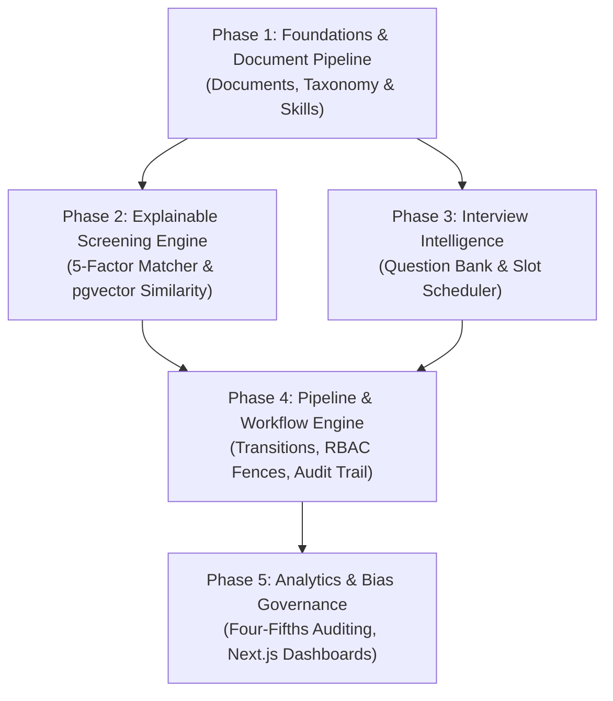

# Step 3.9 — Legacy AI HR Integration Preparation (Corrected)

## 1. Executive Summary & Scope Definition

### 1.1 Objective and Architectural Scope
Step 3.9 constitutes the formal **Legacy AI HR Integration Preparation** for the enterprise-grade, multi-tenant SaaS AI HR Intelligence Platform (`VER 2.0`). Steps 3.2 through 3.8 established an enterprise foundation: an asynchronous FastAPI backend, modular monolith domain layout, PostgreSQL with Row-Level Security (RLS) tenant isolation, SQLAlchemy 2.0 with asyncpg, pgvector (1536-dimensional vector storage and cosine similarity search), distributed Celery workers with Redis broker idempotency, containerized Docker Compose topology, enterprise security perimeter, and an automated testing suite.

The objective of Step 3.9 is **architectural integration planning and preparation, NOT premature full feature migration**. This document systematically inspects the external legacy prototype (`AI HR`), isolates reusable domain logic, uncovers fundamental machine learning and demographic bias defects, defines type-safe integration contracts, and maps an incremental, dependency-governed migration roadmap that preserves the platform's multi-tenant isolation, security policies, and Responsible AI commitments.

### 1.2 Strict Architectural Guardrails & Clarification of Current State
1. **No Monolithic Streamlit Porting**: The legacy Streamlit application (`app.py`) is an unauthenticated single-session prototype with mutable global state. It will **never** be ported or mounted directly into the SaaS platform.
2. **Current State vs. Planned Implementations**:
   - **Document Processing**: `backend/app/modules/documents/tasks.py` contains an existing Celery placeholder task (`parse_document`) that logs parameters and returns a mock status dictionary. The production PDF parsing, OCR fallback, SHA-256 deduplication, and S3 ingestion pipeline are **planned future integration work**, not implemented code.
   - **Skill Extraction & Matching**: `backend/app/modules/screening/` is currently an empty module directory containing only an `__init__.py`. Neither the skill taxonomy, regex normalizer, nor candidate matching engine exist in the current codebase.
   - **Embeddings Infrastructure vs. Matching Engine**: `backend/app/modules/embeddings/` contains an operational vector storage, dimension validation, and cosine similarity service against PostgreSQL `pgvector`. This is **embedding infrastructure**, not an implemented five-factor candidate-matching engine.
   - **Interviews and Pipeline Modules**: `backend/app/modules/interviews/` and `backend/app/modules/pipeline/` contain only skeleton package `__init__.py` files. Question generation, scheduling, and RLS-backed pipeline FSM transitions are **planned future integration work**.
   - **Frontend Routes**: `frontend/src/app/` contains implementations for `/`, `/login`, `/dashboard`, `/api/health`, and `/api/backend-health`. The five role-specific portals (Candidate, Recruiter, Hiring Manager, Org Admin, Super Admin) are **proposed architectural designs**, not implemented screens.
3. **Strict Prohibition of Autonomous Rejections**: The legacy automated candidate rejection loop (`HRAgent.run_full_pipeline` rejecting all candidates outside the top 5) is permanently deprecated. AI outputs are strictly decision-support recommendations; human authorization is mandatory for candidate state changes.
4. **Permanent Removal of Biased Features**: The legacy tabular ML model (`XGBoost`, `RandomForest`, etc.) and preprocessing pipeline (`preprocessing.py`) explicitly utilized `age` and `gender_encoded`, imposing an explicit mathematical age penalty (`- 0.25 * max(0.0, (age - 45) / 5.0)`). These models, features, and synthetic training datasets are classified as discriminatory and rejected from production deployment.
5. **No Architectural Microservices Sprawl**: All integrated capabilities will reside within the existing modular monolith structure (`backend/app/modules/`), preserving transactional boundaries and eliminating cross-network distributed transactions.

---

## 2. Legacy Repository Discovery & Baseline Inventory (Section 12.A)

### 2.1 Provenance and Verification of Legacy Source Material
The SaaS repository (`VER 2.0`) does **not** contain the legacy AI HR source files. Source inspection for the legacy prototype was conducted directly against the external source directory (`C:\Users\bharg\OneDrive\Desktop\AI HR\AI HR\`) and its unpacked archive. Findings concerning legacy algorithms, demographic bias, and synthetic data artifacts are based on this external inspection. Reviewers operating within an isolated SaaS repository workspace must reference that external archive to independently reproduce legacy findings.

### 2.2 Capability Baseline & Readiness Assessment

Every capability is evaluated against four strict readiness categories:
- **Ready for future integration**: Self-contained logic, high architectural alignment, minimal external dependencies.
- **Ready after specified modifications**: Requires refactoring (e.g. converting procedural code to async services, adding tenant scoping).
- **Blocked by unresolved dependencies**: Missing prerequisite upstream models, schemas, or external APIs.
- **Not recommended for reuse**: Flawed, biased, or incompatible with SaaS architecture.

| # | Functional Capability | Legacy Source File(s) | Verified Existing Code in SaaS (`VER 2.0`) | Existing Placeholder / Infrastructure | Proposed Future Integration | Readiness Category | Outstanding Dependencies |
|---|---|---|---|---|---|---|---|
| **1** | **Resume & Document Ingestion** | `utils.py`, `app.py` | None | Celery queue `document_processing`, `BaseTask` retry logic, `parse_document` placeholder task in `backend/app/modules/documents/tasks.py` | Tier 1 (`pdfplumber`) text extraction, Tier 2 (`AWS Textract`) OCR fallback, SHA-256 deduplication, S3 bucket storage | **Ready after specified modifications** | S3 bucket integration, document database schema & migrations |
| **2** | **Skill Extraction & Taxonomy** | `skill_extractor.py` | None | Package `__init__.py` in `backend/app/modules/screening/` | Port `_RAW_TAXONOMY`, `TextNormalizer`, and `ExactMatcher` into `backend/app/modules/screening/skills/` | **Ready for future integration** | None (pure Python / regex domain logic) |
| **3** | **Candidate-Job Matching & Scoring** | `hr_agent.py`, `preprocessing.py` | None | Vector storage, dimension validation & cosine similarity in `backend/app/modules/embeddings/service.py`; design doc in `docs/architecture/14_candidate_matching_design.md` | Implement 5-component explainable scoring service in `backend/app/modules/screening/matching/` | **Ready after specified modifications** | Skill extraction service (Cap 2), candidate/job database schemas |
| **4** | **Interview Question Generation** | `question_generator.py` | None | Package `__init__.py` in `backend/app/modules/interviews/` | Adapt `_KNOWLEDGE` bank and seniority tier heuristics into `backend/app/modules/interviews/questions/` with PII-redacted LLM fallback | **Ready for future integration** | LLM Provider Gateway integration (for fallback only) |
| **5** | **Interview Scheduling & Calendar** | `hr_agent.py` | None | Package `__init__.py` in `backend/app/modules/interviews/` | Database-backed interview slot reservation, optimistic concurrency locking, RFC 5545 iCalendar generation | **Ready after specified modifications** | Interview database schemas, calendar invite generator |
| **6** | **Pipeline Management & Transitions** | `hr_agent.py` | None | Package `__init__.py` in `backend/app/modules/pipeline/` | Port `VALID_TRANSITIONS` FSM into database-backed transition service with RLS and immutable audit logging | **Ready after specified modifications** | Application database schema, audit log service |
| **7** | **AI/ML Model Training & Evaluation** | `train_models.py`, `models/` | None | None | None | **Not recommended for reuse** | Permanently discarded due to demographic bias and synthetic target leakage |
| **8** | **Analytics, Metrics & Visualization** | `train_models.py`, `app.py`, `static/graphs/` | None | None | Analytical SQL aggregation endpoints in `backend/app/modules/reporting/` driving Next.js dashboard charts | **Ready after specified modifications** | Reporting database views, frontend chart components |
| **9** | **Demo / Mock Candidate Generation** | `utils.py` | None | None | Development-only test seed script | **Ready for future integration** | Candidate database schema |
| **10** | **Results Export (CSV / JSON)** | `utils.py`, `app.py` | None | None | Asynchronous Celery export tasks returning presigned download URLs | **Ready after specified modifications** | Celery storage backend, export schemas |
| **11** | **Streamlit UI Architecture** | `app.py` | None | Next.js 14 baseline (`/`, `/login`, `/dashboard`) | Build 5 role-based Next.js portal experiences | **Not recommended for reuse** | Superseded by Next.js 14 frontend architecture |

---

## 3. Dataset & Data Quality Assessment (Section 12.B)

### 3.1 External Legacy Dataset Profile (`resume_dataset_1200.csv`)
Inspection of `resume_dataset_1200.csv` in the external legacy repository revealed 1,200 synthetic rows spanning: `candidate_id`, `name`, `age`, `gender`, `education`, `field_of_study`, `institution`, `experience_years`, and `skills`.



### 3.2 Evidence-Backed Data Quality and Governance Defects
1. **Synthetic Demographic Inconsistencies**:
   - Random combinatorial name and gender assignments (e.g. `Sarah Nair` marked as `Male`, `Amelia Thomas` marked as `Male`).
   - Contradictory academic trajectories (e.g. candidates with "High School" diplomas attributed to specialized medical or engineering institutes).
2. **Circular Target Generation and Label Leakage**:
   - The target label (`hire_recommendation`, binary 0 or 1) was not empirical hiring data. It was derived synthetically in `preprocessing.py` using a hardcoded heuristic formula (`_compute_hr_score`) calculated directly from the input features.
   - 5% random label flipping was applied via `build_target()`. Consequently, trained classifiers did not discover latent talent signals; they merely approximated the synthetic arithmetic formula.
3. **Pre-Split Transformation Data Leakage**:
   - `ResumePreprocessor.fit_transform()` executed `SimpleImputer`, `RobustScaler`, and `PowerTransformer` across the global 1,200 rows prior to train/test partitioning. This leaked test set distribution parameters (mean, standard deviation, interquartile range) into the training partition, invalidating reported performance metrics.
4. **Explicit Demographic Penalization**:
   - In `preprocessing.py`, line 214 of `_compute_hr_score` explicitly penalizes candidates over age 45:
     ```python
     # Legacy snippet from external preprocessing.py:
     if age > 45:
         hr_score -= 0.25 * ((age - 45) / 5.0)
```
   - Both `age` and `gender_encoded` were persisted as active inputs in `models/feature_names.pkl` and ingested by `XGBoost`.
   - **Remediation**: The synthetic dataset, tabular ML training scripts, and serialized `.pkl` models are rejected and will not be imported into `VER 2.0`.

---

## 4. Reusability, Compatibility & Tech Stack Matrix (Section 12.C)

### 4.1 Dependency and Runtime Compatibility Matrix

| Technology / Component | Legacy Status (External Archive) | SaaS Platform Status (`VER 2.0`) | Technical Compatibility | Migration / Integration Action |
|---|---|---|---|---|
| **Python Runtime** | 3.10+ | 3.11.9 (Active Virtualenv) | Fully Compatible | Execute domain logic natively within backend async services. |
| **Web UI** | Streamlit `^1.28.0` | Next.js 14 App Router | Incompatible | Decommission Streamlit; implement features in Next.js. |
| **PDF Extraction** | `pdfplumber 0.10.x` | `pdfplumber` (Planned) | Compatible | Will be wrapped in async Celery worker task. |
| **Local Vector Inference** | `sentence-transformers` (`all-MiniLM-L6-v2`) | Cloud Embedding Gateway + pgvector | Architectural Evolution | Replace heavyweight local PyTorch with Cloud Embeddings and 1536-dim pgvector HNSW indexing. |
| **Tabular Classifiers** | `scikit-learn`, `xgboost` | None (Decommissioned) | Incompatible / Discarded | Replace biased black-box classifiers with explainable multi-component matching formula. |
| **Data Validation** | Custom Python classes | Pydantic v2.10+ | Target Environment | Define strict Pydantic v2 DTOs for all data ingress/egress. |
| **Database / Persistence** | In-memory / CSV | PostgreSQL 16 + pgvector + SQLAlchemy 2.0 | Target Environment | Persist all entities with multi-tenant Row-Level Security. |
| **Task Queue** | Synchronous Streamlit threads | Celery 5.4+ on Redis 7 | Target Environment | Long-running extraction, embedding, and export operations routed to Celery. |

---

## 5. Architectural Integration Mapping & Current Implementation Boundaries

### 5.1 Reality Check: Implemented Foundations vs. Planned Modules

```mermaid
flowchart TD
    subgraph Implemented in SaaS Foundation (Steps 3.2-3.8)
        DB["PostgreSQL 16 + RLS + pgvector"]
        EMB["backend/app/modules/embeddings/<br/>(Vector Storage & Cosine Similarity)"]
        CEL["Celery + Redis Task Engine<br/>(Broker, Retries, Idempotency)"]
        TASK_STUB["backend/app/modules/documents/tasks.py<br/>(parse_document placeholder)"]
        FE_BASE["Next.js 14 Frontend<br/>(/, /login, /dashboard)"]
    end

    subgraph Proposed Future Integration (Step 3.10+)
        MOD_DOC["Production Document Pipeline<br/>(pdfplumber, Textract, SHA-256)"]
        MOD_SKILL["Screening: Skill Taxonomy<br/>(_RAW_TAXONOMY, Normalizer)"]
        MOD_MATCH["Screening: 5-Factor Matcher<br/>(Explainable Scoring Service)"]
        MOD_INT["Interviews Module<br/>(Knowledge Bank, FSM Scheduling)"]
        MOD_PIPE["Pipeline Module<br/>(RLS Transitions, Audit Trail)"]
        FE_PORTALS["5 Role-Specific Portals<br/>(Candidate, Recruiter, HM, Org, Super)"]
    end

    CEL -.->|Plugs Into| MOD_DOC
    EMB -.->|Provides Similarity Math To| MOD_MATCH
    MOD_SKILL -.->|Provides Skills To| MOD_MATCH
    FE_BASE -.->|Expands Into| FE_PORTALS
```

### 5.2 Detailed Module Reality Matrix

| Module / Area | Verified Existing Code in `VER 2.0` | Existing Placeholder Status | Planned Integration Work |
|---|---|---|---|
| **Document Processing** (`backend/app/modules/documents/`) | `tasks.py` (lines 14–45: task definition and retry policies). | `parse_document` is a **placeholder** task that logs IDs and returns a stub status dictionary without parsing files. | Implement genuine Tier 1 (`pdfplumber`) extraction, Tier 2 (`AWS Textract`) OCR, file hashing, and S3 persistence. |
| **Screening & Skills** (`backend/app/modules/screening/`) | `__init__.py` only. | Empty module package. | Port `_RAW_TAXONOMY`, regex normalizer, and alias registry into `backend/app/modules/screening/skills/`. |
| **Candidate Matching** (`backend/app/modules/screening/matching/`) | None in `screening/`. Design doc in `docs/architecture/14_candidate_matching_design.md`. | Empty module package. | Implement the 5-component scoring calculator consuming skill extraction outputs and pgvector similarity. |
| **Embeddings Service** (`backend/app/modules/embeddings/`) | `service.py` (lines 1–273), `models.py` (lines 1–198). | Fully operational vector storage, dimension validation, and cosine similarity queries against pgvector. | Integrate embedding service into the candidate-matching engine as component 5 ($S_{\text{semantic\_align}}$). |
| **Interviews** (`backend/app/modules/interviews/`) | `__init__.py` only. | Empty module package. | Port rule-based `_KNOWLEDGE` bank into question generator service; build calendar scheduling service. |
| **Pipeline** (`backend/app/modules/pipeline/`) | `__init__.py` only. | Empty module package. | Implement application stage state machine with RLS row-locking and immutable audit log records. |
| **Frontend Portals** (`frontend/src/app/`) | `page.tsx`, `login/page.tsx`, `dashboard/page.tsx`, `api/health`, `api/backend-health`. | Functional starter dashboard and authentication forms. | Build the 5 dedicated portal experiences (Candidate, Recruiter, Hiring Manager, Org Admin, Super Admin). |

---

## 6. AI/ML Governance, Algorithmic Bias & Responsible AI Assessment (Section 12.E)

### 6.1 Regulatory Context & Limitations of the Four-Fifths Rule
1. **Four-Fifths (80%) Rule as a Preliminary Screening Indicator**:
   - In accordance with the EEOC Uniform Guidelines on Employee Selection Procedures (29 C.F.R. § 1607.4(D)), the Four-Fifths rule states that a selection rate for any race, sex, or ethnic group which is less than four-fifths (80%) of the rate for the group with the highest selection rate will generally be regarded as evidence of adverse impact.
   - **Crucial Clarification**: The Four-Fifths rule is **an administrative screening tool, not conclusive proof of legal compliance or discrimination**.
     - An employer whose selection rates pass the 80% threshold can still be liable for unlawful discrimination if intentional bias or statistically significant disparities are demonstrated.
     - Conversely, selection rates failing the 80% threshold do not constitute an automatic violation if the selection criteria are proven to be job-related for the position in question and consistent with business necessity.
2. **Sample-Size and Statistical Limitations**:
   - The Four-Fifths rule is mathematically sensitive to sample size. In small applicant pools ($N < 30$ per demographic subgroup), the difference of a single hiring decision can swing the selection ratio across the 80% boundary.
   - Therefore, the platform's fairness auditing must combine the Four-Fifths ratio with **formal statistical significance tests** (e.g., Fisher's exact test for small samples, or the two-standard-deviation / Z-test rule for large candidate cohorts).
3. **Voluntary, Decoupled Demographic Data Handling**:
   - Demographic data (gender, race/ethnicity, age) collected for EEOC/OFCCP reporting must be strictly voluntary and gathered via an independent candidate self-identification flow.
   - **Storage Isolation**: Demographic attributes must reside in separate, access-restricted compliance tables with distinct database permissions.
   - **Strict Decoupling**: Demographic tables must **never** be joined or queried by the screening, candidate-matching, or interview evaluation services. Recruiters, hiring managers, and AI algorithms will have zero access to demographic self-identification data during the selection process.
   - **Auditing Execution**: Fairness audits must run asynchronously, out-of-band, across aggregated completed hiring cycles.

### 6.2 Reality of Algorithmic Bias in Matching Formulas
- **No Formula is Inherently Unbiased**: While the approved 5-factor matching formula ($S_{\text{total}} = 0.40 \cdot S_{\text{req\_skills}} + 0.25 \cdot S_{\text{experience}} + 0.15 \cdot S_{\text{qualifications}} + 0.10 \cdot S_{\text{pref\_skills}} + 0.10 \cdot S_{\text{semantic\_align}}$) eliminates direct demographic inputs (`age`, `gender`), it is **not inherently immune to bias**.
  - Non-demographic features can act as **proxies** for protected classes:
    - *Experience requirements* can correlate with candidate age.
    - *Educational institution names* or degrees can reflect historical socioeconomic and racial disparities.
    - *Semantic embeddings* derived from career summaries can reflect gendered vocabulary patterns.
- **Continuous Monitoring**: Ongoing adverse impact monitoring across job categories, regular threshold calibration, and annual bias audits are required to detect and remediate proxy discrimination.
- **Human Oversight**: Algorithmic scores are strictly decision-support indicators. Autonomous rejections or automated hiring stage advancements are strictly prohibited.

---

## 7. Multi-Tenant Data Ownership, Lifecycle & Privacy (Section 12.D)

### 7.1 Separation of Global Identity vs. Tenant Application Records



1. **Global Candidate Profile (`candidates`)**: Represents the individual job seeker across the platform. Governed by candidate consent under GDPR/CCPA; candidate retains the right to export and request erasure of their global profile.
2. **Tenant Application Record (`applications`, `screening_evaluations`)**: Represents the employer's evaluation record. Bound strictly by PostgreSQL Row-Level Security (`organization_id = current_setting('app.current_org_id')`). Maintained per organizational compliance retention schedules (e.g. 2-year EEOC retention) even if a candidate withdraws active consideration.
3. **PII Redaction Before External LLM Inference**: Candidate names, contact information, and institutional names will be sanitized via entity tokenization before any prompt payload is transmitted to external model providers.

---

## 8. Proposed Service Interfaces, DTOs & API Contracts (Proposed for Step 3.10+)

The following Pydantic v2 schemas represent the **proposed API contracts** to be implemented during future migration phases:

### 8.1 Proposed Skill Extraction DTOs
```python
from pydantic import BaseModel, Field


class ExtractedSkill(BaseModel):
    canonical_name: str = Field(
        ..., description="Standardized taxonomy skill name"
    )
    raw_match: str = Field(
        ..., description="Exact string matched in resume text"
    )
    category: str = Field(
        ...,
        description="Domain cluster (e.g., Programming, Cloud, Data Science)",
    )
    confidence: float = Field(
        ..., ge=0.0, le=1.0, description="Extraction confidence score"
    )
    is_exact_match: bool = Field(
        ..., description="True if matched via regex, False if semantic"
    )


class SkillExtractionRequest(BaseModel):
    text: str = Field(
        ..., min_length=20, description="Raw text of candidate resume or CV"
    )
    threshold: float = Field(
        default=0.45,
        ge=0.0,
        le=1.0,
        description="Semantic similarity threshold",
    )


class SkillExtractionResponse(BaseModel):
    skills: list[ExtractedSkill]
    total_skills_found: int
    categorized_summary: dict[str, list[str]]
    normalized_duration_ms: float
```

### 8.2 Proposed Candidate Matching DTOs
```python
from uuid import UUID
from pydantic import BaseModel, Field


class MatchingComponentScores(BaseModel):
    required_skills_score: float = Field(
        ..., ge=0.0, le=1.0, description="Weight 0.40"
    )
    experience_fit_score: float = Field(
        ..., ge=0.0, le=1.0, description="Weight 0.25"
    )
    qualifications_score: float = Field(
        ..., ge=0.0, le=1.0, description="Weight 0.15"
    )
    preferred_skills_score: float = Field(
        ..., ge=0.0, le=1.0, description="Weight 0.10"
    )
    semantic_alignment_score: float = Field(
        ..., ge=0.0, le=1.0, description="Weight 0.10"
    )


class CandidateMatchResult(BaseModel):
    application_id: UUID
    candidate_id: UUID
    job_id: UUID
    overall_score: float = Field(
        ..., ge=0.0, le=100.0, description="Composite score out of 100"
    )
    components: MatchingComponentScores
    matched_required_skills: list[str]
    missing_required_skills: list[str]
    matched_preferred_skills: list[str]
    experience_years_detected: float
    target_experience_years: float
    explanation_summary: str = Field(
        ..., description="Auditable natural language justification"
    )
```

### 8.3 Proposed Interview Question DTOs
```python
from enum import Enum
from pydantic import BaseModel, Field


class SeniorityTier(str, Enum):
    JUNIOR = "junior"
    MID = "mid"
    SENIOR = "senior"
    LEAD = "lead"


class QuestionCategory(str, Enum):
    CONCEPTUAL = "conceptual"
    CODING_PATTERN = "coding_pattern"
    SYSTEM_DESIGN = "system_design"
    SCENARIO_BEHAVIORAL = "scenario_behavioral"


class InterviewQuestionItem(BaseModel):
    question_id: str
    category: QuestionCategory
    topic: str
    difficulty: SeniorityTier
    prompt_text: str
    evaluation_criteria: list[str]
    expected_key_concepts: list[str]


class QuestionGenerationRequest(BaseModel):
    job_title: str
    detected_skills: list[str]
    experience_years: float
    tier: SeniorityTier | None = None
    question_count: int = Field(default=5, ge=1, le=20)


class QuestionGenerationResponse(BaseModel):
    seniority_tier: SeniorityTier
    primary_domain: str
    questions: list[InterviewQuestionItem]
    generation_source: str = Field(
        ..., description="'knowledge_bank' or 'llm_fallback'"
    )
```

---

## 9. Frontend Portal Assessment (Section 12.F)

### 9.1 Existing Frontend Implementation vs. Planned Portals
Inspection of `frontend/src/app/` reveals the following **existing routes**:
- `/` (`frontend/src/app/page.tsx`): Root redirect / landing view.
- `/login` (`frontend/src/app/login/page.tsx`): Authentication form (`LoginForm.tsx`) supporting tenant selection and credentials.
- `/dashboard` (`frontend/src/app/dashboard/page.tsx`): Minimal starter dashboard displaying session status.
- `/api/health` and `/api/backend-health`: Health check route handlers.

The five role-specific portals below are **planned future frontend experiences** to be constructed on top of the Next.js 14 App Router, **not implemented screens**:

| Planned Portal Experience | Target User Role | Migrated Legacy Capability | Implementation Status in `VER 2.0` |
|---|---|---|---|
| **1. Candidate Portal** | Candidate (`job_seeker`) | Document Ingestion & Status Tracking | **Planned**: Resume upload dropzone, parse preview, application timeline. |
| **2. Recruiter Portal** | Recruiter / Talent Acquisition | Screening, Match Scoring & Pipeline | **Planned**: Match leaderboard, 5-factor breakdown modal, pipeline Kanban. |
| **3. Hiring Manager Portal** | Hiring Manager | Evaluation & Question Generator | **Planned**: Candidate scorecard, question generator panel, interview feedback. |
| **4. Organization Admin Portal** | Org Admin / HR Operations | Analytics & Workflow Governance | **Planned**: Four-Fifths compliance charts, hiring velocity, taxonomy alias editor. |
| **5. Platform Super Admin Portal** | Super Admin (`platform_owner`) | System Health & Taxonomy Management | **Planned**: Global skill taxonomy editor, vector embedding index stats, LLM gateway logs. |

---

## 10. Incremental Migration Roadmap & Dependency Graph (Section 12.G)



### Proposed Phasing
- **Phase 1: Foundational Skill Registry & Document Ingestion**:
  - Implement Tier 1 (`pdfplumber`) text extraction in `backend/app/modules/documents/tasks.py`.
  - Port `_RAW_TAXONOMY` and `TextNormalizer` to `backend/app/modules/screening/skills/`.
- **Phase 2: Explainable Candidate Screening & Vector Embedding**:
  - Implement the 5-component scoring calculator in `backend/app/modules/screening/matching/`.
  - Wire `backend/app/modules/embeddings/service.py` cosine similarity into component 5.
- **Phase 3: Interview Question Engine & Persistent Scheduling**:
  - Port `_KNOWLEDGE` bank to `backend/app/modules/interviews/questions/`.
  - Implement database-backed interview slot reservation in `backend/app/modules/interviews/scheduling/`.
- **Phase 4: Multi-Tenant Pipeline Orchestration**:
  - Implement database-backed stage transition engine in `backend/app/modules/pipeline/` with RLS.
- **Phase 5: Analytics & Responsible AI Governance**:
  - Implement out-of-band Four-Fifths and statistical significance audit calculations.
  - Build the 5 role-based Next.js portal experiences.

---

## 11. Integration Testing & Acceptance Plan

Every planned component must satisfy the following criteria prior to production release:
1. **Unit Testing**:
   - `TextNormalizer` handling symbols (`C++`, `C#`, `.NET`).
   - 5-factor scoring calculator bounds $[0.0, 100.0]$ and deterministic weighting.
   - Question generator seniority tier classification edge cases.
2. **Integration Testing**:
   - Multi-tenant boundary isolation: Org A cannot read Org B screening evaluations.
   - Celery document extraction task idempotency: Duplicate upload returns existing record.
   - PostgreSQL Row-Level Security enforcement across all screening queries.
3. **AI Governance & Fairness Testing**:
   - Verify zero demographic attributes are accepted by or routed to the matching engine.
   - Four-Fifths screening evaluation combined with statistical significance checks on benchmark test data.
   - Verified rejection of autonomous candidate state changes (raising authorization error without human actor context).

---

## 12. Final Readiness Decisions & Blockers Register (Section 12.I)

### 12.1 Authoritative Readiness Decisions

| Decision ID | Area | Architecture Decision | Readiness Category | Evidence & Rationale |
|---|---|---|---|---|
| **DEC-3.9-01** | **UI Architecture** | Decommission Streamlit; build Next.js 14 portals. | **Not recommended for reuse** | Streamlit is single-threaded, lacks multi-tenant isolation, and cannot support enterprise RBAC. |
| **DEC-3.9-02** | **ML Models** | Permanently reject legacy tabular models (`XGBoost`, `RandomForest`) and synthetic dataset. | **Not recommended for reuse** | Legacy code explicitly ingested `age` and `gender_encoded` with mathematical age penalties, violating Title VII and ADEA. |
| **DEC-3.9-03** | **Screening Engine** | Adopt explainable 5-factor formula + pgvector embeddings. | **Ready after specified modifications** | Embeddings infrastructure is operational (`service.py`); 5-factor scoring service to be built in Step 3.10. |
| **DEC-3.9-04** | **Rejection Policy** | Eliminate autonomous candidate rejection. | **Ready for future integration** | Enforce human-in-the-loop governance: AI outputs are advisory; only authenticated recruiters may transition pipeline states. |
| **DEC-3.9-05** | **Skill Taxonomy** | Port `_RAW_TAXONOMY` and regex normalizer. | **Ready for future integration** | Self-contained, high-quality domain assets ready to be ported into `backend/app/modules/screening/skills/`. |
| **DEC-3.9-06** | **Question Bank** | Adapt curated rule-based knowledge bank. | **Ready for future integration** | Self-contained domain dictionary ready to be ported into `backend/app/modules/interviews/questions/`. |

### 12.2 Outstanding Dependencies & Blockers Register
- **Current Blockers**: **ZERO BLOCKERS.** All prerequisite infrastructure from Steps 3.2 through 3.8 (FastAPI, PostgreSQL RLS, pgvector, Celery/Redis, security foundation, automated test harness) is operational and verified.
- **Outstanding Dependencies for Future Steps**:
  - *Step 3.10*: Database schema migrations for candidate profiles, resumes, extracted skills, and job requirements.
  - *Step 3.10*: S3 bucket client integration for document storage and OCR fallback.
