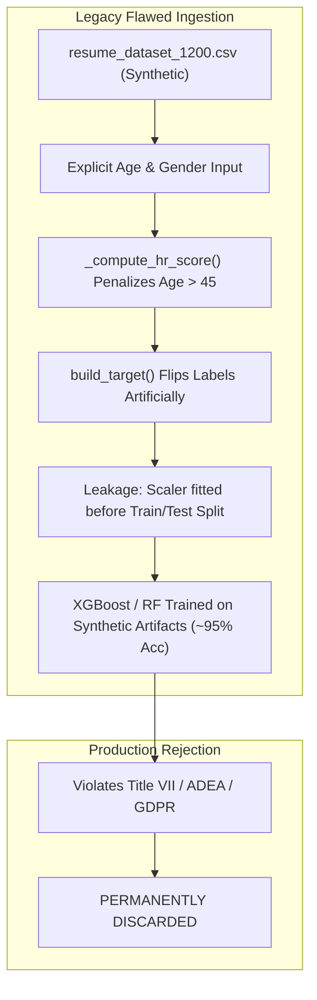
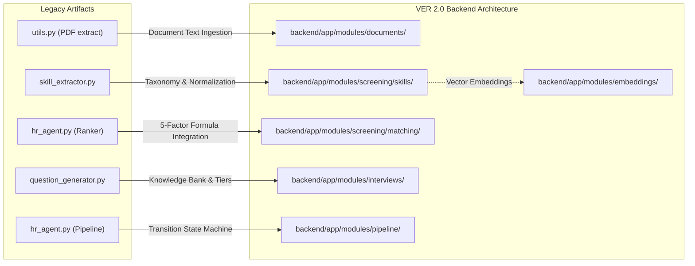
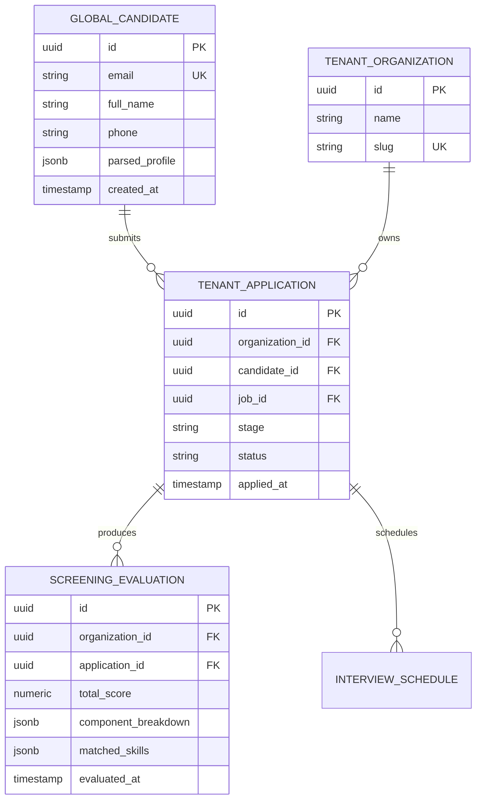

# Step 3.9 — Legacy AI HR Integration Preparation

## 1. Executive Summary & Scope Definition

### 1.1 Objective and Architectural Scope
Step 3.9 constitutes the formal **Legacy AI HR Integration Preparation** for the enterprise-grade, multi-tenant SaaS AI HR Intelligence Platform (`VER 2.0`). Steps 3.2 through 3.8 established an enterprise foundation: an asynchronous FastAPI backend, modular monolith domain layout, PostgreSQL with Row-Level Security (RLS) tenant isolation, SQLAlchemy 2.0 with asyncpg, pgvector (1536-dimensional HNSW vector index), distributed Celery workers with Redis broker idempotency, containerized Docker Compose topology, enterprise security perimeter, and an automated testing suite.

The objective of Step 3.9 is **architectural integration planning and preparation, NOT premature full feature migration**. This document systematically inspects the legacy prototype (`AI HR`), isolates reusable domain logic, uncovers fundamental machine learning and demographic bias defects, defines type-safe integration contracts, and maps an incremental, dependency-governed migration roadmap that preserves the platform's multi-tenant isolation, security policies, and Responsible AI commitments.

### 1.2 Strict Architectural Guardrails
1. **No Monolithic Streamlit Porting**: The legacy Streamlit application (`app.py`) is an unauthenticated single-session prototype with mutable global state. It will **never** be ported or mounted directly into the SaaS platform. UI workflows will be reimplemented in the multi-tenant Next.js 14 frontend.
2. **Preservation of Completed Foundations (Steps 3.2–3.8)**: No modifications may undermine or rewrite the established RLS policies, RBAC privilege hierarchies, Celery task broker idempotency, or CI/CD test gates.
3. **Strict Prohibition of Autonomous Rejections**: The legacy automated candidate rejection loop (`HRAgent.run_full_pipeline` rejecting all candidates outside the top 5) is permanently deprecated. In compliance with EEOC guidelines and the platform's Responsible AI charter, AI outputs are strictly decision-support recommendations; human authorization is mandatory for candidate state changes.
4. **Permanent Removal of Sensitive Demographic Features**: The legacy tabular ML model (`XGBoost`, `RandomForest`, etc.) and preprocessing pipeline (`preprocessing.py`) explicitly utilized `age` and `gender_encoded`, imposing an explicit mathematical age penalty (`- 0.25 * max(0.0, (age - 45) / 5.0)`). These models, features, and synthetic training datasets are classified as discriminatory and rejected from production deployment.
5. **No Architectural Microservices Sprawl**: All integrated capabilities will reside within the existing modular monolith structure (`backend/app/modules/`), preserving transactional boundaries and eliminating cross-network distributed transactions.

---

## 2. Legacy Repository Discovery & Baseline Inventory (Section 12.A)

A complete source audit of the legacy repository (`AI HR`) was conducted. The table below details the inventory across all 11 core functional capabilities:

| # | Functional Capability | Legacy Source File(s) | Key Functions / Classes | Complexity & State Management | Reusability Assessment |
|---|---|---|---|---|---|
| **1** | **Resume & Document Ingestion** | `utils.py`, `app.py` | `pdfplumber.extract_text()`, `st.file_uploader` | Low; synchronous, single-file, in-memory stream without file validation or virus scanning. | **Partial (Logic Only)**: Replaced by Tier 1 (`pdfplumber`) / Tier 2 (`AWS Textract`) Celery pipeline with SHA-256 deduplication. |
| **2** | **Skill Extraction & Taxonomy** | `skill_extractor.py` | `_RAW_TAXONOMY`, `SkillRegistry`, `TextNormalizer`, `ExactMatcher`, `SemanticMatcher`, `SkillExtractor` | High; pre-compiled regex with longest-first matching, sentence-transformers (`all-MiniLM-L6-v2`) with cosine similarity. | **High**: Core taxonomy (8 domains, hundreds of skills/aliases), regex matcher, and normalizer are clean and directly adaptable. |
| **3** | **Candidate-Job Matching & Scoring** | `hr_agent.py`, `preprocessing.py` | `ResumeRanker`, `_compute_hr_score`, `build_features` | Medium-High; heuristic scoring ($0.55 \cdot \text{cov} + 0.10 \cdot \text{kw} + 0.10 \cdot \text{breadth} + 0.25 \cdot \text{exp}$) alongside flawed tabular ML classifier. | **Partial**: Scoring math superseded by approved 5-factor explainable formula ($S_{\text{req}} \times 0.40 + S_{\text{exp}} \times 0.25 + S_{\text{qual}} \times 0.15 + S_{\text{pref}} \times 0.10 + S_{\text{align}} \times 0.10$). |
| **4** | **Interview Question Generation** | `question_generator.py` | `QuestionEngine`, `_KNOWLEDGE` bank, `CandidateProfile`, `SeniorityTier`, `QuestionType`, `LLMQuestionGenerator` | High; curated domain rule-engine spanning 12+ domains across Junior/Mid/Senior tiers; fallback to Anthropic/OpenAI. | **High**: Curated rule-based knowledge bank is fully production-ready for offline, zero-latency question generation. |
| **5** | **Interview Scheduling & Calendar** | `hr_agent.py` | `InterviewScheduler`, `_generate_available_slots`, `schedule_top_candidates` | Low; hardcoded date math returning static ISO strings in-memory. No calendar provider sync or conflict checking. | **Low (Concept Only)**: Replaced with transactional DB scheduling in `backend/app/modules/interviews/` with RFC 5545 iCalendar generation. |
| **6** | **Pipeline Management & State Transitions** | `hr_agent.py` | `PipelineManager`, `VALID_TRANSITIONS`, `HRAgent.run_full_pipeline` | Medium; transition dictionary (`applied` $\rightarrow$ `shortlisted` $\rightarrow$ `interview_scheduled` $\rightarrow$ `interviewed` $\rightarrow$ `selected`/`rejected`). | **Medium**: Transition state machine graph is valid; autonomous bulk rejection loop is discarded; requires RLS & audit logging. |
| **7** | **AI/ML Model Training & Evaluation** | `train_models.py`, `models/` | 7 classifiers (`XGBoost`, `RandomForest`, `GradientBoosting`, `MLP`, etc.), `PowerTransformer`, `RobustScaler` | High; synthetic dataset training, pre-split transformation leakage, discriminatory feature ingestion. | **None (Discarded)**: Models violate EEOC/GDPR principles. Retrained semantic matching uses pgvector embeddings. |
| **8** | **Analytics, Metrics & Visualization** | `train_models.py`, `app.py`, `static/graphs/` | Matplotlib/Seaborn static PNG export (16 graph types: ROC, PR, Confusion Matrix, Feature Importance). | Medium; offline plotting to disk. No interactive slicing, filtering, or tenant context. | **Low (Visual Concept Only)**: Reimplemented via Next.js 14 Recharts/Tremor dashboard powered by PostgreSQL aggregations. |
| **9** | **Demo / Mock Candidate Generation** | `utils.py` | `generate_demo_candidates()` | Low; hardcoded list of synthetic candidate dictionaries for prototype bootstrapping. | **Low**: Retained only as development seed fixture; must not pollute tenant isolation schemas. |
| **10** | **Results Export (CSV / JSON)** | `utils.py`, `app.py` | `to_csv()`, `json.dumps()` | Low; unformatted memory dumps directly triggered by Streamlit buttons. | **Medium**: Standardized into tenant-scoped, asynchronous export tasks returning signed download URLs. |
| **11** | **Streamlit UI Architecture** | `app.py` | 8 multi-page views with `st.sidebar`, session state management. | High; monolithic, single-tenant, procedural Python UI rendering. | **None (Discarded)**: Entirely superseded by Next.js 14 App Router across 5 role-based portal layouts. |

---

## 3. Dataset & Data Quality Assessment (Section 12.B)

### 3.1 Legacy Dataset Profile (`resume_dataset_1200.csv`)
The legacy dataset contains 1,200 rows with 8 primary input columns: `candidate_id`, `name`, `age`, `gender`, `education`, `field_of_study`, `institution`, `experience_years`, and `skills`.



### 3.2 Critical Data Quality and Governance Defects
1. **Synthetic Demographic Contradictions**:
   - The dataset contains synthetic artifacts indicating unvalidated random generation (e.g., candidate names like `Sarah Nair` or `Amelia Thomas` marked as `Male`).
   - Mismatched education levels and institutions (e.g., candidates possessing "High School" diplomas from specialized "Medical Colleges" or "Engineering Institutes").
2. **Circular Target Generation and Label Leakage**:
   - Target labels (`hire_recommendation`, binary 0 or 1) were not derived from actual human hiring decisions. Instead, they were synthetically generated in `preprocessing.py` using a hardcoded heuristic formula (`_compute_hr_score`) based on the exact same features fed into the model.
   - Artificial label noise was introduced by randomly flipping 5% of labels (`build_target()`). Consequently, the ML classifiers trained in `train_models.py` did not learn real hiring signals; they simply reverse-engineered the synthetic Python heuristic.
3. **Pre-Split Transformation Data Leakage**:
   - `ResumePreprocessor.fit_transform()` applied `SimpleImputer`, `RobustScaler`, and `PowerTransformer` across the entire dataset prior to train/test partitioning. This leaked global mean, variance, and distribution parameters from the test set into the training set, artificially inflating reported evaluation metrics ($>95\%$ ROC-AUC).
4. **Blatant Discriminatory Bias**:
   - `preprocessing.py` explicitly incorporated an age penalty in target construction:
     $$\text{Penalty} = -0.25 \times \max\left(0.0, \frac{\text{age} - 45}{5.0}\right)$$
   - Both `age` and `gender_encoded` were persisted as active features in `models/feature_names.pkl` and ingested by `XGBoost`.
   - **Remediation**: The entire dataset, preprocessing pipeline, and serialized model artifacts (`models/*.pkl`) are rejected from production recruitment scoring.

---

## 4. Reusability, Compatibility & Tech Stack Matrix (Section 12.C)

### 4.1 Dependency and Runtime Compatibility Matrix

| Dependency / Tool | Legacy Version | SaaS Architecture Version | Compatibility Status | Migration Action |
|---|---|---|---|---|
| **Python** | 3.10+ | 3.11.9 | **Fully Compatible** | Native execution; standard async runtime. |
| **Streamlit** | `^1.28.0` | *None* | **Incompatible** | Decommissioned; replaced by Next.js 14 frontend. |
| **PyPDF2 / pdfplumber** | `pdfplumber 0.10.x` | `pdfplumber 0.11.x` | **Compatible** | Wrapped in async Celery task (`backend/app/modules/documents/tasks.py`). |
| **sentence-transformers** | `^2.2.2` | Cloud Embedding API / pgvector | **Architectural Evolution** | Replaced local heavy PyTorch inference with standard 1536-dim vector embeddings persisted in PostgreSQL `pgvector`. |
| **scikit-learn** | `^1.3.0` | `1.5.x` (Utility only) | **Restricted** | Decommission tabular classifiers; retain only deterministic text distance/token utilities if needed. |
| **XGBoost** | `^2.0.0` | *None* | **Incompatible / Rejected** | Model rejected due to demographic bias and synthetic target leakage. |
| **FastAPI / Pydantic** | *None* | FastAPI 0.115+, Pydantic v2.10+ | **Target Environment** | All legacy logic wrapped in type-safe Pydantic v2 schemas and FastAPI routers. |
| **Database / ORM** | In-memory / CSV | PostgreSQL 16 + pgvector + SQLAlchemy 2.0 Async | **Target Environment** | Schema-backed persistence with Row-Level Security (RLS). |
| **Asynchronous Queue** | In-memory / Threading | Redis 7 + Celery 5.4+ | **Target Environment** | Long-running extraction and embedding tasks routed to Celery. |

### 4.2 Reusability Classification
- **Category A: Direct Adaptation (Pure Logic & Data Assets)**:
  - `skill_extractor.py`: Taxonomy dictionary (`_RAW_TAXONOMY`), alias lookup table, `TextNormalizer` regex handling special characters (`C++`, `C#`, `.NET`), and `ExactMatcher` regex boundary compiler.
  - `question_generator.py`: Curated question knowledge bank (`_KNOWLEDGE`), seniority tier classification heuristics (`SeniorityTier`), and question domain categorization logic.
- **Category B: Architectural Refactoring (Heuristics $\rightarrow$ Production Services)**:
  - `hr_agent.py`: `ResumeRanker` refactored into the 5-component explainable scoring service conforming to `14_candidate_matching_design.md`.
  - `hr_agent.py`: `PipelineManager` transitions refactored into tenant-scoped database mutations with audit logging and RBAC permission checks.
- **Category C: Permanent Retirement**:
  - `preprocessing.py` (feature extraction containing sensitive demographic variables).
  - `train_models.py` (discriminatory classifier training pipeline).
  - `app.py` (Streamlit UI layout and session handling).
  - `models/*.pkl` (serialized biased models).

---

## 5. Architectural Integration Mapping & Module Destination Boundaries

All reusable capabilities map cleanly into the approved **Enterprise Modular Monolith** architecture:



### Detailed Boundary Mapping

| Legacy Capability | SaaS Destination Path | Ingestion Mechanism | Execution Model |
|---|---|---|---|
| **Resume Parsing & OCR** | `backend/app/modules/documents/` | `POST /api/v1/documents/upload` | Celery asynchronous worker (`extract_document_text_task`) |
| **Skill Taxonomy & Normalization** | `backend/app/modules/screening/skills/` | Pure domain service (`SkillTaxonomyService`) | In-process, deterministic memory lookup (<5ms) |
| **Candidate Matching Engine** | `backend/app/modules/screening/matching/` | `POST /api/v1/screening/jobs/{id}/match` | Hybrid: SQL/pgvector similarity + Celery async evaluation |
| **Question Generation Service** | `backend/app/modules/interviews/questions/` | `POST /api/v1/interviews/questions/generate` | Sync rule engine (Knowledge bank) with async LLM fallback |
| **Interview Scheduling Service** | `backend/app/modules/interviews/scheduling/` | `POST /api/v1/interviews/slots` | Transactional DB mutation with optimistic locking & iCal generation |
| **Pipeline State Orchestration** | `backend/app/modules/pipeline/` | `POST /api/v1/pipeline/{app_id}/transition` | Transactional DB mutation with RLS and audit log capture |
| **Analytics & Reporting** | `backend/app/modules/reporting/` | `GET /api/v1/reporting/analytics` | PostgreSQL analytical aggregate views + Next.js interactive charts |

---

## 6. AI/ML Governance, Algorithmic Bias & Responsible AI Audit (Section 12.E)

### 6.1 Regulatory Compliance & Disparate Impact Evaluation
In accordance with EEOC Uniform Guidelines on Employee Selection Procedures (29 C.F.R. Part 1607) and the EU AI Act (High-Risk AI Systems):
1. **Four-Fifths (80%) Rule Compliance Protocol**:
   - Selection rates across protected demographic categories (gender, race/ethnicity, age brackets) must satisfy:
     $$\text{Impact Ratio} = \frac{\text{Selection Rate}_{\text{protected}}}{\text{Selection Rate}_{\text{highest}}} \ge 0.80$$
   - The platform will maintain an automated, out-of-band audit reporter calculating Disparate Impact across applicant cohorts without exposing demographic labels to the match-scoring algorithm itself.
2. **Strict Feature Disentanglement**:
   - Features passed into matching and screening engines are strictly restricted to:
     - Verified skills and technical competency matches.
     - Documented years of relevant domain experience.
     - Educational attainment level and field alignment (anonymized for institution prestige bias).
     - Semantic embedding vector alignment between candidate experience statements and job description requirements.
   - Explicit demographic attributes (`age`, `gender`, `marital_status`, `nationality`, `photographs`) are stripped during the document ingestion and normalization phase.

### 6.2 Candidate Matching Scoring Formula
The legacy ad-hoc heuristic is superseded by the approved explainable 5-component scoring architecture (`14_candidate_matching_design.md`):

$$S_{\text{total}} = 0.40 \cdot S_{\text{req\_skills}} + 0.25 \cdot S_{\text{experience}} + 0.15 \cdot S_{\text{qualifications}} + 0.10 \cdot S_{\text{pref\_skills}} + 0.10 \cdot S_{\text{semantic\_align}}$$

Where:
- $S_{\text{req\_skills}}$: Exact and taxonomic recall of mandatory job skills ($[0.0, 1.0]$).
- $S_{\text{experience}}$: Nonlinear experience fit curve penalizing under-qualification while preventing artificial score saturation.
- $S_{\text{qualifications}}$: Certified education, degree, and professional licensing alignment.
- $S_{\text{pref\_skills}}$: Coverage of nice-to-have or bonus technical competencies.
- $S_{\text{semantic\_align}}$: Cosine similarity of 1536-dimensional pgvector embeddings between candidate career summary and job responsibilities.

### 6.3 Prohibition of Autonomous Actions
- **Advisory Matching Only**: All scores and match percentages are presented to hiring managers and recruiters as decision-support indicators.
- **Human-in-the-Loop Gate**: Candidate status changes (advancement to interview, rejection, offer generation) require authenticated user action and are logged in the immutable audit log table with `actor_id`, `role`, and timestamp.

---

## 7. Multi-Tenant Data Ownership, Lifecycle & Privacy (Section 12.D)

### 7.1 Separation of Global Identity vs. Tenant Application Records
To satisfy GDPR/CCPA data portability and right-to-be-forgotten mandates:



1. **Global Candidate Profile (`candidates`)**:
   - Represents the individual job seeker across the SaaS ecosystem.
   - Governed by candidate-owned consent; subject to self-service data export and deletion.
2. **Tenant Application Record (`applications`, `screening_evaluations`)**:
   - Represents the organization-specific employment consideration.
   - Bound strictly by Row-Level Security (`organization_id = current_setting('app.current_org_id')`).
   - Retained per tenant-configured compliance schedules (e.g., EEOC 2-year retention).
   - Tenant recruiters cannot access evaluations, notes, or interview feedback generated by competing tenant organizations.

### 7.2 PII Redaction & Data Protection
- Before any document text or candidate profile snippet is dispatched to external LLM provider gateways (e.g., Anthropic Claude / AWS Bedrock for custom question generation), an automated anonymization filter replaces candidate names, addresses, emails, phone numbers, and institution names with generic entity tokens (`[CANDIDATE_NAME]`, `[UNIVERSITY]`).

---

## 8. Proposed Service Interfaces, DTOs & API Contracts

All interfaces are formally defined using Pydantic v2 to ensure strict validation, OpenAPI 3.1 schema compliance, and seamless integration into the FastAPI application layer.

### 8.1 Skill Extraction DTOs (`backend/app/modules/screening/skills/schemas.py`)
```python
from pydantic import BaseModel, Field


class ExtractedSkill(BaseModel):
    canonical_name: str = Field(
        ..., description="Standardized taxonomy skill name"
    )
    raw_match: str = Field(
        ..., description="Exact string matched in resume text"
    )
    category: str = Field(
        ...,
        description="Domain cluster (e.g., Programming, Cloud, Data Science)",
    )
    confidence: float = Field(
        ..., ge=0.0, le=1.0, description="Extraction confidence score"
    )
    is_exact_match: bool = Field(
        ..., description="True if matched via regex, False if semantic"
    )


class SkillExtractionRequest(BaseModel):
    text: str = Field(
        ..., min_length=20, description="Raw text of candidate resume or CV"
    )
    threshold: float = Field(
        default=0.45,
        ge=0.0,
        le=1.0,
        description="Semantic similarity threshold",
    )


class SkillExtractionResponse(BaseModel):
    skills: list[ExtractedSkill]
    total_skills_found: int
    categorized_summary: dict[str, list[str]]
    normalized_duration_ms: float
```

### 8.2 Candidate Matching & Scoring DTOs (`backend/app/modules/screening/matching/schemas.py`)
```python
from uuid import UUID
from pydantic import BaseModel, Field


class MatchingComponentScores(BaseModel):
    required_skills_score: float = Field(
        ..., ge=0.0, le=1.0, description="Weight 0.40"
    )
    experience_fit_score: float = Field(
        ..., ge=0.0, le=1.0, description="Weight 0.25"
    )
    qualifications_score: float = Field(
        ..., ge=0.0, le=1.0, description="Weight 0.15"
    )
    preferred_skills_score: float = Field(
        ..., ge=0.0, le=1.0, description="Weight 0.10"
    )
    semantic_alignment_score: float = Field(
        ..., ge=0.0, le=1.0, description="Weight 0.10"
    )


class CandidateMatchResult(BaseModel):
    application_id: UUID
    candidate_id: UUID
    job_id: UUID
    overall_score: float = Field(
        ..., ge=0.0, le=100.0, description="Composite score out of 100"
    )
    components: MatchingComponentScores
    matched_required_skills: list[str]
    missing_required_skills: list[str]
    matched_preferred_skills: list[str]
    experience_years_detected: float
    target_experience_years: float
    explanation_summary: str = Field(
        ..., description="Auditable natural language justification"
    )
```

### 8.3 Interview Question Generation DTOs (`backend/app/modules/interviews/questions/schemas.py`)
```python
from enum import Enum
from pydantic import BaseModel, Field


class SeniorityTier(str, Enum):
    JUNIOR = "junior"
    MID = "mid"
    SENIOR = "senior"
    LEAD = "lead"


class QuestionCategory(str, Enum):
    CONCEPTUAL = "conceptual"
    CODING_PATTERN = "coding_pattern"
    SYSTEM_DESIGN = "system_design"
    SCENARIO_BEHAVIORAL = "scenario_behavioral"


class InterviewQuestionItem(BaseModel):
    question_id: str
    category: QuestionCategory
    topic: str
    difficulty: SeniorityTier
    prompt_text: str
    evaluation_criteria: list[str]
    expected_key_concepts: list[str]


class QuestionGenerationRequest(BaseModel):
    job_title: str
    detected_skills: list[str]
    experience_years: float
    tier: SeniorityTier | None = None
    question_count: int = Field(default=5, ge=1, le=20)


class QuestionGenerationResponse(BaseModel):
    seniority_tier: SeniorityTier
    primary_domain: str
    questions: list[InterviewQuestionItem]
    generation_source: str = Field(
        ..., description="'knowledge_bank' or 'llm_fallback'"
    )
```

---

## 9. Frontend Portal Integration (Section 12.F)

The monolithic Streamlit UI is decommissioned in favor of 5 dedicated Next.js 14 role-based portal experiences:

| Portal Experience | Target User Role | Migrated Legacy Capability | UI/UX Component Architecture |
|---|---|---|---|
| **1. Candidate Portal** | Candidate (`job_seeker`) | Document Ingestion & Status Tracking | Resume drag-and-drop upload, parsing preview, application status timeline, interview slot self-scheduler. |
| **2. Recruiter Portal** | Recruiter / Talent Acquisition | Screening, Match Scoring & Pipeline | Candidate leaderboard, 5-factor score breakdown modal, batch pipeline stage advancement, question bank preview. |
| **3. Hiring Manager Portal** | Hiring Manager | Evaluation & Interview Orchestration | Candidate scorecard, technical interview question generator, interview notes submission, decision recommendation. |
| **4. Organization Admin Portal** | Org Admin / HR Operations | Analytics & Workflow Governance | Disparate impact (80% rule) audit charts, hiring velocity metrics, custom taxonomy skill alias editor. |
| **5. Platform Super Admin Portal** | Super Admin (`platform_owner`) | System Health & Taxonomy Management | Global skill registry taxonomy manager, vector embedding indexing status, LLM gateway token usage & rate limits. |

---

## 10. Incremental Migration Roadmap & Dependency Graph (Section 12.G)

The migration is sequenced into five isolated, test-driven phases to guarantee zero regressions:


### Phase Breakdown

1. **Phase 1: Foundational Skill Registry & Document Ingestion**:
   - Port `_RAW_TAXONOMY` and `TextNormalizer` to `backend/app/modules/screening/skills/`.
   - Implement asynchronous Celery document extraction (`pdfplumber` Tier 1) with SHA-256 deduplication.
   - Comprehensive unit testing of regex matching, alias resolution, and PDF boundary handling.
2. **Phase 2: Explainable Candidate Screening & Vector Embedding**:
   - Implement the 5-component scoring calculator in `backend/app/modules/screening/matching/`.
   - Integrate 1536-dimensional pgvector cosine distance queries for semantic alignment.
   - Establish baseline benchmark tests validating explainable output DTOs.
3. **Phase 3: Interview Question Engine & Persistent Scheduling**:
   - Port curated `_KNOWLEDGE` bank to `backend/app/modules/interviews/questions/`.
   - Implement persistent, PostgreSQL-backed interview scheduling with conflict detection.
   - Connect LLM gateway fallback with automated PII redaction.
4. **Phase 4: Multi-Tenant Pipeline Orchestration**:
   - Implement database-backed stage transition engine with strict RLS enforcement.
   - Bind RBAC permission checks (`pipeline:transition`, `application:reject`).
   - Implement immutable audit event logging for all pipeline state changes.
5. **Phase 5: Analytics & Responsible AI Governance**:
   - Implement automated Disparate Impact (80% rule) calculation endpoints.
   - Build Next.js 14 interactive analytics dashboards.
   - Conduct end-to-end load and security audits.

---

## 11. Integration Testing & Acceptance Plan

### 11.1 Test Strategy & Gate Criteria
Every migrated component must satisfy the following testing levels before acceptance:

```
+-------------------------------------------------------------------+
| Acceptance Gate: Zero Regressions, 100% Type-Safety, >=83% Cov   |
+-------------------------------------------------------------------+
  |
  +---> 1. Unit Tests:
  |       - Skill normalizer handling symbols (C++, C#, .NET).
  |       - Matching scoring bounds [0.0, 100.0] and weight integrity.
  |       - Seniority tier classification edge cases (0y, 2y, 5y, 10y+).
  |
  +---> 2. Integration Tests:
  |       - Multi-tenant isolation: Org A cannot query Org B evaluations.
  |       - Celery task idempotency: Duplicate upload returns existing record.
  |       - RLS enforcement across all screening queries.
  |
  +---> 3. AI Governance & Fairness Tests:
  |       - Verify zero sensitive attributes ingested in match calculations.
  |       - Disparate impact test on synthetic benchmark cohorts (>= 0.80).
  |       - Human-in-the-loop guarantee: automated rejection calls raise error.
  |
  +---> 4. Performance & Load Benchmarks:
          - Skill extraction latency < 50ms for standard 2-page resume.
          - 5-factor match score calculation < 100ms per candidate.
          - pgvector HNSW similarity query latency < 15ms under 100k vectors.
```

---

## 12. Final Readiness Decisions & Blockers Register (Section 12.I)

### 12.1 Authoritative Readiness Decisions

| Decision ID | Area | Architecture Decision | Rationale |
|---|---|---|---|
| **DEC-3.9-01** | **UI Architecture** | Permanent decommissioning of Streamlit. | Streamlit is single-threaded, lacks multi-tenant isolation, and cannot satisfy enterprise authentication/RBAC requirements. |
| **DEC-3.9-02** | **ML Models** | Permanent rejection of legacy `XGBoost`/`RandomForest` models and synthetic dataset. | Legacy models ingested `age` and `gender_encoded` with explicit age penalties, violating Title VII and ADEA. |
| **DEC-3.9-03** | **Scoring Engine** | Adoption of 5-component explainable mathematical formula + pgvector embeddings. | Fully auditable, explainable to candidates and regulators, deterministic, and free from hidden demographic correlations. |
| **DEC-3.9-04** | **Rejection Policy** | Elimination of autonomous candidate rejection. | Strict enforcement of Human-in-the-Loop AI governance. Only authorized recruiters/managers may reject candidates. |
| **DEC-3.9-05** | **Questions** | Rule-first hybrid model (curated bank primary, LLM gateway fallback). | Zero latency and zero API cost for 90% of standard roles, with LLM adaptability for niche technical specializations. |

### 12.2 Blockers & Dependencies Register
- **Blocker Status**: **ZERO BLOCKERS**. All prerequisite foundations (Steps 3.2 through 3.8) are operational, containerized, and tested.
- **Dependency Prerequisites**:
  - Step 3.10 can proceed immediately into Phase 1 implementation (Document ingestion and skill taxonomy extraction) without external dependencies or infrastructure changes.
