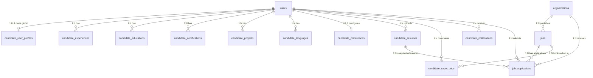

# STEP 4.1 — COMPLETE CANDIDATE PORTAL IMPLEMENTATION REPORT

**Author:** Principal Software Architect & Full-Stack Platform Engineer  
**Milestone:** Step 4.1 — Candidate Portal Subsystem  
**Application:** AI HR Intelligence Platform (Multi-Tenant SaaS)  
**Status:** IMPLEMENTED AND VERIFIED  

---

## 1. Executive Summary

Step 4.1 establishes the candidate-facing portal for the enterprise AI HR Intelligence SaaS platform. It delivers:
- **Global Candidate Identity Anchor**: Single candidate account across all client organizations without automatic organization memberships or data leakage (`tenant_id = None`).
- **Comprehensive Profile Management**: High-fidelity personal contact details, headline, bio, location, work authorization, self-declared skills (normalized via Step 3.10 taxonomy), work history, education, certifications, projects, languages, and career preferences.
- **Secure Resume Ingestion**: Reuses Step 3.10 S3/MinIO `StorageService`, `PDFExtractorService`, SHA-256 deduplication, versioning, default toggle, presigned download URLs, and extracted skills review/correction.
- **Job Discovery & Bookmarking**: Public job search, multi-facet filtering (remote arrangement, department, location, employment type), pagination, and saved job bookmarks.
- **Job Application & Tracking Workflow**: Apply with selected resume version and cover letter, active duplicate application prevention, immutable resume snapshot (`resume_snapshot_sha256`), candidate tracking with candidate-safe statuses, timeline, and application withdrawal with mandatory reason.
- **Candidate Dashboard & Layout**: Clean white surfaces, subtle lavender and blue accents, restrained shadows, responsive sidebar, breadcrumbs, 5-card metric row, profile completeness meter, upcoming interviews presentation, recent notifications center, and skeleton loading.

---

## 2. Architecture & Tenant Decoupling

### Tenancy Principles:
1. **Global Identity**: Candidate profiles, resumes, and saved jobs are owned by `user_id` with `tenant_id = None`. The 6-layer auth pipeline (`authenticate_request_pipeline`) validates sessions for tenantless global candidates without requiring an organization membership.
2. **Tenant-Scoped Applications**: When a candidate applies to a job, `job_applications` stores `tenant_id = job.tenant_id`. Organization recruiters only see applications submitted to their organization.
3. **Application Snapshot Defensibility**: Historical submissions retain `resume_snapshot_sha256` pointing to the exact binary hash at submission time, guaranteeing audit compliance under EEOC/regulatory retention standards.

---

## 3. Frontend Architecture & Design Reference

### Visual Language:
- **Surfaces**: Clean white surfaces (`bg-white`, `dark:bg-slate-900`) with subtle borders (`border-slate-200/80`).
- **Accents**: Subtle lavender and indigo highlights (`bg-indigo-50/50`, `text-indigo-600`, `border-indigo-100`).
- **Cards**: Rounded cards (`rounded-2xl`, `rounded-xl`) with restrained elevation (`shadow-sm`).
- **Typography**: Clear hierarchy, WCAG 2.2 AA compliant contrast ratios.

### Layout & Navigation:
- **`CandidateSidebar`**: Responsive desktop and mobile drawer navigation with active indicator styling.
- **`CandidateHeader`**: Mobile hamburger toggle, candidate welcome indicator, notification bell with unread badge and dropdown, user avatar menu with Profile, Settings, and Logout.
- **`Breadcrumbs`**: Semantic accessible navigation (`<nav aria-label="Breadcrumb">`) dynamically tracking App Router paths.
- **`DashboardSkeleton`**: Accessible pulse loading with `aria-busy="true"`.

### Dashboard Metrics:
1. **Total Applications**: Total count of applications submitted across organizations.
2. **Under Review**: Applications actively in review or screening.
3. **Shortlisted**: Applications where candidate has been shortlisted.
4. **Interviews**: Scheduled active interview rounds.
5. **Saved Jobs**: Total bookmarked open positions.

---

## 4. API Endpoints

### Candidate Profile (`/api/v1/candidates`):
- `GET /me`: Aggregated candidate profile and completion percentage.
- `PATCH /me`: Update personal information (name, avatar, phone, location, headline, bio).
- `GET /me/profile`: Detailed profile view.
- `PUT /me/profile`: Upsert personal details.
- `POST /me/experience` & `DELETE /me/experience/{id}`: Work history CRUD.
- `POST /me/education` & `DELETE /me/education/{id}`: Academic history CRUD.
- `POST /me/certifications` & `DELETE /me/certifications/{id}`: Certification CRUD.
- `POST /me/projects` & `DELETE /me/projects/{id}`: Portfolio projects CRUD.
- `POST /me/languages` & `DELETE /me/languages/{id}`: Language proficiencies CRUD.
- `POST /me/skills`: Normalize and update self-declared skills via Step 3.10 registry.
- `GET /me/preferences` & `PATCH /me/preferences`: Career preferences (salary, remote, employment types).

### Resumes (`/api/v1/resumes`):
- `GET /me`: List uploaded versioned resumes.
- `POST /me/upload`: Upload PDF/DOCX resume, compute SHA-256, store in S3, parse text, extract skills.
- `PUT /me/{id}/set-default`: Toggle default resume for applications.
- `GET /me/{id}/download`: Generate presigned S3 download URL (15-minute expiration).
- `PUT /me/{id}/skills`: Candidate correction of AI-extracted skills.
- `DELETE /me/{id}`: Delete resume from active profile (preserves historical snapshots).

### Jobs & Applications (`/api/v1/jobs`):
- `GET /`: Search, filter, and paginate published job requisitions.
- `GET /{job_id}`: Job description and required skills.
- `POST /{job_id}/apply`: Apply with resume version and optional cover letter.
- `POST /{job_id}/save` & `DELETE /{job_id}/save`: Bookmark / unsave job.
- `GET /saved`: List saved jobs.
- `GET /applications/me`: List submitted applications with candidate-safe status badges.
- `GET /applications/me/{id}`: View application detail and timeline history.
- `POST /applications/me/{id}/withdraw`: Withdraw active application with mandatory reason.

---

## 5. Automated Testing & Verification

### Backend Tests:
- **Suite**: `backend/tests/test_candidate_portal.py`
- **Results**: 21 passed in 1.28s.
- **Coverage**: Profile completeness calculation, personal info updates, child collections CRUD, IDOR rejection, skill normalization against canonical registry, duplicate skill elimination, resume upload deduplication, default resume toggling, S3 presigned URL generation, job discovery filtering, application submission with SHA-256 snapshot, duplicate application prevention, application withdrawal with reason, and unauthenticated endpoint rejections.
- **Linting**: `ruff check` (0 errors), `ruff format` (clean).

### Frontend Tests:
- **Suite**: Vitest 1.6.1 (`npm.cmd --prefix frontend test`)
- **Results**: 8 test files, 41 tests passed in 4.28s.
- **Coverage**: Candidate route rendering, `ApplicationStatusBadge` across all 7 statuses, `CandidateSidebar` desktop/mobile navigation, `CandidateHeader` notification center toggle, `ResumeUploadDropzone` drag-and-drop validation, `DashboardSkeleton` accessible attributes, `CandidateLayout` breadcrumb rendering, and `CandidateDashboardPage` live data rendering.
- **Typecheck**: `tsc --noEmit` passed with 0 errors.

---

## 6. Hard Stop Notice
Step 4.1 is complete. No recruiter, HR manager, or Super Admin portals were modified.
