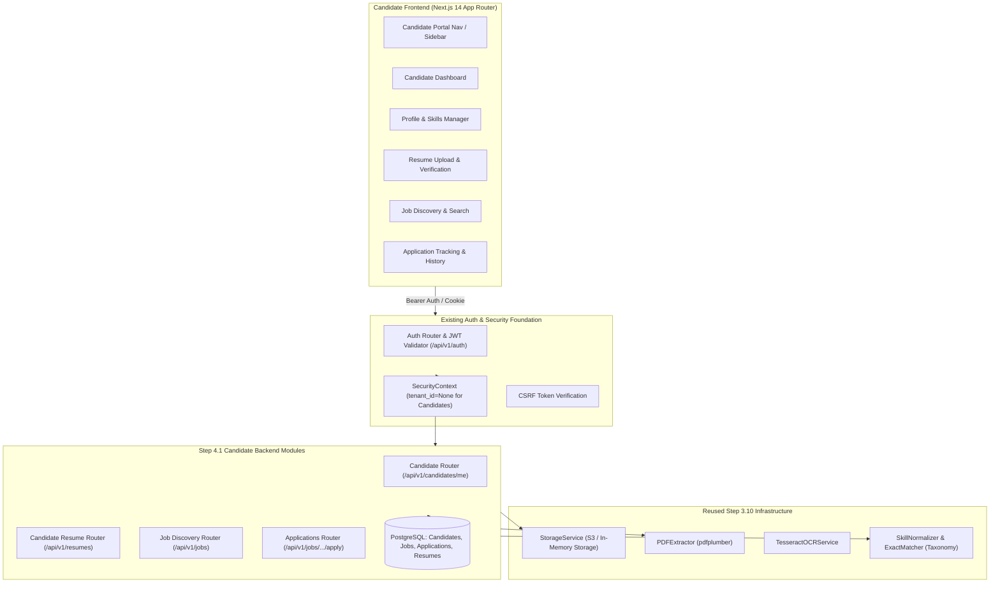

# STEP 4.1 — CANDIDATE PORTAL DISCOVERY REPORT & ARCHITECTURAL INTEGRATION MAP

> **Milestone**: Step 4.1 — Complete Candidate Portal  
> **Status**: SUBSTAGE 4.1.1 COMPLETED (Discovery & Integration Mapping)  
> **Repository Baseline**: Commit `99beadf` | 428 Backend Tests Passing | 25 Frontend Tests Passing  
> **Date**: 2026-11-09  

---

## 1. Executive Summary & Architecture Strategy

Step 4.1 establishes the candidate-facing experience of the AI HR Intelligence Platform. In accordance with enterprise architectural principles and project guidelines, the Candidate Portal must not be implemented as a disconnected UI prototype or an isolated demo. It functions as an integrated module within the existing SaaS platform, leveraging the production-grade foundation completed in Steps 3.2 through 3.10:

- **Global Candidate Identity Anchor**: A candidate possesses a single global user account (`users` table) enabling them to apply across multiple distinct client organizations without duplicated profiles, shared tenant memberships, or artificial tenant-binding.
- **Direct Reuse of Document Ingestion & Skill Registry (Step 3.10)**: Resume processing directly reuses the existing `StorageService` (S3/local), `PDFExtractor` (`pdfplumber` with structure preservation), OCR fallback (`TesseractOCRService`), and `ExactMatcher` / `SkillNormalizer` canonical taxonomy integration. No parallel upload or extraction systems are created.
- **Immutable Application Evidence**: When a candidate submits an application to an organization's job, an immutable snapshot of their resume document (`document_id` and content SHA-256) is recorded. Future profile modifications or new resume uploads do not alter historically submitted application records.
- **Tenant Isolation & Candidate Ownership**: Organizations access candidate data solely through explicit job applications submitted to that tenant. Candidate personal portfolios, unsubmitted resumes, saved jobs, notifications, and preferences remain strictly candidate-owned and isolated from tenant administrators.

---

## 2. Complete Repository Inspection Findings

### 2.1 Backend Architecture Inspection

| Layer / Subsystem | Actual Repository State | Integration Assessment for Step 4.1 |
| :--- | :--- | :--- |
| **Authentication & Identity** (`backend/app/modules/auth/`) | Implemented (`models.py`, `service.py`, `router.py`, `jwt.py`, `redis_session.py`). Supports MFA, password reset, 6-layer request validation, version fences. | **Direct Reuse**: Candidate registration, login, logout, password recovery, session tokens (`tenant_id=None` supported). |
| **Candidate Profile Anchor** (`CandidateUserProfile`) | Implemented in `auth/models.py` (`user_id`, `headline`, `bio`, `portfolio_urls`, `self_declared_skills`). | **Extension**: Requires structured child tables for Work Experience, Education, Certifications, Projects, Languages, and Preferences. |
| **Organization & Tenancy** (`backend/app/modules/organizations/`) | Implemented (`Organization`, `Role`, `Permission`, `OrganizationMembership`). | **Boundary Enforced**: Candidates do NOT receive tenant memberships. Organization ID is only referenced when applying to a job. |
| **Document Ingestion** (`backend/app/modules/documents/`) | Implemented (`Document`, `DocumentExtraction`, `DocumentService`, `StorageService`, Celery tasks). Enforces SHA-256 deduplication and AES256 S3 storage. | **Direct Reuse**: Candidate resumes are stored using `StorageService` (`candidates/{user_id}/resumes/...`). |
| **Skill Registry & Matching** (`backend/app/modules/screening/skills/`) | Implemented (`taxonomy.py`, `normalizer.py`, `matcher.py`, `registry.py`). 45+ canonical skills across 7 categories. | **Direct Reuse**: Extracted resume text is normalized and matched against canonical skills for candidate verification. |
| **Candidates Domain Module** (`backend/app/modules/candidates/`) | Empty stub (`__init__.py`). | **Creation**: Implement models, schemas, service, and router for candidate profile, preferences, saved jobs, applications, notifications. |
| **Jobs Domain Module** (`backend/app/modules/jobs/`) | Empty stub (`__init__.py`). | **Creation**: Implement foundational `Job` model (published jobs discovery), schemas, read-only search/filter service, and router. |
| **Pipeline Domain Module** (`backend/app/modules/pipeline/`) | Empty stub (`__init__.py`). | **Scope Control**: Internal recruiter pipeline is deferred to Step 4.2; candidate application submission and tracking will link to `JobApplication`. |
| **Database Migrations** (`backend/alembic/versions/`) | Revisions `001`, `002`, `003` active. Clean migration state. | **Creation**: Alembic migration `004_candidate_portal_and_applications.py` creating candidate child tables, jobs, applications, saved jobs, notifications. |

### 2.2 Frontend Architecture Inspection

| Layer / Component | Actual Repository State | Integration Assessment for Step 4.1 |
| :--- | :--- | :--- |
| **Framework & Engine** | Next.js 14.2.3 (App Router), React 18.3.1, TypeScript 5.4.5, Tailwind CSS 3.4.3. | Active and verified (`tsc --noEmit` clean). |
| **Test Runner & Environment** | Vitest 1.6.0 with HappyDOM and Testing Library. All 7 existing test suites (25 tests) pass. | **Verified**: Uses `@rollup/wasm-node` fallback to ensure deterministic execution across all host environments. |
| **Navigation & Layout** (`components/Navigation.tsx`) | Global header with initial role branching (`candidate` vs `recruiter`/`admin`). | **Extension**: Candidate portal layout with dedicated sidebar, header, active status badges, and mobile responsiveness. |
| **Authentication UI** (`app/login/page.tsx`, `components/LoginForm.tsx`) | Login form with credentials and error handling. | **Extension**: Registration page, email verification notice, password recovery request/reset flows. |
| **Candidate Portal Pages** (`app/dashboard/` and candidate routes) | General recruitment dashboard stub. | **Creation**: Full candidate portal sub-routes: Overview, Profile, Resumes, Jobs, Saved Jobs, Applications, Account Settings. |

---

## 3. Component Reuse & Extension Strategy

### 3.1 What Can Be Reused Directly
1. **`app.modules.auth.service` & `router`**: User creation, authentication, password reset, session refresh, and CSRF token mechanics.
2. **`app.modules.auth.dependencies.require_authenticated_user`**: Validates session against Redis/DB, returns `SecurityContext` with candidate's `user_id` and `tenant_id=None`.
3. **`app.modules.documents.storage.StorageService`**: Secure multipart uploads, SHA-256 verification, presigned URL generation, and cleanup.
4. **`app.modules.documents.extractor.PDFExtractor`**: Text extraction, table extraction, metadata, and quality scoring.
5. **`app.modules.documents.ocr.TesseractOCRService`**: Scanned PDF fallback extraction.
6. **`app.modules.screening.skills.registry.skill_registry`**: Normalization and skill taxonomy lookup (45+ canonical skills across 7 domains).
7. **`app.core.database.get_db`**: Async SQLAlchemy session management.

### 3.2 What Needs Extension
1. **`CandidateUserProfile`**: Add child relationships and fields for phone number, location, preferred job title, work authorization, salary expectations, remote preference.
2. **Document Ingestion for Candidates**: Provide candidate-scoped resume entity (`candidate_resumes`) or document linkage that allows candidate global ownership while retaining SHA-256 content tracking.
3. **Frontend UI Components**: Provide form controls, modals, badge statuses, file upload dropzone, and responsive navigation.

### 3.3 What Must Be Created (Missing)
1. **Candidate Profile Entities**:
   - `CandidateExperience`: Title, company, location, start_date, end_date, is_current, description, skills used.
   - `CandidateEducation`: Institution, degree, field_of_study, start_year, end_year, grade/GPA.
   - `CandidateCertification`: Name, issuing_organization, issue_date, expiration_date, credential_id, credential_url.
   - `CandidateProject`: Title, description, role, url, skills used.
   - `CandidateLanguage`: Language name, proficiency level (Native, Fluent, Professional, Conversational, Basic).
   - `CandidatePreference`: Desired roles, locations, remote preference, minimum salary, currency, employment types.
2. **Resume Management Entities**:
   - `CandidateResume`: `id`, `user_id`, `storage_key`, `filename`, `file_size_bytes`, `content_sha256`, `mime_type`, `status`, `extracted_text`, `skills_extracted` (JSONB), `is_default`, `version_number`.
3. **Job Discovery & Applications Entities**:
   - `Job`: `id`, `tenant_id` (organization), `title`, `slug`, `department`, `location`, `remote_type`, `employment_type`, `description`, `requirements`, `skills_required` (JSONB), `experience_level`, `status` (`published`, `closed`), `published_at`, `application_deadline`.
   - `JobApplication`: `id`, `job_id`, `candidate_id` (`user_id`), `tenant_id`, `resume_id` (immutable reference), `resume_snapshot_sha256`, `status` (internal), `candidate_status` (public), `cover_letter`, `applied_at`, `withdrawn_at`, `withdrawal_reason`.
   - `CandidateSavedJob`: `user_id`, `job_id`, `saved_at`.
   - `CandidateNotification`: `id`, `user_id`, `title`, `message`, `category`, `is_read`, `action_url`, `created_at`.

---

## 4. API Integration Contracts for Step 4.1

### 4.1 Candidate Profile (`/api/v1/candidates/me`)
- `GET /api/v1/candidates/me/profile`: Retrieve aggregated candidate profile including personal info, summary, experience, education, certifications, projects, languages, skills.
- `PUT /api/v1/candidates/me/profile`: Upsert core personal details, headline, and bio.
- `POST /api/v1/candidates/me/experience`, `PUT /.../{id}`, `DELETE /.../{id}`: Work experience CRUD.
- `POST /api/v1/candidates/me/education`, `PUT /.../{id}`, `DELETE /.../{id}`: Education CRUD.
- `POST /api/v1/candidates/me/certifications`, `DELETE /.../{id}`: Certifications CRUD.
- `POST /api/v1/candidates/me/projects`, `DELETE /.../{id}`: Projects CRUD.
- `POST /api/v1/candidates/me/skills`: Add/update candidate self-declared skills (normalized against taxonomy).
- `GET /api/v1/candidates/me/preferences`, `PATCH /api/v1/candidates/me/preferences`: Career preferences.

### 4.2 Resume Management (`/api/v1/resumes`)
- `POST /api/v1/resumes/upload`: Secure multipart upload. Executes SHA-256 deduplication, antivirus check, and triggers text extraction and skill matching.
- `GET /api/v1/resumes`: List all candidate resumes with version numbers, active default flag, and processing status.
- `GET /api/v1/resumes/{resume_id}`: Resume metadata, lifecycle status (`UPLOADED`, `PROCESSING`, `COMPLETED`, `FAILED`).
- `GET /api/v1/resumes/{resume_id}/extraction`: Extracted text and parsed skills preview.
- `PATCH /api/v1/resumes/{resume_id}/extracted-data`: Candidate corrections to extracted skills and text.
- `POST /api/v1/resumes/{resume_id}/set-default`: Designate active default resume for 1-click applications.
- `GET /api/v1/resumes/{resume_id}/download-url`: Time-limited presigned S3 URL.
- `DELETE /api/v1/resumes/{resume_id}`: Safe soft/hard delete (ensuring submitted applications retain historical reference).

### 4.3 Job Discovery (`/api/v1/jobs`)
- `GET /api/v1/jobs`: Public/Candidate search and filter across published opportunities (query, department, location, remote arrangement, experience level, pagination).
- `GET /api/v1/jobs/{job_id}`: Job requisition details, required skills, and application status if already applied.
- `POST /api/v1/candidates/me/saved-jobs/{job_id}`: Bookmark job.
- `GET /api/v1/candidates/me/saved-jobs`: Retrieve saved jobs.
- `DELETE /api/v1/candidates/me/saved-jobs/{job_id}`: Unbookmark job.

### 4.4 Job Applications (`/api/v1/jobs` & `/api/v1/candidates/me/applications`)
- `POST /api/v1/jobs/{job_id}/apply`: Apply with selected resume version and optional cover letter. Enforces unique constraint preventing duplicate active applications.
- `GET /api/v1/candidates/me/applications`: List candidate applications with candidate-safe status badge (`submitted`, `under_review`, `in_screening`, `interview_stage`, `offer_stage`, `not_selected`, `withdrawn`).
- `GET /api/v1/candidates/me/applications/{application_id}`: Detailed view of application timeline, organization name, job details, and submitted resume version.
- `POST /api/v1/candidates/me/applications/{application_id}/withdraw`: Gracefully withdraw application with mandatory reason.

### 4.5 Notifications & Settings (`/api/v1/candidates/me/notifications`)
- `GET /api/v1/candidates/me/notifications`: List candidate notifications (e.g. status changes, submission confirmations).
- `PATCH /api/v1/candidates/me/notifications/{id}/read`: Mark notification as read.
- `POST /api/v1/candidates/me/notifications/read-all`: Mark all as read.

---

## 5. Database Schema & Migration Design

### 5.1 Alembic Migration Plan (`004_candidate_portal_and_applications.py`)
1. **Candidate Profile Extension**:
   - `candidate_user_profiles` modified to include `phone`, `location_city`, `location_country`, `preferred_title`, `work_authorization`, `updated_at`.
   - `candidate_experiences`: Foreign key to `users.id` (ON DELETE CASCADE), indexed on `(user_id, start_date DESC)`.
   - `candidate_educations`: Foreign key to `users.id` (ON DELETE CASCADE).
   - `candidate_certifications`: Foreign key to `users.id` (ON DELETE CASCADE).
   - `candidate_projects`: Foreign key to `users.id` (ON DELETE CASCADE).
   - `candidate_preferences`: `user_id` PK/FK to `users.id`.
2. **Candidate Resumes (`candidate_resumes`)**:
   - `id` UUIDv7 primary key.
   - `user_id` FK to `users.id` (indexed).
   - `storage_key`, `filename`, `file_size_bytes`, `content_sha256`, `mime_type`, `status`.
   - `extracted_text`, `skills_extracted` (JSONB).
   - `is_default` BOOLEAN (partial unique index on `(user_id)` WHERE `is_default = TRUE`).
   - `version_number` INT.
3. **Job Postings (`jobs`)**:
   - `id` UUIDv7 primary key.
   - `tenant_id` FK to `organizations.id` (indexed).
   - `title`, `slug`, `department`, `location`, `remote_type`, `employment_type`.
   - `description`, `requirements`, `skills_required` (JSONB).
   - `status` (VARCHAR: `draft`, `published`, `closed`).
   - `published_at`, `application_deadline`.
4. **Job Applications (`job_applications`)**:
   - `id` UUIDv7 primary key.
   - `job_id` FK to `jobs.id` (indexed).
   - `candidate_id` FK to `users.id` (indexed).
   - `tenant_id` FK to `organizations.id` (indexed).
   - `resume_id` FK to `candidate_resumes.id`.
   - `resume_snapshot_sha256` VARCHAR(64) (immutable evidence anchor).
   - `status` VARCHAR(50) (internal ATS status).
   - `candidate_status` VARCHAR(50) (candidate-facing status).
   - `cover_letter` TEXT.
   - `applied_at` TIMESTAMPTZ.
   - `withdrawn_at` TIMESTAMPTZ.
   - `withdrawal_reason` TEXT.
   - **Unique Active Constraint**: `UNIQUE (candidate_id, job_id)` prevents duplicate applications to the same job.
5. **Saved Jobs (`candidate_saved_jobs`)**:
   - Composite PK `(user_id, job_id)`.
6. **Candidate Notifications (`candidate_notifications`)**:
   - `id` UUIDv7 primary key, `user_id` FK, `title`, `message`, `category`, `is_read`, `created_at`.

---

## 6. Security, IDOR Prevention & Tenant Isolation

1. **Authentication Context**: All `/api/v1/candidates/me/*` and `/api/v1/resumes/*` endpoints obtain the user identity strictly from the verified `SecurityContext.user_id`. Frontend-supplied candidate IDs are ignored.
2. **Strict IDOR Mitigation**:
   - Resume queries filter unconditionally by `WHERE candidate_resumes.user_id = :authenticated_user_id`.
   - Application queries filter by `WHERE job_applications.candidate_id = :authenticated_user_id`.
   - Saved jobs filter by `WHERE candidate_saved_jobs.user_id = :authenticated_user_id`.
3. **Tenant Boundary Preservation**:
   - Organization users have tenant context (`tenant_id`); candidates have global identity (`tenant_id = None`).
   - Organization recruiters cannot view candidates until a candidate explicitly submits a `JobApplication` for that organization's job.
   - Candidates cannot view draft or internal jobs, internal recruiter notes, evaluation rubrics, or peer applications.
4. **CSRF & File Security**:
   - Mutating candidate endpoints enforce CSRF double-submit token matching.
   - Resume uploads pass through magic-number MIME validation, filename sanitization, size checks (max 10MB), and malware scanner hooks.

---

## 7. Exact Files Created and Modified in Step 4.1

### Backend Files
| Action | File Path | Description |
| :--- | :--- | :--- |
| **Create** | `backend/alembic/versions/004_candidate_portal_and_applications.py` | Alembic migration for candidate tables, jobs, and applications |
| **Create** | `backend/app/modules/candidates/models.py` | SQLAlchemy models for candidate profile, experience, education, resumes, saved jobs, notifications |
| **Create** | `backend/app/modules/candidates/schemas.py` | Pydantic DTOs for candidate profile, skills, preferences, resumes, applications |
| **Create** | `backend/app/modules/candidates/service.py` | Domain service orchestrating candidate profile, resumes, applications, and saved jobs |
| **Create** | `backend/app/modules/candidates/router.py` | FastAPI endpoints for `/api/v1/candidates/me` and `/api/v1/resumes` |
| **Create** | `backend/app/modules/jobs/models.py` | SQLAlchemy model for `Job` and `JobApplication` |
| **Create** | `backend/app/modules/jobs/schemas.py` | Pydantic DTOs for public job discovery and application requests |
| **Create** | `backend/app/modules/jobs/service.py` | Service for job search, filtering, and application submission |
| **Create** | `backend/app/modules/jobs/router.py` | FastAPI endpoints for `/api/v1/jobs` |
| **Modify** | `backend/app/db/base.py` | Register new candidate and job models for Alembic metadata discovery |
| **Modify** | `backend/app/api/v1/router.py` | Mount candidate and job routers |
| **Create** | `backend/tests/test_candidate_portal.py` | Backend unit and integration tests (profile, resumes, jobs, applications, IDOR) |

### Frontend Files
| Action | File Path | Description |
| :--- | :--- | :--- |
| **Create** | `frontend/src/app/candidate/layout.tsx` | Dedicated responsive candidate portal layout with sidebar and header |
| **Create** | `frontend/src/app/candidate/dashboard/page.tsx` | Candidate overview dashboard (profile score, recent applications, saved jobs) |
| **Create** | `frontend/src/app/candidate/profile/page.tsx` | Interactive profile editor (personal, experience, education, skills) |
| **Create** | `frontend/src/app/candidate/resumes/page.tsx` | Resume management, upload, extraction preview, default selection |
| **Create** | `frontend/src/app/candidate/jobs/page.tsx` | Job discovery page with keyword search, location/remote filters, job details |
| **Create** | `frontend/src/app/candidate/applications/page.tsx` | Application tracking list, status progress, withdrawal modal |
| **Create** | `frontend/src/app/candidate/settings/page.tsx` | Account security, notifications, and privacy preferences |
| **Create** | `frontend/src/components/candidate/CandidateSidebar.tsx` | Responsive sidebar navigation component |
| **Create** | `frontend/src/components/candidate/ResumeUploadDropzone.tsx` | Drag-and-drop secure resume upload component |
| **Create** | `frontend/src/components/candidate/ApplicationStatusBadge.tsx` | Candidate-facing status badge component |
| **Create** | `frontend/src/__tests__/candidate_portal.test.tsx` | Frontend unit tests for candidate portal components |
| **Create** | `frontend/e2e/candidate_journey.spec.ts` | Playwright end-to-end test for candidate workflow |

---

## 8. Substage Implementation Roadmap

- **Substage 4.1.1 — Candidate Architecture and Integration Mapping** *(Current: Completed)*
  - Completed comprehensive repository inspection, dependency mapping, data ownership definitions, and discovery report.
- **Substage 4.1.2 — Candidate Identity and Profile Foundation**
  - Implement database models, Alembic migration `004`, Pydantic schemas, and `/api/v1/candidates/me/profile` endpoints.
- **Substage 4.1.3 — Candidate Portal Frontend Foundation**
  - Install frontend form/query libraries, build candidate portal layout, responsive sidebar, and dashboard overview.
- **Substage 4.1.4 — Resume Management**
  - Connect upload dropzone to `StorageService` and `PDFExtractor`, implement resume versions, extraction preview, and skill matching.
- **Substage 4.1.5 — Job Discovery**
  - Implement `Job` model, search/filter APIs, job discovery UI, and job bookmarking.
- **Substage 4.1.6 — Application Workflow**
  - Implement application submission with resume version snapshotting, duplicate prevention, tracking UI, and withdrawal.
- **Substage 4.1.7 — Notifications, Settings and Privacy**
  - In-app notification center, candidate privacy options, and security settings.
- **Substage 4.1.8 — Integration, Testing and Acceptance**
  - Execute backend tests, frontend tests, Playwright E2E, full regression verification, and document final acceptance.
